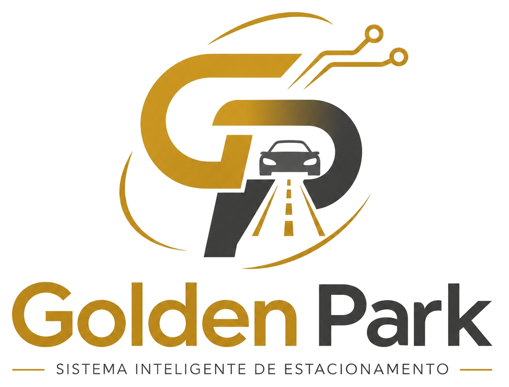
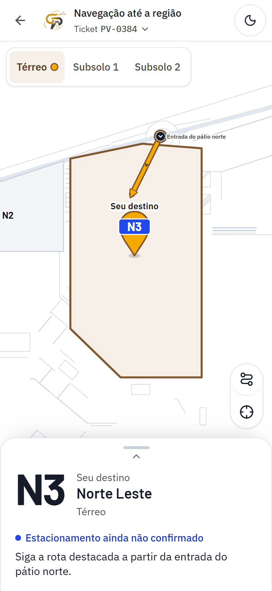
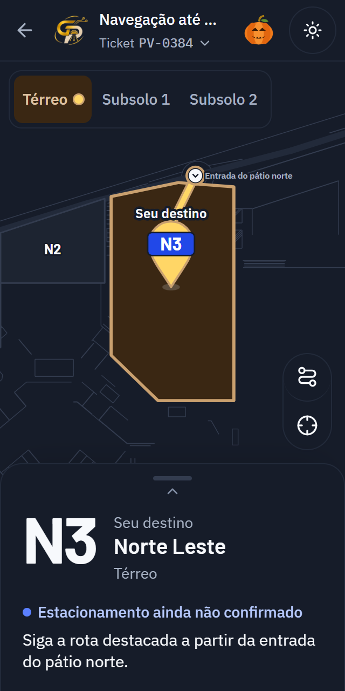
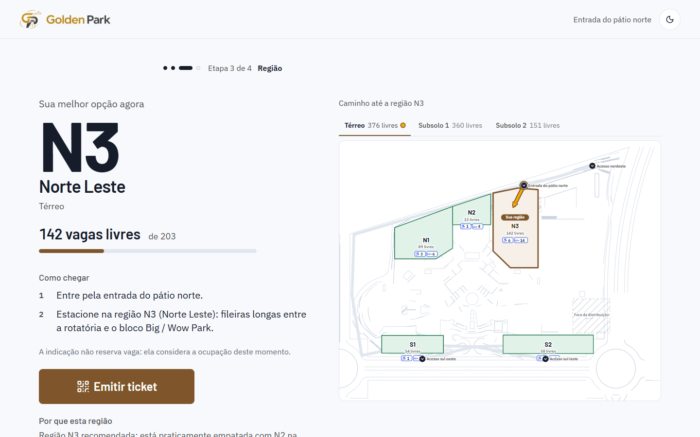
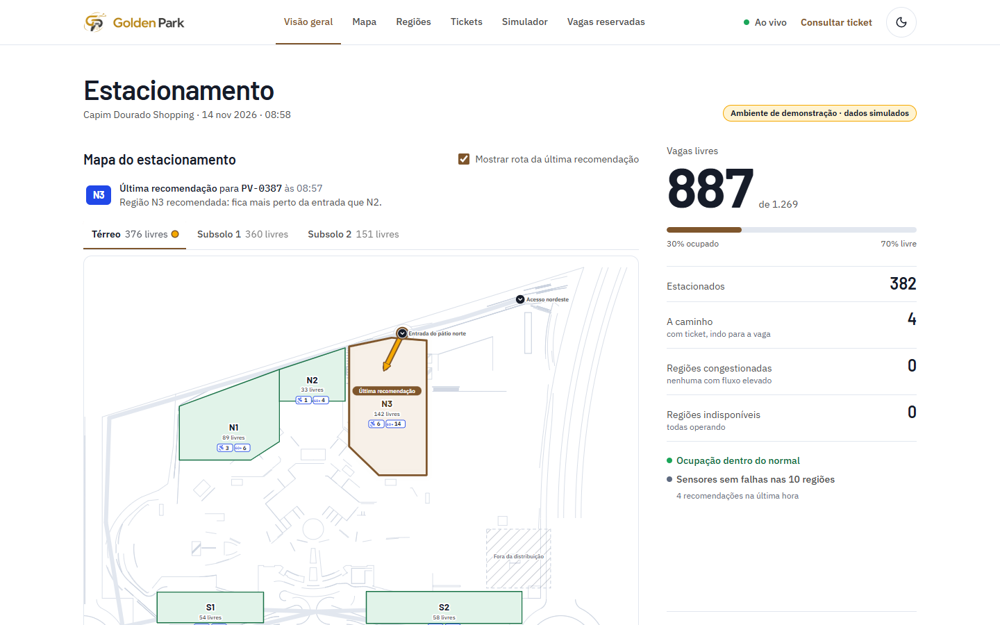

<p align="center">
  
</p>

# Golden Park — Sistema inteligente de estacionamento

> O projeto se chamava **ParkVision** até a atualização de identidade visual; documentos das etapas anteriores mantêm o nome antigo como registro histórico. Identificadores técnicos (pacotes `@parkvision/*`, tokens `--pv-*`, URL do repositório) foram preservados por compatibilidade. Identidade, logos e temas: [docs/mvp/14-golden-park.md](docs/mvp/14-golden-park.md).

Sistema que **organiza e distribui automaticamente os veículos** no estacionamento do Capim Dourado Shopping:
- recomenda a melhor região na entrada;
- emite um ticket com QR Code;
- guia o motorista pelo celular, sem aplicativo;
- mostra a operação em tempo real no painel.

> **Status atual: MVP funcional.** As três interfaces (totem, localizador pelo QR Code e painel administrativo) estão implementadas e integradas ao back-end real: API, banco, algoritmo, simulador e tempo real. Os números de ocupação nas demonstrações vêm do simulador e aparecem sempre marcados como dados simulados.

<p align="center">
  
  &nbsp;
  
</p>

<p align="center">
  
  
</p>

## As três interfaces

| Interface | Endereço | O que faz |
|---|---|---|
| **Totem de entrada** | `/totem?acesso=A_ROT` | O motorista escolhe o veículo e, se precisar, a vaga reservada (PcD ou pessoa idosa). Recebe a região recomendada, o motivo e o caminho, e emite o ticket com QR Code. |
| **Localizador (QR Code)** | `/t/<token>` | Página mobile tipo app de navegação: mapa em tela cheia, rota pelos corredores até a região, painel inferior com orientações e ticket. Depois de estacionar, mostra a região registrada. |
| **Painel administrativo** | `/painel` | Vagas livres em destaque, mapa interativo com ocupação por região, tabela de zonas (comuns, PcD, pessoa idosa), operação de tickets, simulador e vagas reservadas. |

As três seguem a identidade aprovada nos wireframes:
- bronze como cor de ação e ouro no logo;
- temas claro e escuro, com a preferência salva;
- funcionam a partir de 320 px de largura.

## O que o MVP já faz

- **Distribuição inteligente:** cada região recebe uma pontuação por disponibilidade (50%), distância pela rota (30%) e fluxo recente (20%). A recomendação vem com justificativa em português.
- **Sem reserva:** recomendar não ocupa vaga. A ocupação só muda quando o estacionamento é confirmado e quando o veículo sai, com a capacidade revalidada no banco, também em operações simultâneas.
- **Rotas:** menor caminho no grafo de vias do mapa digital, que foi feito a partir da planta real, nos três níveis (térreo, subsolo 1 e subsolo 2).
- **Vagas PcD e para pessoa idosa:**
  - mínimos legais calculados sobre o total (Lei 13.146/2015 e Lei 10.741/2003);
  - quem pede vaga comum nunca recebe vaga reservada, e quem pede reservada só recebe do próprio tipo;
  - a distribuição física das vagas é uma proposta simulada até a validação em campo.
- **Tempo real:** o painel e o localizador se atualizam sozinhos (Socket.IO) e se recuperam depois de uma queda de conexão.
- **Simulador:** gera entradas, confirmações, saídas, falhas de sensor e congestionamento, sempre marcados como simulados. Tem seis cenários (A–F) e carrinhos animados no mapa do painel.
- **Honestidade nos dados:**
  - sem GPS: o localizador não rastreia o veículo;
  - nenhuma distância ou tempo inventado;
  - nenhum caminho é chamado de acessível sem validação na planta.

Ainda **não** fazem parte do MVP:
- sensores físicos (os eventos de sensor existem na API e são simulados);
- painéis de LED;
- pagamento por QR Code.

## Como rodar

Pré-requisitos: Node.js 22+, pnpm 10 e Docker Desktop.

```bash
pnpm install
```

```bash
cp .env.example apps/api/.env
```

```bash
pnpm db:up
```

```bash
pnpm db:push
```

```bash
pnpm db:seed
```

Em dois terminais, suba a API (`http://localhost:3333`) e a web (`http://localhost:5173`):

```bash
pnpm dev:api
```

```bash
pnpm dev:web
```

Depois abra `http://localhost:5173/totem?acesso=A_ROT`, emita um ticket e escaneie o QR Code (ou abra o endereço dele) para ver o localizador. O painel fica em `http://localhost:5173/painel`. Para controlar o simulador, informe o token do operador no painel (o `SIMULADOR_TOKEN` do `.env`).

### Testes

Testes unitários e de integração (o banco de teste `parkvision_teste` precisa estar no ar):

```bash
pnpm test
```

Ponta a ponta, com Playwright usando o Edge instalado, no banco de teste:

```bash
pnpm e2e
```

## Documentação do MVP

| Etapa | Documento |
|---|---|
| Etapa 0 — Arquitetura do MVP, contratos, mapa digital | [01-arquitetura-mvp](docs/mvp/01-arquitetura-mvp.md) · [02-contratos](docs/mvp/02-contratos.md) · [04-proposta-mapa](docs/mvp/04-proposta-mapa.md) · [06-revisao-planta](docs/mvp/06-revisao-planta.md) |
| Etapa 1 — Back-end e algoritmo | [07-relatorio-etapa-1](docs/mvp/07-relatorio-etapa-1.md) |
| Etapa 2 — Simulador | [08-simulador](docs/mvp/08-simulador.md) · [09-relatorio-etapa-2](docs/mvp/09-relatorio-etapa-2.md) |
| Etapa 3 — Interfaces e mapa interativo | [10-interfaces](docs/mvp/10-interfaces.md) · [11-relatorio-etapa-3](docs/mvp/11-relatorio-etapa-3.md) |
| Etapa 4 — Integração completa | [12-integracao](docs/mvp/12-integracao.md) · [13-relatorio-etapa-4](docs/mvp/13-relatorio-etapa-4.md) |
| Identidade Golden Park | [14-golden-park](docs/mvp/14-golden-park.md) |
| Navegação mobile e simulação | [15-evolucao-mapa-navegacao](docs/mvp/15-evolucao-mapa-navegacao.md) |
| Vagas PcD e pessoa idosa | [16-vagas-reservadas](docs/mvp/16-vagas-reservadas.md) |
| Telas MVP a partir dos wireframes | [17-telas-mvp](docs/mvp/17-telas-mvp.md) |

Capturas de todas as etapas: [docs/mvp/capturas/](docs/mvp/capturas/).

## Tecnologias

| Camada | Escolha |
|---|---|
| Linguagem | **TypeScript** |
| Frontend | React 19 + Vite · Tailwind 4 ligado aos tokens do Design System · Lucide · mapa em SVG próprio |
| Backend | Node.js 24 + Fastify 5 · Socket.IO · Prisma 6 · Zod |
| Banco de dados | PostgreSQL 16 (Docker) |
| Algoritmo e rotas | Pacote `@parkvision/core` (funções puras, Dijkstra no grafo de vias) |
| Testes | Vitest · Testing Library · Playwright |
| **Tecnologia sorteada** | **Design System**: tokens em 3 camadas, componentes, estados, temas, governança |

## Estrutura de pastas

```
.
├── apps/
│   ├── api/            # Fastify + Socket.IO + Prisma, simulador embutido
│   └── web/            # totem, localizador (QR Code) e painel — React + Vite
├── packages/
│   ├── shared/         # contratos (tipos + Zod), mapa digital oficial, vagas reservadas
│   └── core/           # algoritmo de distribuição, rotas e distribuição das vagas reservadas
├── design-system/      # tokens (fonte da verdade), logos, scripts de build e contraste
├── docs/
│   ├── mvp/            # documentação das etapas do MVP, mapa e capturas
│   ├── diagrams/       # diagramas Mermaid
│   └── planta/         # planta recebida (PDF + imagens)
└── prototype/          # protótipo HTML da 1ª entrega (planejamento)
```

## Equipe

- Eliton de Sousa Pereira
- Marcos Feliphe Freitas Moraes
- Gustavo Araújo Lopes
- Arthur Santos Coelho

## Histórico: 1ª entrega (planejamento)

Antes do MVP, a 1ª entrega (13/11/2026) reuniu documentação, arquitetura, Design System e um protótipo visual das telas.

- **Protótipo:** pode ser aberto direto no navegador, mas é só visual, sem back-end.

  ### [Abrir o protótipo da 1ª entrega](https://elitondesousa.github.io/golden-park/prototype/)

- **Documentos de planejamento:**
  [visão geral](docs/01-visao-geral.md) ·
  [requisitos](docs/02-requisitos.md) ·
  [arquitetura](docs/03-arquitetura.md) ·
  [Design System](docs/04-design-system.md) ·
  [telas](docs/05-telas.md) ·
  [tecnologia sorteada](docs/06-tecnologia-sorteada.md) ·
  [roadmap](docs/07-roadmap.md) ·
  [decisões técnicas](docs/08-decisoes-tecnicas.md) ·
  [distribuição inteligente](docs/09-distribuicao-inteligente.md) ·
  [análise da planta](docs/10-analise-planta.md) ·
  [checklist](docs/CHECKLIST-PRIMEIRA-ENTREGA.md)
- **Diferenças em relação ao MVP:** algumas escolhas do planejamento mudaram na implementação, como Fastify em vez de NestJS, Tailwind em vez de CSS Modules e pesos do algoritmo de 50/30/20. Os relatórios das etapas registram cada mudança.
