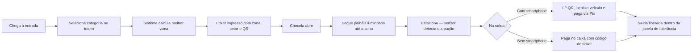

# 01 — Visão Geral

> **Projeto:** ParkVision — Estacionamento Inteligente
> **Tecnologia sorteada:** Design System (requisito central)
> **Etapa:** 1ª entrega — Planejamento Técnico (13/11/2026)
> **Status da planta:** **RECEBIDA em 13/11/2026** (Capim Dourado Shopping — Planta Mix). A análise e a proposta inicial de zonas estão em [10-analise-planta.md](10-analise-planta.md). Contagens de vagas que a planta não informa (pátios descobertos e motos) continuam pendentes e não foram estimadas.

---

## Sumário

1. [Contexto e problema](#1-contexto-e-problema)
2. [Objetivos](#2-objetivos)
3. [Proposta de solução](#3-proposta-de-solução)
4. [Público-alvo e personas](#4-público-alvo-e-personas)
5. [Benefícios esperados](#5-benefícios-esperados)
6. [Escopo](#6-escopo)
7. [Premissas e restrições](#7-premissas-e-restrições)
8. [Documentos relacionados](#8-documentos-relacionados)

---

## 1. Contexto e problema

Estacionamentos de shopping centers concentram grande volume de veículos em janelas de tempo curtas (fins de semana, feriados, datas comemorativas, horário de almoço e fim de expediente). Na maior parte deles, o motorista entra sem nenhuma informação sobre onde há vagas livres e passa a "caçar" vaga circulando pelos corredores.

### 1.1 Sintomas observados

| # | Problema | Efeito |
|---|----------|--------|
| P1 | **Dificuldade de encontrar vaga** — o motorista não sabe em que pavimento/região há vagas livres. | Frustração, sensação de lotação mesmo com vagas disponíveis em outras áreas. |
| P2 | **Congestionamento interno** — vários veículos circulam ao mesmo tempo pelos mesmos corredores procurando vaga. | Filas na rampa e nos corredores, risco de colisões leves, conflito com pedestres. |
| P3 | **Distribuição desigual** — as áreas próximas às entradas do shopping lotam, enquanto áreas mais distantes ficam ociosas. | Subutilização da capacidade instalada; sensação de "estacionamento cheio". |
| P4 | **Tempo perdido procurando vaga** — o tempo de busca soma-se ao tempo de permanência. | Pior experiência do cliente; maior emissão de poluentes e consumo de combustível. |
| P5 | **Dificuldade de lembrar onde o carro foi deixado.** | Tempo extra na saída, chamados à segurança/atendimento. |
| P6 | **Filas no caixa de pagamento** em horários de pico. | Atraso na saída e acúmulo na cancela. |
| P7 | **Operação "às cegas"** — a administração não tem visão em tempo real da ocupação, nem histórico confiável para decidir. | Decisões de operação e tarifação baseadas em percepção. |

### 1.2 Sobre números e estatísticas

Este documento **não apresenta estatísticas de mercado**. Quaisquer números citados no projeto (tempo médio de busca, percentual de ocupação, redução de congestionamento etc.) devem ser tratados como **hipóteses a validar** — por observação em campo, dados do próprio shopping ou fontes citáveis — e não como fatos.

Hipóteses de trabalho a validar:

| ID | Hipótese | Como validar |
|----|----------|--------------|
| H1 | Em horários de pico há vagas livres em áreas menos visíveis enquanto outras áreas estão lotadas. | Histórico de ocupação por zona (snapshots por minuto) na fase de testes/piloto. |
| H2 | Direcionar o motorista para uma zona na entrada reduz o tempo médio de busca. | Comparar tempo entre emissão do ticket e ocupação da vaga, com e sem recomendação (simulação e maquete). |
| H3 | Sinalização luminosa por zona é compreendida sem necessidade de smartphone. | Teste de usabilidade com participantes de perfis variados (Fase 4). |
| H4 | Pagamento via QR Code reduz a fila no caixa. | Medir proporção de pagamentos via QR × caixa em teste/piloto. |

---

## 2. Objetivos

### 2.1 Objetivo geral

Projetar e prototipar um **sistema de estacionamento inteligente** para shopping centers que **monitore as vagas em tempo real** e **distribua automaticamente os veículos entre zonas**, reduzindo o tempo de busca e o congestionamento interno, **sem exigir smartphone** do motorista, com interface construída sobre um **Design System** próprio.

### 2.2 Objetivos específicos

| ID | Objetivo específico |
|----|---------------------|
| OE1 | Monitorar o estado de cada vaga (livre, ocupada, reservada, indisponível, em manutenção, erro de sensor) por sensores IoT comunicando via MQTT. |
| OE2 | Recomendar, no momento da entrada, a **melhor zona** para cada veículo considerando disponibilidade, distância pela rota de circulação, fluxo recente e saúde dos sensores (ver [09-distribuicao-inteligente.md](09-distribuicao-inteligente.md)). |
| OE3 | Considerar a **categoria do veículo** (moto, carro pequeno, carro grande) e vagas especiais (PcD/idoso) na recomendação. |
| OE4 | Emitir **ticket físico** com zona, setor, orientações de trajeto, QR Code e código curto. |
| OE5 | Guiar o motorista por **sinalização luminosa** (painéis por zona/cruzamento), independente de aplicativo. |
| OE6 | Oferecer **painel administrativo** web com ocupação em tempo real, mapa de vagas, alertas, configurações, histórico e auditoria. |
| OE7 | Permitir a **localização do veículo** e o **pagamento via QR Code** (página web mobile, Pix — simulado nesta etapa), mantendo o caixa tradicional. |
| OE8 | Construir e documentar um **Design System** (tokens, componentes, padrões de acessibilidade) que garanta consistência e contraste mínimo WCAG 2.2 AA em todas as interfaces (ver [04-design-system.md](04-design-system.md)). |
| OE9 | Projetar a solução de forma **adaptável à planta real** (hierarquia Estabelecimento → Pavimento → Zona → Setor → Vaga e circulação modelada como grafo dirigido). |

---

## 3. Proposta de solução

O estacionamento é dividido em **zonas e setores** (conforme a planta real — **pendente**). Sensores instalados nas vagas informam a ocupação a um **sistema central**, que calcula a melhor zona para cada veículo que chega. O motorista recebe essa orientação em um **ticket impresso** e é guiado por **painéis luminosos**; o smartphone é opcional (apenas para localizar o veículo e pagar pelo QR Code).

### 3.1 As 9 funcionalidades

| # | Funcionalidade | Descrição resumida | Canal principal |
|---|----------------|--------------------|-----------------|
| F1 | **Monitoramento de vagas em tempo real** | Sensores (ESP32 + HC-SR04 no protótipo; magnetômetro em produção) publicam o estado de cada vaga via MQTT; o backend consolida e propaga às telas via WebSocket. Sensores offline são detectados (heartbeat/LWT). | Sensores → backend → painel |
| F2 | **Distribuição inteligente por zona** | Algoritmo de pontuação recomenda a zona com melhor equilíbrio entre disponibilidade, distância, fluxo e saúde dos sensores. Na v1 **recomenda zona** (não garante vaga). | Totem de entrada |
| F3 | **Classificação do veículo** | Seleção da categoria no totem (Moto / Carro pequeno / Carro grande) e indicação de necessidade de vaga preferencial (PcD/idoso); verificação física de altura/comprimento por barreira infravermelha (planejada). | Totem de entrada |
| F4 | **Ticket físico orientativo** | Impressão térmica com zona, setor, orientações de trajeto, horário de entrada, QR Code (somente URL com token opaco) e código curto numérico. | Impressora térmica 80 mm |
| F5 | **Sinalização luminosa** | Painéis de LED nas rampas e cruzamentos exibem vagas livres por zona e setas de direção, com cor **e** texto/ícone. | Painéis ESP32 + LED |
| F6 | **Painel administrativo** | Dashboard de ocupação, mapa de vagas, alertas de sensores, ações manuais (bloquear vaga/zona), configurações, histórico/relatórios e auditoria. | Web (React) |
| F7 | **Localização do veículo** | Pelo QR Code ou código do ticket, o motorista consulta a zona/setor para onde foi direcionado e as orientações de retorno. | Página web mobile / totem / atendimento |
| F8 | **Pagamento via QR Code (Pix)** | Página web mobile mostra tempo e valor e permite pagar via Pix (provedor simulado nesta etapa); o caixa tradicional permanece disponível. | Página web mobile / caixa |
| F9 | **Acessibilidade e operação sem smartphone** | Todo o fluxo essencial (entrar, ser orientado, estacionar, pagar, sair) funciona apenas com ticket, sinalização física e atendimento humano; interfaces seguem WCAG 2.2 AA. | Todos |

> Detalhes de arquitetura, telas e decisões: [03-arquitetura.md](03-arquitetura.md), [05-telas.md](05-telas.md), [08-decisoes-tecnicas.md](08-decisoes-tecnicas.md).

### 3.2 Fluxo resumido do motorista

---

## 4. Público-alvo e personas

O público principal são **frequentadores de shopping centers que chegam de carro ou moto** e a **equipe que opera e administra o estacionamento**.

> As personas abaixo são **fictícias**, criadas para orientar decisões de design. Não representam pesquisa com usuários reais (pesquisa prevista na Fase 4 — ver [07-roadmap.md](07-roadmap.md)).

### 4.1 Motoristas

| Persona | Perfil | Necessidades | Dores atuais | Como o ParkVision atende |
|---------|--------|--------------|--------------|--------------------------|
| **Motorista com smartphone** — "Camila", 34 anos | Frequenta o shopping aos fins de semana com a família; usa Pix no dia a dia. | Achar vaga rápido; lembrar onde estacionou; sair sem fila. | Circula vários minutos; esquece o setor; fila no caixa. | Ticket indica a zona; QR Code mostra onde o carro está e permite pagar pelo celular. |
| **Motorista sem smartphone (ou sem bateria/dados)** — "Seu Antônio", 61 anos | Usa celular básico; prefere pagar no caixa. | Orientação clara sem tecnologia; atendimento humano. | Sinalização confusa; tecnologia obrigatória o exclui. | Ticket impresso legível + painéis luminosos + caixa tradicional com código curto. Nenhuma etapa exige app. |
| **Motorista PcD ou idoso** — "Renata", 45 anos, usuária de cadeira de rodas | Precisa de vaga preferencial próxima a acessos/elevadores. | Garantia de ser direcionada a vaga preferencial compatível; interfaces acessíveis. | Vagas preferenciais ocupadas indevidamente; totens altos, telas de baixo contraste. | Opção "vaga preferencial" no totem; recomendação considera vagas PcD/idoso; interfaces WCAG 2.2 AA; atendimento de apoio. |

### 4.2 Equipe do estacionamento e do shopping

| Persona | Perfil | Necessidades | Como o ParkVision atende |
|---------|--------|--------------|--------------------------|
| **Operador do estacionamento** — "Diego" | Acompanha a operação na central/guichê; atende motoristas. | Ver ocupação ao vivo; reagir a alertas; bloquear vaga/zona; tratar ticket perdido; receber pagamento no caixa. | Dashboard e mapa em tempo real, alertas, ações manuais auditadas, busca de ticket por código. |
| **Gestor / administração do shopping** — "Marina" | Responsável por receita, satisfação e capacidade. | Indicadores (ocupação por período, picos, permanência, receita); configurar tarifas e regras. | Relatórios e histórico, configurações de tarifa/tolerância/pesos do algoritmo, perfis de acesso. |
| **Equipe de manutenção** — "Paulo" | Técnico de instalações/eletrônica. | Saber qual sensor ou painel falhou e onde; marcar vaga em manutenção. | Lista de sensores offline/com erro, localização no mapa, estado "Em manutenção" com registro de ações. |

---

## 5. Benefícios esperados

> Benefícios qualitativos esperados. Ganhos quantitativos serão **medidos**, não presumidos (ver hipóteses H1–H4).

### 5.1 Para o motorista

- Menos tempo procurando vaga — chega à entrada já sabendo a zona.
- Menos estresse e menos circulação em corredores congestionados.
- Facilidade para reencontrar o veículo (zona/setor no ticket e na página do QR).
- Pagamento sem fila pelo celular, **ou** no caixa tradicional — escolha do motorista.
- Inclusão: funciona sem smartphone, com informação por cor **e** texto/ícone.

### 5.2 Para a operação

- Visão em tempo real da ocupação por pavimento, zona e setor.
- Detecção automática de sensores com falha e alertas de zonas lotadas.
- Ações manuais (bloquear vaga/zona, manutenção) refletidas imediatamente na distribuição e nos painéis.
- Rastreabilidade: logs de auditoria de ações administrativas e eventos de pagamento.

### 5.3 Para o shopping

- Melhor aproveitamento da capacidade instalada (distribuição mais uniforme entre zonas).
- Melhor experiência do cliente, com potencial reflexo na permanência e na imagem do shopping (hipótese a validar).
- Dados históricos para decisões de tarifação, expansão, eventos e escala de equipe.
- Solução escalável para múltiplos pavimentos e unidades.

---

## 6. Escopo

### 6.1 Escopo da 1ª entrega (13/11/2026 — Planejamento Técnico)

A 1ª entrega é **documental e de projeto**; **não** é um MVP funcional.

| Item | Entregável | Local |
|------|-----------|-------|
| Visão geral do produto | Este documento | `docs/01-visao-geral.md` |
| Requisitos (RF, RNF, RN, rastreabilidade) | Documento de requisitos | [02-requisitos.md](02-requisitos.md) |
| Arquitetura da solução | Diagramas e componentes | [03-arquitetura.md](03-arquitetura.md) |
| Design System (tecnologia sorteada) | Tokens (primitive → semantic → component), logo, tipografia, estados de vaga, validação de contraste | [04-design-system.md](04-design-system.md), `design-system/` |
| Telas | Especificação/protótipo das telas | [05-telas.md](05-telas.md), `prototype/` |
| Tecnologia sorteada | Justificativa e aplicação do Design System | [06-tecnologia-sorteada.md](06-tecnologia-sorteada.md) |
| Cronograma e roadmap | Fases, riscos, gestão no Geproj | [07-roadmap.md](07-roadmap.md) |
| Decisões técnicas | Registro de decisões e alternativas | [08-decisoes-tecnicas.md](08-decisoes-tecnicas.md) |
| Distribuição inteligente | Algoritmo de recomendação de zona | [09-distribuicao-inteligente.md](09-distribuicao-inteligente.md) |
| Adaptação à planta | Procedimento para aplicar a planta real | [adaptacao-planta.md](adaptacao-planta.md) |

### 6.2 Escopo do produto (fases seguintes até o MVP)

Protótipo React com Design System e Storybook; backend NestJS + Prisma + PostgreSQL; WebSocket; algoritmo de distribuição; simulador de sensores MQTT; maquete com ESP32 + HC-SR04 e painel de sinalização; página de pagamento mobile com provedor simulado; testes. Detalhes em [07-roadmap.md](07-roadmap.md).

### 6.3 Fora do escopo

| Item | Situação |
|------|----------|
| Reconhecimento de placas (LPR) e câmeras com visão computacional | Evolução futura. |
| Aplicativo nativo (Android/iOS) | Fora do escopo — a página web mobile cobre o uso por smartphone. |
| Processamento de pagamentos reais / integração com gateway em produção | Fora do escopo — v1 usa `MockProvider`; gateway Pix real é evolução. |
| Reserva antecipada de vaga (antes de chegar ao shopping) | Fora do escopo. |
| Reserva de vaga específica na entrada (TTL) | Evolução pós-MVP (planejada no algoritmo). |
| Instalação física em estacionamento real | Fora do escopo — validação em maquete. |
| Integração com cancelas/catracas de fornecedores comerciais específicos | Fora do escopo — cancela simulada/maquete. |
| Cache distribuído (Redis) e série temporal (TimescaleDB) | Evolução — v1 usa somente PostgreSQL. |
| Programa de fidelidade, validação de ticket por lojistas, convênios | Fora do escopo. |

---

## 7. Premissas e restrições

### 7.1 Premissas

| ID | Premissa |
|----|----------|
| PR1 | A planta real do estacionamento será fornecida em etapa posterior; até lá, zonas e setores são exemplos (ex.: "Zona Z1…Z4", pavimento "Piso G1"), rotulados como **"EXEMPLO — será substituída após análise da planta"**. |
| PR2 | O estacionamento pode ser modelado na hierarquia **Estabelecimento → Pavimento → Zona → Setor → Vaga**, com circulação representada por **grafo dirigido** (respeitando mão única). |
| PR3 | Haverá energia e rede local disponíveis nos pontos de instalação de sensores, painéis e totem (a confirmar com a planta). |
| PR4 | A operação continuará contando com caixa e atendimento humano. |
| PR5 | A validação técnica será feita com simulador de sensores e maquete física de baixo custo. |
| PR6 | O time domina ou pode aprender TypeScript, adotado como linguagem única (front, back, simulador e Design System). |

### 7.2 Restrições

| ID | Restrição |
|----|-----------|
| RE1 | **Limites da planta recebida:** só são afirmados os dados escritos ou desenhados na planta (ex.: 140 vagas no Subsolo 1, 216 no Subsolo 2). Escala geral, cotas, vagas dos pátios descobertos e de motos não constam e ficam pendentes. Ver [10-analise-planta.md](10-analise-planta.md). |
| RE2 | Projeto acadêmico: orçamento de hardware limitado (ESP32, HC-SR04, LEDs, impressora térmica opcional). |
| RE3 | Prazo da disciplina: fases e datas são estimativas a ajustar ao calendário acadêmico. |
| RE4 | Nenhuma transação financeira real e nenhum dado de cartão nesta etapa. |
| RE5 | O Design System é requisito central (tecnologia sorteada): todas as interfaces devem consumir os tokens `--pv-*`. |
| RE6 | Conformidade com a LGPD e com a legislação vigente sobre vagas preferenciais (PcD/idoso). |
| RE7 | Gestão do projeto no Geproj (To Host), com uso manual. |

---

## 8. Documentos relacionados

- [02 — Requisitos](02-requisitos.md)
- [03 — Arquitetura](03-arquitetura.md)
- [04 — Design System](04-design-system.md)
- [05 — Telas](05-telas.md)
- [06 — Tecnologia Sorteada](06-tecnologia-sorteada.md)
- [07 — Cronograma e Roadmap](07-roadmap.md)
- [08 — Decisões Técnicas](08-decisoes-tecnicas.md)
- [09 — Distribuição Inteligente](09-distribuicao-inteligente.md)
- [Adaptação à planta](adaptacao-planta.md)
