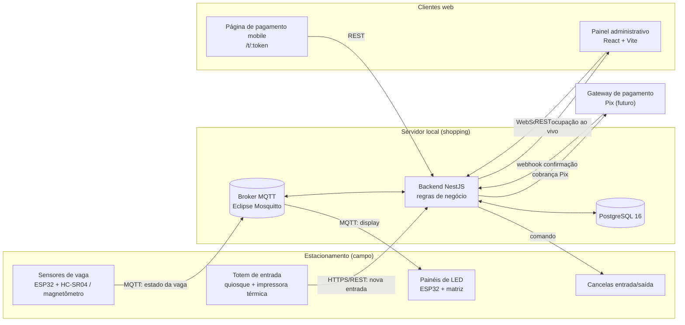
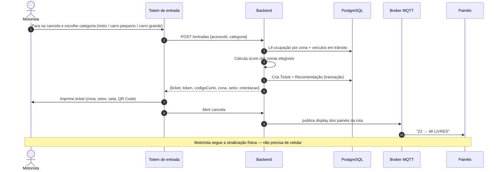
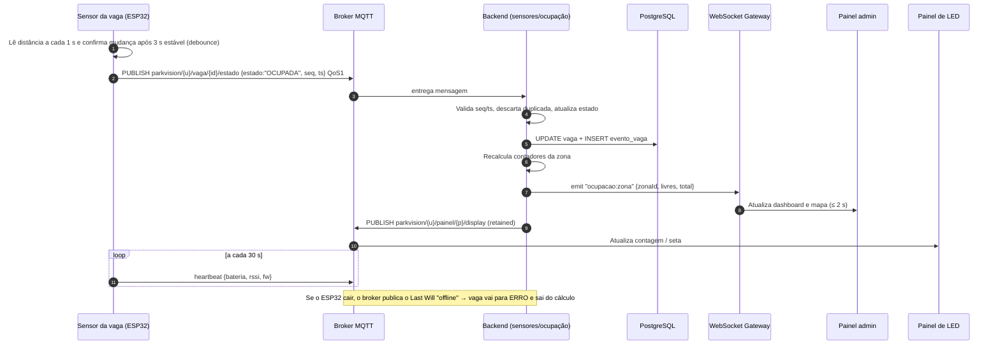
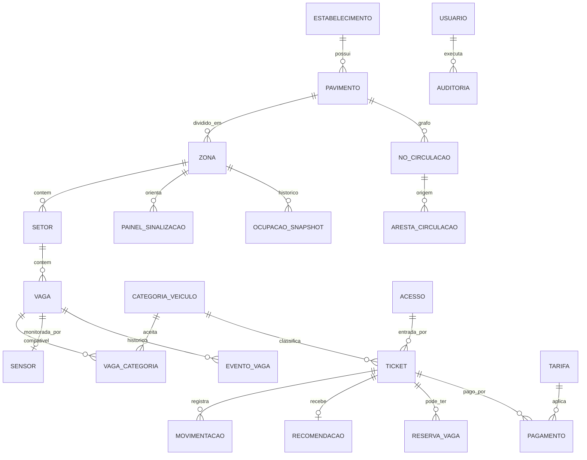
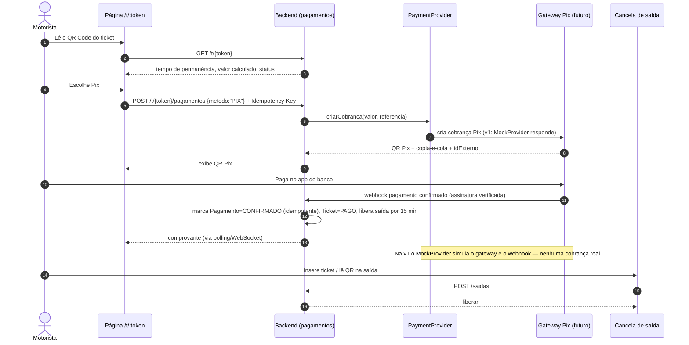

# 03 — Arquitetura Técnica

> **Status:** proposta da 1ª entrega (13/11/2026). Elementos marcados com 🗺️ dependem da **planta real** — recebida em 13/11/2026 e analisada em [10-analise-planta.md](10-analise-planta.md) (Subsolo 1: 140 vagas; Subsolo 2: 216; pátios descobertos norte e sul).

## 1. Princípios de arquitetura

| Princípio | O que significa no ParkVision |
|---|---|
| **Uma linguagem só** | TypeScript no frontend, backend, simulador de sensores e Design System. Reduz a curva de aprendizado da equipe e permite compartilhar tipos (ex.: `EstadoVaga`). |
| **Orientado a eventos** | Sensores publicam mudanças de estado; o backend reage, recalcula a ocupação e propaga para painel e sinalização. Nada fica "perguntando" o tempo todo. |
| **Operação local primeiro** | Em produção o núcleo (broker, backend, banco) roda num servidor dentro do shopping. Se a internet cair, entrada, distribuição, sinalização e saída continuam funcionando. |
| **Adaptadores nas bordas** | Gateway de pagamento, tipo de sensor e impressora ficam atrás de interfaces. Trocar o fornecedor não mexe na regra de negócio. |
| **Sem depender de smartphone** | O fluxo completo (entrar, ser orientado, estacionar, pagar no caixa, sair) funciona só com ticket impresso e sinalização física. O app/web é complemento. |
| **Design System como contrato visual** | Toda interface consome os mesmos tokens e componentes (ver [04-design-system.md](04-design-system.md)). |

## 2. Visão geral



Arquivo fonte do diagrama: [diagrams/01-arquitetura-geral.md](diagrams/01-arquitetura-geral.md).

## 3. Stack escolhida

| Camada | Tecnologia | Por quê (resumo — justificativa completa em [08-decisoes-tecnicas.md](08-decisoes-tecnicas.md)) |
|---|---|---|
| Linguagem | **TypeScript** | Tipagem estática em todo o projeto; um só ecossistema (Node/npm). |
| Frontend | **React 19 + Vite** | Ecossistema grande, componentização casa com Design System, build rápido, demo fácil. |
| Estilo | **CSS Modules + tokens CSS `--pv-*`** | Os tokens do Design System viram variáveis CSS nativas; tema claro/escuro sem JavaScript. |
| Documentação de componentes | **Storybook 9** | Vitrine viva do Design System, testes visuais e de acessibilidade (addon a11y). |
| Gráficos / ícones | **Recharts / Lucide** | Recharts é declarativo em React; Lucide tem traço uniforme e licença aberta. |
| Backend | **Node.js 24 LTS + NestJS** | Arquitetura modular, injeção de dependência, WebSocket Gateway e transporte MQTT nativos. |
| ORM | **Prisma** | Esquema declarativo legível ([backend/prisma/schema.prisma](../backend/prisma/schema.prisma)), migrações, tipos gerados. |
| Banco | **PostgreSQL 16** | Transações ACID para tickets e pagamentos; controle de concorrência para reservas; evolução para TimescaleDB no histórico. |
| Mensageria IoT | **MQTT 3.1.1/5 + Eclipse Mosquitto** | Protocolo leve, padrão em IoT, suportado pelo ESP32, QoS, mensagens retidas e *Last Will*. |
| Tempo real web | **WebSocket (Socket.IO)** | Atualização do painel sem recarregar; reconexão automática. |
| Hardware de vaga | **ESP32 + HC-SR04** (protótipo) / **magnetômetro QMC5883L** (produção) | Baixo custo para maquete; magnetômetro é mais robusto em piso. |
| Infra de demo | **Docker Compose** | Sobe broker + banco + backend + frontend com um comando. |
| Gestão | **Geproj (To Host)** | Ferramenta patrocinadora; uso manual (ver [07-roadmap.md](07-roadmap.md)). |

## 4. Organização dos módulos

### 4.1 Estrutura planejada do repositório (monorepo npm workspaces)

```
parkvision/
├── design-system/        # tokens (fonte JSON), CSS gerado, marca, especificação de componentes
│   └── (fase 1) packages React dos componentes + Storybook
├── frontend/             # (fase 1) React + Vite — painel admin e página de pagamento
│   └── src/
│       ├── app/          # rotas, layout (Sidebar, Header), providers (tema, socket)
│       ├── features/     # dashboard/, mapa/, distribuicao/, tickets/, pagamento/, configuracoes/
│       ├── shared/       # hooks, cliente da API, tipos compartilhados
│       └── styles/       # import de tokens.css + reset
├── backend/              # NestJS + Prisma
│   ├── prisma/schema.prisma   # ✅ já modelado nesta entrega
│   └── src/modules/      # (fase 2) um módulo por domínio — tabela abaixo
├── simulator/            # (fase 3) simulador de sensores MQTT para demonstração
├── firmware/             # (fase 3) código ESP32 (sensor e painel)
├── prototype/            # ✅ protótipo navegável das telas (HTML + tokens)
└── docs/                 # ✅ documentação
```

> Pastas marcadas com "(fase N)" **não foram criadas** nesta entrega para não deixar diretórios vazios; aparecem aqui como planejamento.

### 4.2 Módulos do backend (NestJS)

| Módulo | Responsabilidade | Principais entradas → saídas |
|---|---|---|
| `estrutura` | Cadastro de estabelecimento, pavimentos, zonas, setores, vagas, grafo de circulação 🗺️ | CRUD REST → eventos `estrutura.alterada` |
| `sensores` | Recebe leituras MQTT, aplica debounce/validação, controla heartbeat e saúde | MQTT `.../vaga/+/estado` → evento `vaga.estado_alterado` |
| `ocupacao` | Mantém contadores por zona/categoria, grava snapshots de histórico (1/min) | `vaga.estado_alterado` → `ocupacao.atualizada` |
| `distribuicao` | Calcula o score das zonas e emite a recomendação (e, na evolução, reserva vaga) | `POST /entradas` → `Recomendacao` |
| `tickets` | Sessão de estacionamento: entrada, token do QR, código curto, saída | `POST /entradas`, `POST /saidas` |
| `pagamentos` | Calcula tarifa, cria cobrança via `PaymentProvider`, processa webhook idempotente | `POST /t/:token/pagamentos` → `pagamento.confirmado` |
| `sinalizacao` | Converte ocupação/recomendações em mensagens para cada painel | `ocupacao.atualizada` → MQTT `.../painel/+/display` |
| `realtime` | WebSocket Gateway: transmite estado ao painel administrativo | eventos internos → Socket.IO |
| `auth` | Login de operadores/gestores, perfis (RBAC) | JWT em cookie httpOnly |
| `auditoria` | Registra ações administrativas e mudanças manuais de estado | todos os comandos administrativos |

Os módulos se comunicam por **eventos internos** (`@nestjs/event-emitter`). Assim, `sinalizacao` não conhece `sensores` — só reage a `ocupacao.atualizada`.

## 5. Fluxos de comunicação

### 5.1 Entrada do veículo



Fonte: [diagrams/02-fluxo-entrada.md](diagrams/02-fluxo-entrada.md).

### 5.2 Sensores → backend → painel



Fonte: [diagrams/05-comunicacao-sensores.md](diagrams/05-comunicacao-sensores.md).

### 5.3 Pagamento por QR Code

Detalhado em [diagrams/04-pagamento-qrcode.md](diagrams/04-pagamento-qrcode.md) e na seção 9.

### 5.4 Contratos de mensagem

**Tópicos MQTT** (`{u}` = identificador da unidade/estabelecimento):

| Tópico | Direção | QoS | Retido | Payload (JSON) |
|---|---|---|---|---|
| `parkvision/{u}/vaga/{vagaId}/estado` | sensor → backend | 1 | não | `{ "estado": "LIVRE"\|"OCUPADA", "distanciaCm": 42, "seq": 1093, "ts": "2026-11-13T10:42:05Z" }` |
| `parkvision/{u}/sensor/{sensorId}/heartbeat` | sensor → backend | 0 | não | `{ "rssi": -61, "bateria": 87, "fw": "0.3.1" }` |
| `parkvision/{u}/sensor/{sensorId}/status` | broker (LWT) / sensor | 1 | sim | `"online"` / `"offline"` |
| `parkvision/{u}/painel/{painelId}/display` | backend → painel | 1 | sim | `{ "linhas": [{ "texto": "Z2", "seta": "DIREITA", "livres": 48 }], "modo": "NORMAL"\|"LOTADO"\|"FALHA" }` |
| `parkvision/{u}/painel/{painelId}/status` | painel → backend | 1 | sim | `"online"` / `"offline"` |

**Eventos WebSocket** (servidor → painel admin): `ocupacao:geral`, `ocupacao:zona`, `vaga:estado`, `sensor:saude`, `entrada:nova`, `alerta:novo`.

**API REST (recorte inicial):**

| Método | Rota | Uso |
|---|---|---|
| `POST` | `/entradas` | Totem registra entrada e recebe recomendação + ticket |
| `POST` | `/saidas` | Cancela de saída valida ticket pago/tolerância |
| `GET` | `/ocupacao` | Resumo geral e por zona |
| `GET` | `/mapa/{pavimentoId}` | Estrutura + estado das vagas para o mapa |
| `GET` | `/tickets?status=&busca=` | Lista para operadores |
| `GET` | `/t/{token}` | Página de pagamento: resumo do ticket (sem dados pessoais) |
| `POST` | `/t/{token}/pagamentos` | Cria cobrança Pix (mock nesta fase) |
| `POST` | `/webhooks/pagamentos/{provedor}` | Confirmação assíncrona do gateway |
| `GET/POST/PATCH` | `/config/zonas`, `/config/vagas`, `/config/categorias`, `/config/sensores`, `/config/paineis` | Tela de Configurações |

## 6. Banco de dados

### 6.1 Modelo conceitual



### 6.2 Entidades e onde cada informação exigida é armazenada

| Informação exigida | Entidade(s) | Observações |
|---|---|---|
| Zonas | `Zona`, `Setor`, `Pavimento`, `Estabelecimento` 🗺️ | Hierarquia flexível: a planta define quantos pavimentos/zonas/setores existem. Zona tem `noEntradaId` (distância calculada pelo grafo) e `capacidadeVazaoPorMin`, usados no score. |
| Vagas | `Vaga`, `VagaCategoria` 🗺️ | `estado` (enum com os 6 estados de negócio; "carregamento" é só de interface), `tipo` (comum, PcD, idoso, moto…), posição `x,y` no desenho da planta. |
| Categorias de veículos | `CategoriaVeiculo` | Moto, Carro pequeno, Carro grande (configurável). Compatibilidade N:N com vagas. |
| Tickets | `Ticket` | Sessão de estacionamento. Guarda `tokenPublico` (do QR) e `codigoCurto` (digitável). Placa é **opcional**. |
| Entradas e saídas | `Movimentacao` | Tipo `ENTRADA`/`SAIDA`, acesso, horário, operador (se manual). |
| Pagamentos | `Pagamento`, `Tarifa` | Status, método (PIX, CARTAO, CAIXA), `idExterno` do gateway, `chaveIdempotencia`. Nunca armazena dados de cartão. |
| Histórico de ocupação | `EventoVaga` (cada mudança) + `OcupacaoSnapshot` (agregado por zona/minuto) | Eventos para auditoria/diagnóstico; snapshots para gráficos rápidos. Evolução: hypertable TimescaleDB. |
| Circulação 🗺️ | `NoCirculacao`, `ArestaCirculacao` | Grafo dirigido: aresta tem sentido, distância e flag de bloqueio. Rotas = menor caminho (Dijkstra). |
| Sinalização | `PainelSinalizacao` | Posição, zona/nó associado, tópico MQTT. |
| Distribuição | `Recomendacao`, `ReservaVaga` | Recomendação guarda o score e a justificativa (JSON) de cada zona — transparência. |

O esquema completo está em **[backend/prisma/schema.prisma](../backend/prisma/schema.prisma)**.

### 6.3 Concorrência

- **Recomendação de zona (v1):** a contagem de "veículos em trânsito" (recomendações emitidas e ainda não convertidas em ocupação, com expiração de 10 min) é descontada das vagas livres. Isso evita mandar 20 carros para uma zona com 5 vagas.
- **Reserva de vaga específica (evolução):** atualização atômica condicional, sem *race condition*:

```sql
UPDATE vaga
   SET estado = 'RESERVADA', reservada_ate = now() + interval '5 minutes'
 WHERE id = (
   SELECT id FROM vaga
    WHERE zona_id = $1 AND estado = 'LIVRE' AND id IN (SELECT vaga_id FROM vaga_categoria WHERE categoria_id = $2)
    ORDER BY distancia_entrada_m
    LIMIT 1
    FOR UPDATE SKIP LOCKED)
RETURNING id;
```

Um job a cada 30 s devolve para `LIVRE` as reservas expiradas sem ocupação. Detalhes em [09-distribuicao-inteligente.md](09-distribuicao-inteligente.md).

## 7. IoT e monitoramento

### 7.1 Opções de sensoriamento avaliadas

| Opção | Custo | Prós | Contras | Uso no projeto |
|---|---|---|---|---|
| **Ultrassônico (HC-SR04)** montado no teto, sobre a vaga | Muito baixo | Fácil de programar, ótimo para maquete | Sensível a poeira, temperatura e objetos; precisa de alimentação | **Protótipo/maquete** |
| **Magnetômetro (QMC5883L)** no piso | Baixo/médio | Detecta a massa metálica do veículo; imune a iluminação; robusto | Calibração por vaga; motos pequenas podem gerar sinal fraco | **Produção (piso)** |
| **Ultrassônico industrial com LED integrado** (teto) | Médio | Mostra estado na própria vaga (LED verde/vermelho) | Custo por vaga maior | Opção de produção para áreas cobertas |
| **Câmera + visão computacional** (uma câmera cobre várias vagas) | Médio (por vaga, cai com a cobertura) | Menos dispositivos; permite LPR futuro | Processamento, privacidade (LGPD), iluminação | **Futuro** |

### 7.2 Arquitetura de campo

- **Nó de vaga:** ESP32 + sensor. Firmware lê a cada 1 s, aplica *debounce* de 3 s (só publica mudança estável), envia heartbeat a cada 30 s e registra *Last Will* `offline` com *keepalive* MQTT de 30 s — o broker publica o LWT em ~45 s (1,5 × keepalive), dentro da meta de detectar sensor offline em ≤ 90 s. Se a conexão continuar ativa mas o heartbeat parar (3 ausências = 90 s), o backend também marca o sensor como offline.
- **Rede:** Wi-Fi no protótipo. Em produção, avaliar **cabeamento RS-485/Ethernet por corredor** ou **LoRaWAN** (subsolos atrapalham Wi-Fi) — decisão depende da planta e da infraestrutura do shopping 🗺️.
- **Pontos de instalação 🗺️:** definidos após a planta — um sensor por vaga monitorada, painéis nos pontos de decisão do grafo (bifurcações de corredor, rampas, entradas de pavimento), contador por zona nas entradas de zona. Lista provisória de critérios em [adaptacao-planta.md](adaptacao-planta.md).
- **Saúde:** vaga com sensor offline ou com leituras incoerentes passa ao estado `ERRO` e **sai do cálculo** de disponibilidade (não conta nem como livre nem como ocupada), e gera alerta para manutenção.

### 7.3 Hardware de sinalização

- Painéis com **ESP32 + matriz de LED (ex.: P10)**, assinando seu tópico `.../painel/{id}/display`. Mensagens **retidas**: ao religar, o painel recebe imediatamente a última instrução.
- Conteúdo padronizado pelo Design System (ver [04-design-system.md §8](04-design-system.md)): código da zona, seta de direção (âmbar), número de vagas livres, estado `LOTADO`.
- **Modo de falha seguro:** se o painel não recebe atualização por 2 min, exibe "SIGA A SINALIZAÇÃO FIXA" em vez de um número desatualizado.
- **Indicador por vaga (opcional):** LED verde/vermelho/azul (PcD) acima da vaga, acionado pelo próprio nó do sensor.

## 8. Ticket e QR Code

| Campo impresso | Origem | Observação |
|---|---|---|
| Logo + "ParkVision" | Design System | Impressora térmica 80 mm, monocromática |
| **Zona e setor recomendados** | `Recomendacao` | Em fonte grande (Barlow), com seta e instrução curta ("Suba a rampa e siga a seta Z2") |
| Data/hora de entrada | `Ticket.entradaEm` | |
| Categoria | `Ticket.categoriaId` | |
| **QR Code** | `https://<dominio>/t/{tokenPublico}` | Só a URL. Nenhum dado pessoal, placa ou valor no QR |
| Código curto | `Ticket.codigoCurto` | 6 dígitos (ex.: `418 273`), únicos entre tickets ativos, para digitar no caixa/terminal ou no site |
| "Guarde este ticket para localizar seu veículo" | — | Localização do veículo = zona/setor impressos |

**Regras do token:**

- 128 bits aleatórios (CSPRNG), codificados em base62 (~22 caracteres). Não sequencial, não derivado da placa ou do horário.
- O banco guarda o **hash SHA-256** do token; a busca é feita pelo hash (vazamento do banco não expõe tokens válidos).
- O token só dá acesso ao **resumo do próprio ticket** (entrada, permanência, valor, status) e à cobrança. Deixa de aceitar pagamento quando a saída é registrada; depois disso só o comprovante fica consultável, por até 24 h, e o token é invalidado.
- *Rate limiting* na rota `/t/*` para impedir varredura.

## 9. Pagamentos



- **Interface `PaymentProvider`:** `criarCobranca()`, `consultar()`, `validarWebhook()`. Implementações: `MockProvider` (fase 2, demonstração) e um adaptador real (Mercado Pago, Pagar.me ou Asaas — escolha na fase de MVP, todos oferecem Pix).
- **Idempotência:** chave por tentativa de pagamento; webhook repetido não gera crédito duplicado.
- **Sem dados de cartão no ParkVision:** cartão (futuro) via checkout hospedado do gateway (escopo PCI fica com o gateway).
- **Caminho sem smartphone:** pagamento no caixa/terminal de autoatendimento usando o código curto ou o próprio ticket — mesmo endpoint, método `CAIXA`.

Fonte: [diagrams/04-pagamento-qrcode.md](diagrams/04-pagamento-qrcode.md).

## 10. Segurança

- HTTPS/TLS em toda a comunicação web; MQTT com usuário/senha por dispositivo e TLS na produção; ACL do Mosquitto (sensor só publica no próprio tópico; painel só assina o próprio).
- Painel administrativo com login, perfis **Operador**, **Gestor** e **Manutenção** (RBAC); sessão por JWT em cookie `httpOnly`.
- **LGPD:** placa é opcional, mascarada em listagens (`ABC-1•34`) e removida após prazo de retenção configurável. QR sem dados pessoais.
- Auditoria de ações manuais (forçar estado de vaga, cancelar ticket, liberar cancela).
- Validação de entrada com DTOs (`class-validator`), *rate limiting* nas rotas públicas.

## 11. Implantação

| Ambiente | Como | Finalidade |
|---|---|---|
| **Desenvolvimento** | `docker compose up` → postgres, mosquitto, backend, frontend + simulador | Cada integrante roda tudo localmente |
| **Demonstração acadêmica** | Frontend em hospedagem estática (ex.: Vercel); backend + Postgres em PaaS (ex.: Render/Railway); simulador gerando eventos | Acesso pela banca via link |
| **Produção (visão de produto)** | Servidor de borda no shopping (backend, broker, banco) + réplica/backup em nuvem; painel acessível remotamente via VPN/túnel | Operação contínua mesmo sem internet |

## 12. Integrações futuras

| Integração | Fase | Observação |
|---|---|---|
| Gateway de pagamento com Pix | MVP | Via `PaymentProvider` |
| Reconhecimento de placas (LPR) | Pós-MVP | Fora do escopo; exigiria câmeras e avaliação LGPD |
| Consulta SENATRAN | Pós-MVP | Fora do escopo |
| App mobile / localizar veículo online | Pós-MVP | Hoje: página web pelo QR |
| Reserva antecipada de vaga | Pós-MVP | Usa o mesmo mecanismo de `ReservaVaga` |
| Integração com sistema de cancelas existente do shopping | MVP/produção | Depende do fornecedor instalado |
| TimescaleDB / Redis | Escala | Histórico de alta frequência / cache de estado ao vivo |
