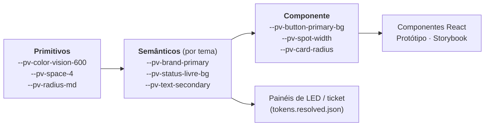

# 04 — Design System ParkVision

> Tecnologia/prática sorteada pela equipe. Este documento define **o quê** compõe o Design System; o [06-tecnologia-sorteada.md](06-tecnologia-sorteada.md) explica **por que** e **como** ele é aplicado no projeto.
>
> **Material demonstrável:**
> - Tokens (fonte da verdade): [`design-system/tokens/tokens.json`](../design-system/tokens/tokens.json)
> - CSS gerado: [`design-system/tokens/build/tokens.css`](../design-system/tokens/build/tokens.css)
> - Marca: [`design-system/brand/`](../design-system/brand/)
> - Contratos dos componentes: [`design-system/components/README.md`](../design-system/components/README.md)
> - Vitrine viva + telas: [`prototype/index.html`](../prototype/index.html) → página **Design System**

---

## 1. Conceito

**Smart Mobility — "o estacionamento que se organiza sozinho".**

A linguagem visual nasce do próprio ambiente do estacionamento: **asfalto**, **placa de estacionamento** e **faixa pintada no chão**. Em vez de um "dashboard genérico", o ParkVision usa o vocabulário que o motorista já conhece da rua — e o mesmo vocabulário aparece no painel administrativo, no ticket impresso e nos painéis de LED.

| Atributo | Como aparece |
|---|---|
| **Confiança** | Azul de sinalização oficial, contraste alto, números grandes e estáveis (algarismos tabulares) |
| **Clareza** | Cada estado tem cor + ícone + rótulo + código; hierarquia tipográfica curta |
| **Eficiência** | Densidade de informação controlada, grid de 4 px, nada decorativo sem função |
| **Modernidade** | Navegação escura com acento âmbar, superfícies limpas, tipografia de sinalização |

## 2. Identidade visual

> **Atualização — Golden Park.** O nome oficial passou a ser **Golden Park**, com as duas logos fornecidas pela equipe:
>
> | Logo | Tema | Arquivos (`design-system/brand/`) |
> |---|---|---|
> | Dourada e preta | **Modo claro** (padrão) | `golden-park-claro-original.jpg` (original) · `golden-park-claro-{completo,simbolo,nome}.png` |
> | Dourada e bege | **Modo escuro** | `golden-park-escuro-original.jpg` (original) · `golden-park-escuro-{completo,simbolo,nome}.png` |
>
> Os PNG são as logos originais apenas **recortadas e com o fundo creme removido** (`design-system/scripts/preparar-logos.py`), sem redesenho e sem mudar proporções. A paleta ganhou o **ouro** (marca e ações primárias) e o **grafite** (modo escuro); a navegação passou a acompanhar o tema para a logo certa sempre ficar sobre o fundo certo. Detalhes: [mvp/14-golden-park.md](mvp/14-golden-park.md). O texto abaixo descreve a identidade anterior (ParkVision) e fica como histórico; a placa azul de região, os estados e a regra "âmbar = rota" continuam valendo.

### 2.1 Nome e logotipo (identidade anterior — ParkVision)

- **Nome:** ParkVision — escrito sempre junto, com "P" e "V" maiúsculos.
- **Símbolo:** uma **placa azul de cantos arredondados** (referência à placa indicativa de estacionamento) com a letra **P**; o bojo do P é uma **lente**, e a pupila âmbar representa o **sensor** que "enxerga" as vagas.
- **Logotipo horizontal:** símbolo + "Park" (Barlow SemiBold, cor de texto) + "Vision" (Barlow Bold, azul Vision).

| Arquivo | Uso |
|---|---|
| [`logo-symbol.svg`](../design-system/brand/logo-symbol.svg) | Favicon, avatar, totem, cabeçalho do ticket, sidebar recolhida |
| [`logo-horizontal.svg`](../design-system/brand/logo-horizontal.svg) | Sidebar expandida, página de pagamento, documentos |

**Diretrizes do logo**

- Área de proteção: no mínimo ¼ da largura do símbolo em todos os lados.
- Tamanho mínimo: símbolo 20 px (tela) / 8 mm (impresso).
- Sobre fundo escuro: "Park" passa para branco; o símbolo não muda.
- Impressão térmica (monocromática): símbolo em preto sólido com P e lente vazados.
- ❌ Não distorcer, não aplicar sombra, não trocar a cor da placa, não usar a pupila âmbar isolada como ícone de status.

### 2.2 Paleta

**Primitivos** (valores brutos — nunca usados direto em componentes):

| Família | Papel | Faixa | Âncora |
|---|---|---|---|
| **Asfalto** | Neutros frios: superfícies, texto, bordas | 25 → 950 | `#161C29` (900) |
| **Vision** | Marca e ações primárias. Referência ao azul das placas de estacionamento | 50 → 900 | `#2148E8` (600) |
| **Faixa** | Âmbar da pintura viária. **Exclusivo para orientação**: setas, rotas, item ativo da navegação | 100 → 900 | `#F5A800` (500) |
| **Verde** | Estado *Livre*, sucesso, ocupação normal | 100 → 900 | `#1BA659` |
| **Vermelho** | Estado *Ocupada*, erro de operação, ocupação lotada | 100 → 900 | `#E5484D` |
| **Violeta** | Estado *Reservada* | 100 → 900 | `#7C5CFF` |
| **Laranja** | Estado *Em manutenção*, atenção, ocupação alta | 100 → 900 | `#F07F13` |
| **Magenta** | Estado *Erro* (falha de sensor/dispositivo) | 100 → 900 | `#D6336C` |

**Por que o âmbar não é cor de estado?** Para que uma seta de rota nunca seja confundida com "atenção". O motorista aprende: *âmbar = caminho*. Isso vale da tela ao painel de LED.

### 2.3 Tipografia

| Família | Papel | Por quê |
|---|---|---|
| **Barlow** (500/600/700) | Display: títulos, KPIs, números de vagas, painéis de LED, zona no ticket | Desenhada com inspiração em placas e sinalização viária; ótima leitura à distância |
| **IBM Plex Sans** (400/500/600) | Texto de interface e leitura | Neutra, técnica, excelente em tamanhos pequenos e com acentuação do português |
| **IBM Plex Mono** (500) | IDs de ticket, códigos de vaga e sensor, placas, valores em tabela | Caracteres inequívocos (0/O, 1/l), alinhamento em colunas |

Todas gratuitas (SIL Open Font License), via Google Fonts. Números em KPIs e tabelas usam `font-variant-numeric: tabular-nums` para não "dançarem" na atualização em tempo real.

**Escala tipográfica** (`--pv-font-size-*`): 12 · 14 · 16 · 18 · 20 · 24 · 30 · 36 · 48 · 64 (`sign`, para totem e painel).

### 2.4 Hierarquia visual

| Nível | Uso | Estilo |
|---|---|---|
| **Display** | Número principal de KPI, zona recomendada, painel físico | Barlow 600–700, 36–64 px, `line-height: tight` |
| **H1** | Título da tela | Barlow 600, 24–30 px |
| **H2** | Título de card/seção | Barlow 600, 18–20 px |
| **Corpo** | Texto, rótulos de formulário | Plex Sans 400–500, 14–16 px |
| **Legenda** | Metadados, timestamps, ajuda | Plex Sans 400, 12 px, `text-secondary` |
| **Dado** | IDs, placas, códigos | Plex Mono 500, 13–14 px |

Regra prática: **uma informação dominante por card** (o número), um rótulo, um contexto. Cor de marca para **ação**, nunca para decoração.

### 2.5 Iconografia

- Biblioteca **Lucide** (traço 1,75 px, cantos arredondados), tamanho 16/20/24 px.
- Ícones de estado fixos: `circle-check` (Livre), `car` (Ocupada), `clock` (Reservada), `ban` (Indisponível), `wrench` (Manutenção), `triangle-alert` (Erro), `loader` (Carregamento).
- Categorias: `bike` (Moto), `car` (Carro pequeno), `truck`/`car-front` (Carro grande), `accessibility` (PcD).
- Ícone nunca aparece sozinho em ação crítica: sempre com rótulo ou `aria-label`.

## 3. Tokens

### 3.1 Arquitetura em três camadas



| Camada | Pergunta que responde | Pode ser usada em componente? |
|---|---|---|
| **Primitive** | "Quais valores existem?" | ❌ Não |
| **Semantic** | "Para que serve?" (fundo, texto, estado…) — **muda por tema** | ✅ Sim |
| **Component** | "Como este componente específico usa?" | ✅ Sim (preferencial) |

**Trocar o tema = redefinir apenas a camada semântica.** Os componentes não sabem se estão no claro ou no escuro.

### 3.2 Nomenclatura

```
--pv-{categoria}-{item}-{variação}
--pv-color-asfalto-900       primitivo
--pv-status-ocupada-bg       semântico
--pv-button-primary-bg-hover componente
```

Prefixo `pv-` evita colisão com bibliotecas de terceiros. Nomes de estado em português, iguais aos do banco (`EstadoVaga`) — o mesmo vocabulário do banco à tela.

### 3.3 Inventário (v0.1.0)

| Grupo | Tokens | Exemplos |
|---|---|---|
| Cores primitivas | 53 | `--pv-color-vision-600`, `--pv-color-faixa-500` |
| Espaçamento (grid 4 px) | 11 | `--pv-space-1` (4 px) … `--pv-space-16` (64 px) |
| Raios | 7 | `xs 2` · `sm 4` · `md 8` · `lg 12` · `xl 16` · `pill` |
| Bordas | 3 | `hairline 1` · `thick 2` · `focus 3` |
| Tipografia | 20 | famílias, tamanhos, pesos, alturas de linha |
| Sombras | 3 | `sm` (cards), `md` (dropdown/hover), `lg` (modal) |
| Movimento | 4 | `fast 120ms` · `base 200ms` · `slow 320ms` · `easing standard` |
| Camadas (z-index) | 6 | `sticky` · `dropdown` · `overlay` · `modal` · `toast` |
| Semânticos | 68 × 2 temas | `bg-*`, `text-*`, `border-*`, `brand-*`, `wayfinding-*`, `feedback-*`, `status-*`, `occupancy-*`, `chart-*` |
| Componente | 68 | `button-*`, `card-*`, `input-*`, `badge-*`, `sidebar-*`, `header-*`, `table-*`, `modal-*`, `alert-*`, `spot-*`, `meter-*`, `focus-*` |

### 3.4 Pipeline

```
tokens.json  ──node build-tokens.mjs──►  build/tokens.css            (web: React, protótipo, Storybook)
                                    ├─►  build/tokens.resolved.json  (gráficos em canvas, firmware dos painéis, ticket)
                                    └─►  prototype/assets/tokens.css
             ──node check-contrast.mjs─► verificação WCAG dos pares críticos (falha o build se < 4.5:1)
```

- Formato compatível com o padrão **W3C Design Tokens** (`$value`, `$type`, `$description`) — importável no Figma (Tokens Studio) futuramente.
- O build **falha** se um tema tiver token semântico que o outro não tem, ou se uma referência não existir.
- Resultado atual da verificação de contraste: **26/26 pares aprovados (≥ 4,5:1)** nos temas claro e escuro.

## 4. Estados visuais

**Regra de ouro: cor nunca é o único sinal.** Todo estado combina **cor + ícone + rótulo + código de letra** e, quando a forma é pequena (vaga no mapa), também um **padrão de preenchimento**. Assim o sistema funciona para pessoas com daltonismo, em impressão monocromática e em painel de LED de uma cor.

| Estado | Código | Cor (token) | Ícone | Padrão no mapa | Rótulo | Significado |
|---|---|---|---|---|---|---|
| **Livre** | `L` | `status-livre-*` (verde) | `circle-check` | Sólido claro | "Livre" | Sensor confirma vaga vazia |
| **Ocupada** | `O` | `status-ocupada-*` (vermelho) | `car` | Sólido | "Ocupada" | Sensor confirma veículo |
| **Reservada** | `R` | `status-reservada-*` (violeta) | `clock` | Contorno duplo | "Reservada · 4 min" | Vaga reservada para um ticket (evolução) |
| **Indisponível** | `X` | `status-indisponivel-*` (cinza) | `ban` | Hachura diagonal | "Indisponível" | Bloqueada pela operação (evento, obra) |
| **Em manutenção** | `M` | `status-manutencao-*` (laranja) | `wrench` | Listras largas | "Manutenção" | Vaga ou sensor em intervenção |
| **Erro** | `E` | `status-erro-*` (magenta) | `triangle-alert` | Borda tracejada | "Erro de sensor" | Sensor offline/incoerente; fora do cálculo |
| **Carregamento** | — | `status-carregamento-*` | `loader` | Shimmer (skeleton) | "Atualizando…" | Dado ainda não recebido |

Cada estado tem três tokens: `-solid` (preenchimentos e ícones), `-bg` (fundo de badge/vaga) e `-fg` (texto sobre `-bg`, contraste ≥ 4,5:1).

**Ocupação de zona** (medidores e mapa de calor): `Normal` < 70% (verde) · `Alta` 70–89% (laranja) · `Lotada` ≥ 90% (vermelho) — sempre com o rótulo textual e o percentual ao lado.

**Estados de interação** (todos os componentes interativos): `default` · `hover` · `focus-visible` (anel de 3 px `--pv-focus-ring-color` com afastamento de 2 px) · `active` · `disabled` (opacidade 0,45 + `cursor: not-allowed` + `aria-disabled`) · `loading` (spinner + rótulo "Processando…", bloqueia clique duplo). Prioridade: disabled > loading > active > focus > hover > default.

## 5. Componentes

Catálogo inicial. Contratos (props/variantes em TypeScript) em [`design-system/components/README.md`](../design-system/components/README.md); demonstração na página **Design System** do protótipo.

| Componente | Variantes | Estados | Tokens principais | Onde aparece |
|---|---|---|---|---|
| **Button** | primary · secondary · ghost · danger; sm/md/lg; com ícone | default, hover, focus, active, disabled, loading | `button-*` | Todas as telas |
| **Card** | padrão · KPI · interativo | default, hover (interativo), loading | `card-*` | Dashboard, Distribuição |
| **KPI / StatCard** | com tendência · com meta | normal, loading, erro | `card-*`, display | Dashboard |
| **OccupancyMeter** (indicador de ocupação) | barra · anel | normal / alta / lotada | `meter-*`, `occupancy-*` | Dashboard, Mapa, Distribuição |
| **StatusBadge** | estado de vaga · status de ticket · status de dispositivo | 7 estados de vaga + status de negócio | `badge-*`, `status-*`, `feedback-*` | Tabelas, mapa, detalhes |
| **TextField / Select / Toggle** | com ícone, com ajuda, numérico | default, focus, erro (mensagem), disabled, read-only | `input-*` | Configurações, Tickets (busca) |
| **DataTable** | com filtros, paginação, linha clicável | vazio, carregando (skeleton), erro | `table-*` | Tickets, Configurações |
| **Sidebar** (navegação lateral) | expandida · recolhida (< 900 px) | item ativo (indicador âmbar), hover, focus | `sidebar-*` | Layout do painel |
| **Header** (cabeçalho) | com ações · com busca | — | `header-*` | Layout do painel |
| **Modal / Drawer** | confirmação · formulário · detalhe | aberto/fechado; foco preso; `Esc` fecha | `modal-*` | Detalhe de ticket, cadastro de zona |
| **Alert / Toast** | info · sucesso · atenção · erro | dispensável ou fixo | `alert-*`, `feedback-*` | Dashboard, formulários |
| **Chart** (gráficos) | linha (histórico) · barras (por zona) | carregando, vazio | `chart-*` | Dashboard |
| **ParkingSpot** (vaga) | carro · moto · PcD; orientação 0°/90° | 7 estados + selecionada + foco | `spot-*`, `status-*` | Mapa, mini-mapa da distribuição |
| **ZoneCard / ZoneOverlay** (zona) | card · polígono sobre a planta | normal / alta / lotada / inelegível / selecionada | `occupancy-*`, `border-*` | Mapa, Distribuição |
| **RouteLine** (rota) | seta · linha tracejada | ativa / inativa | `wayfinding-*` | Distribuição, Mapa |
| **TicketPreview** | térmico 80 mm | — | mono, display | Tickets, Pagamento |
| **SignagePanel** (painel físico) | zona + seta + contagem · LOTADO · FALHA | normal, lotado, falha | `wayfinding-*`, `sign` | Configurações → Sinalização, documentação |
| **Skeleton** | texto · card · vaga | shimmer (respeita `prefers-reduced-motion`) | `status-carregamento-*` | Qualquer carregamento |
| **Stepper** | 3 passos | atual · concluído · pendente | `brand-*` | Pagamento mobile |

## 6. Regras de utilização

**Fazer ✅**

- Usar sempre tokens semânticos ou de componente (`var(--pv-status-livre-bg)`), nunca hex.
- Exibir estado com cor + ícone + texto; no mapa, também o código de letra e o padrão.
- Usar Barlow para números de destaque e Plex Mono para identificadores.
- Usar âmbar (`wayfinding-*`) apenas para rota/direção e item ativo da navegação.
- Garantir área de toque ≥ 44 px (48 px na página de pagamento mobile).
- Rotular dados de demonstração e a planta provisória ("EXEMPLO").

**Evitar ❌**

- Vermelho para ação que não seja destrutiva/erro.
- Mais de um botão `primary` por área de decisão.
- Animações em atualizações de tempo real que chamem atenção sem necessidade (respeitar `prefers-reduced-motion`).
- Texto em caixa-alta longo (só em rótulos curtos e painéis físicos).
- Criar componente novo quando uma variante resolve.

## 7. Acessibilidade

- **WCAG 2.2 nível AA** como meta. Contraste de texto validado automaticamente nos tokens (≥ 4,5:1).
- Navegação completa por teclado; foco sempre visível; ordem lógica; *skip link* para o conteúdo.
- Mapa: cada vaga é um elemento com `aria-label` ("Vaga Z2-B-17, livre, carro pequeno"); alternativa em tabela/lista por zona.
- Atualizações em tempo real anunciadas com moderação (`aria-live="polite"` só no resumo, nunca em cada vaga).
- Gráficos com resumo textual e tabela de dados alternativa.
- Tema escuro e respeito a `prefers-color-scheme`, `prefers-reduced-motion` e zoom de 200%.
- **Acessibilidade física:** todo o fluxo funciona sem smartphone — ticket impresso legível (zona em fonte grande), sinalização luminosa redundante (seta + texto + número), caixa com atendimento humano.

## 8. Aplicações fora da tela

O mesmo Design System governa os pontos de contato físicos — por isso existe o `tokens.resolved.json` com valores finais.

| Ponto de contato | Aplicação |
|---|---|
| **Painel de LED** | Fundo escuro (`bg-nav`), código da zona em Barlow, seta âmbar (`wayfinding-route`), número de livres; `LOTADO` em vermelho **com a palavra escrita**; modo falha "SIGA A SINALIZAÇÃO FIXA" |
| **Ticket térmico** | Logo monocromático, zona/setor em Barlow grande, seta, QR, código curto em Plex Mono |
| **Totem** | Botões de categoria com ícone + texto grandes (`font-size-sign`), alto contraste |
| **Indicador por vaga** | LED verde (livre) / vermelho (ocupada) / azul (PcD livre) — reforçado pela placa física |

## 8.1 Aplicação no MVP (Etapa 3)

As três interfaces do MVP (`apps/web`) usam estes tokens pelo Tailwind 4 (`@theme` → `var(--pv-*)`). Na Etapa 3, entraram três extensões:

- **Placa da região:** o código da região numa placa azul com filete branco, que é o elemento de identidade presente no totem, no ticket, no painel e no localizador.
- **Faixas de ocupação por região:** com vagas (< 70%), ocupação alta (70–89%), quase lotada (≥ 90% com vagas), lotada (0 vagas, padrão xadrez), indisponível (hachura) e falha de sensor (pontos).
- **Tokens do mapa:** papel, tinta da planta e vias, ligados aos tokens semânticos para acompanhar o tema.

Detalhes: [docs/mvp/10-interfaces.md](mvp/10-interfaces.md).

## 9. Organização, aplicação e manutenção

### 9.1 Estrutura no repositório

```
design-system/
├── tokens/
│   ├── tokens.json              ← fonte da verdade (editar aqui)
│   └── build/                   ← gerado (não editar)
│       ├── tokens.css
│       └── tokens.resolved.json
├── brand/                       ← logos SVG
├── components/README.md         ← contratos/props dos componentes
└── scripts/
    ├── build-tokens.mjs         ← gera CSS/JSON
    └── check-contrast.mjs       ← valida WCAG
```

Na **Fase 1** (protótipo React) entra `design-system/react/` com os componentes reais (`Button.tsx` + `Button.module.css` + `Button.stories.tsx`) e o **Storybook** como documentação navegável, publicado junto com cada versão.

### 9.2 Como será aplicado no desenvolvimento

1. O frontend importa `tokens.css` uma única vez (`frontend/src/styles/index.css`).
2. Telas são montadas **só** com componentes do Design System; CSS local de tela cuida apenas de layout (grid, posicionamento).
3. Um *lint* (stylelint com regra `color-no-hex` + plugin de tokens) bloqueia hex e valores mágicos fora de `design-system/`.
4. Cada componente nasce com história no Storybook mostrando todas as variantes × estados e passa no addon de acessibilidade (axe).

### 9.3 Governança e manutenção

| Item | Regra |
|---|---|
| **Responsável** | O integrante no papel de UX/UI é o responsável pelo Design System; qualquer integrante pode propor mudança |
| **Proposta de mudança** | Issue/tarefa no Geproj com: problema, onde ocorre, proposta, impacto em telas |
| **Critério para novo componente** | Usado em ≥ 2 telas ou é domínio do produto (vaga, zona, rota). Caso contrário, compor com existentes |
| **Revisão** | Mudanças em `tokens.json` exigem revisão de UX + verificação de contraste passando |
| **Versionamento** | SemVer: *patch* = ajuste de valor; *minor* = token/componente novo; *major* = token removido/renomeado |
| **Registro** | `CHANGELOG` do Design System a cada versão; tokens obsoletos marcados `$deprecated` por uma versão antes da remoção |
| **Sincronização com a planta** | Quando a planta chegar, novos tipos de vaga/zona viram variantes de `ParkingSpot`/`ZoneOverlay`, não componentes novos |
