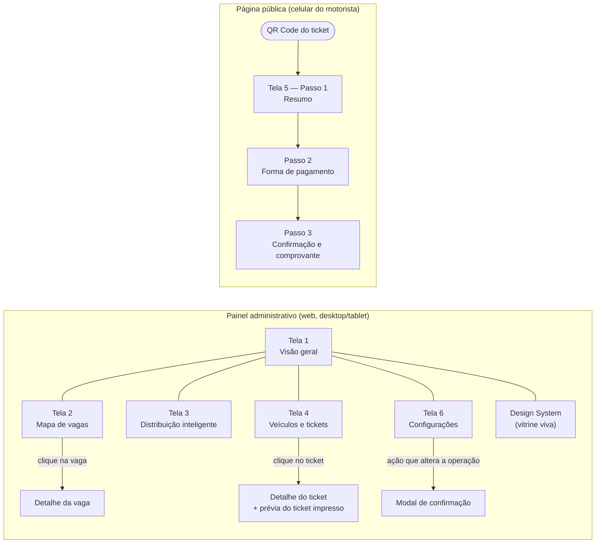

# 05 — Estrutura das Telas

> Protótipo navegável de alta fidelidade: **[`prototype/index.html`](../prototype/index.html)** (abre direto no navegador, sem build). Todas as telas usam apenas os tokens e componentes do Design System ([04](04-design-system.md)). Os números exibidos são **dados de demonstração**; o mapa interativo usa uma simulação rotulada como exemplo, e o painel "Planta real" mostra a proposta de zonas sobre a planta do Capim Dourado Shopping ([10](10-analise-planta.md)).

## 1. Mapa de navegação

**Estrutura comum do painel (layout):** `Sidebar` escura com o logo e os itens de navegação (item ativo com indicador âmbar), `Header` com caminho (estabelecimento / pavimento), título da tela, selo **Dados de demonstração**, indicador "Ao vivo" e botão de tema claro/escuro. Em telas menores que 900 px a navegação recolhe para ícones; abaixo de 600 px vira menu lateral com botão.

## 2. Telas

### Tela 1 — Visão geral (Dashboard administrativo) · `#dashboard`

| Item | Descrição |
|---|---|
| **Objetivo** | Dar ao gestor/operador a situação do estacionamento em segundos |
| **Usuário** | Gestor, operador |
| **Informações** | Total de vagas · disponíveis · ocupadas · % de ocupação (com faixa Normal/Alta/Lotada) · veículos no estacionamento (estacionados + a caminho) · ocupação por zona · saúde dos sensores (online, offline por LWT, leitura incoerente) · gráfico de ocupação do dia com linhas de 70% e 90% · alertas recentes |
| **Componentes** | `StatCard` (faixa de KPIs), `OccupancyMeter`, `StatusBadge`, `SensorHealth` (barra segmentada + números), `LineChart`, `Alert` em lista, `DataTable` compacta |
| **Interações** | Link "Ver no mapa"; atualização em tempo real via WebSocket (simulada pelo relógio) |
| **Estados** | Carregando: `Skeleton` nos cards · Erro de conexão: `Alert` de erro no topo e últimos valores com horário · Vazio: não se aplica (sempre há estrutura cadastrada) |
| **Acessibilidade** | Medidores com `role="meter"` e rótulo textual; gráfico com título, descrição e resumo em texto; faixas de ocupação sempre escritas |
| **Depende da planta** | Zonas e totais passam a ser os reais (N1–N3, S1–S2, SS1-A/B/M, SS2-O/C/L) |

### Tela 2 — Mapa de vagas · `#mapa`

| Item | Descrição |
|---|---|
| **Objetivo** | Mostrar onde estão as vagas livres e ocupadas e permitir inspecionar cada zona e vaga |
| **Usuário** | Operador, manutenção |
| **Informações** | **Planta real: proposta de zonas** (térreo, Subsolo 1 e Subsolo 2 com zonas sobrepostas, acessos e tabela de zonas) · simulação interativa do componente de mapa com zonas, setores e vagas nos 7 estados · legenda com contagem por estado · sentido de circulação · entrada e saída |
| **Componentes** | `ZoneOverlay` (retângulos sobre a planta), `ParkingSpot` (carro e moto), `ZoneCard` (cabeçalho de zona), `RouteLine`/setas âmbar, filtros em `Chip`, `Alert` de exemplo provisório, `DataTable` (resumo por setor) |
| **Interações** | Filtro "Piso inteiro" ou zona individual (mostra a zona ampliada + localizador); clique em uma vaga mostra código, estado, sensor e última leitura |
| **Estados** | Vaga sem dado: estado **Atualizando…** (shimmer) · Sensor offline: **Erro de sensor** (borda tracejada) · Zona lotada: badge **Lotada** |
| **Acessibilidade** | Cada vaga tem `aria-label` ("Vaga Z2-B-17, livre, carro"); estados com cor + ícone + letra + padrão; tabela alternativa por setor |
| **Depende da planta** | ✅ Planta recebida: a proposta de zonas já é exibida. Pendente: contagem das vagas dos pátios e motos, polígonos exatos e substituição da simulação Z1–Z4 pelas zonas reais |

### Tela 3 — Distribuição inteligente · `#distribuicao`

| Item | Descrição |
|---|---|
| **Objetivo** | Explicar ao operador **qual zona foi recomendada e por quê** |
| **Usuário** | Operador, gestor |
| **Informações** | Veículo identificado (ticket, categoria escolhida no totem, horário, totem; placa fora do escopo) · prévia do painel de entrada · zona recomendada em destaque com score, livres efetivas, setor sugerido e distância · tabela do cálculo por critério (disponibilidade 40%, distância 25%, fluxo 25%, saúde 10%) · barras comparando os scores · rota sugerida em mini-mapa · zonas inelegíveis com o motivo · aviso "v1 recomenda zona; não garante vaga individual" |
| **Componentes** | `ScoreBreakdown`, `ZoneCard`, `RouteLine`, `SignagePanel`, `StatusBadge`, `Alert` (info) |
| **Interações** | Leitura; na versão funcional, histórico das últimas recomendações |
| **Estados** | Sem zona elegível: card de erro "Sem vagas para esta categoria" e painel **LOTADO** |
| **Acessibilidade** | Tabela com cabeçalhos e legenda; fórmula em texto; zona vencedora indicada por texto, não só pela cor |
| **Depende da planta** | Distâncias reais pela rota do grafo; nomes das zonas reais |

### Tela 4 — Veículos e tickets · `#tickets`

| Item | Descrição |
|---|---|
| **Objetivo** | Encontrar e acompanhar sessões de estacionamento |
| **Usuário** | Operador de caixa, atendimento |
| **Informações** | Ticket (mono) · placa quando informada (mascarada, LGPD) · categoria com ícone · horário de entrada · zona e setor direcionados · permanência · status (Em andamento, Pagamento pendente, Pago, Saída registrada) |
| **Componentes** | `TextField` de busca, `Select` de filtros, `DataTable`, `StatusBadge`, `Drawer` de detalhe com linha do tempo e `TicketPreview` (ticket térmico com zona, setor, orientação, QR e código curto) |
| **Interações** | Busca por ticket, placa ou código curto; filtros por status e categoria; clique abre o detalhe; ações "Registrar pagamento no caixa" e "Reimprimir ticket" |
| **Estados** | Vazio: "Nenhum ticket encontrado" + "Limpar filtros" · Carregando: skeleton de linhas |
| **Acessibilidade** | Drawer com foco preso e `Esc` para fechar; linhas acessíveis por botão |
| **Depende da planta** | Códigos de zona/setor reais no ticket |

### Tela 5 — Pagamento por QR Code (mobile) · `#pagamento`

| Item | Descrição |
|---|---|
| **Objetivo** | O motorista paga pelo celular lendo o QR do ticket, sem app e sem login |
| **Usuário** | Motorista |
| **Informações** | Passo 1: identificação do ticket, tempo de permanência, valor calculado, onde o veículo está (zona/setor) · Passo 2: Pix (QR + copia e cola), cartão ("em breve"), pagar no caixa com o código curto · Passo 3: confirmação, comprovante e horário-limite para sair |
| **Componentes** | `Stepper`, `Card`, botões `lg` (48 px), opções de pagamento (radio), `Alert` "Simulação — sem pagamento real" |
| **Interações** | Avançar/voltar entre passos; copiar código Pix; simular confirmação |
| **Estados** | Aguardando confirmação · Pago · Token inválido/expirado (mensagem com orientação para o caixa) |
| **Acessibilidade** | Alvos de toque ≥ 48 px; leitura linear; alternativa sem celular sempre indicada (caixa) |
| **Segurança** | O QR contém só `/t/{token}` (token opaco); nada de placa ou dado pessoal |

### Tela 6 — Configurações · `#config`

| Item | Descrição |
|---|---|
| **Objetivo** | Cadastrar e ajustar a estrutura e os dispositivos |
| **Usuário** | Gestor, manutenção |
| **Informações** | Abas **Zonas** (lista + edição: nome nos painéis, pavimento, vazão em veículos/min, limites de ocupação, participação na distribuição) · **Vagas** (estado, compatibilidade por vaga, alteração manual para manutenção/indisponível) · **Categorias de veículos** (botão no totem, vagas compatíveis, barreira IR planejada) · **Sensores** (sensores em atenção, heartbeat, debounce, offline após N heartbeats, LWT) · **Sinalização** (painéis, modo automático/manual, prévia do painel, envio de teste) |
| **Componentes** | `Tabs`, `DataTable`, `TextField`, `Select`, `Toggle`, `Modal` de confirmação, `SignagePanel` |
| **Estados de formulário** | Padrão · foco · erro com mensagem ligada ao campo · desabilitado |
| **Depende da planta** | Cadastro das zonas reais propostas em [10](10-analise-planta.md) |

### Página Design System · `#design-system`

Vitrine viva usada pela equipe e pela banca: logo, cores primitivas e semânticas (lidas dos tokens em tempo real, mudam com o tema), tipografia, espaçamento, raios, sombras, botões (4 variantes × 5 estados), badges, campos, alertas, modal, card, tabela, medidor de ocupação, vaga nos 7 estados, skeleton e painel de sinalização física.

## 3. Fluxos

### 3.1 Motorista sem smartphone

```mermaid
flowchart LR
  A([Chega ao acesso]) --> B[Painel externo mostra zonas<br/>e vagas livres]
  B --> C[Totem: escolhe categoria<br/>e, se precisar, vaga especial]
  C --> D[Recebe ticket impresso:<br/>zona, setor, seta, QR, código curto]
  D --> E[Segue as setas âmbar<br/>dos painéis]
  E --> F[Estaciona na zona indicada]
  F --> G[Compras]
  G --> H[Volta: zona/setor no ticket<br/>localizam o veículo]
  H --> I[Paga no caixa com o ticket<br/>ou código curto]
  I --> J([Sai pela cancela])
```

### 3.2 Motorista com smartphone

Igual ao anterior até o passo G; depois lê o QR do ticket → Tela 5 (resumo → Pix → comprovante) → sai pela cancela dentro da tolerância.

### 3.3 Operador

Tela 1 (visão geral e alertas) → Tela 2 (inspeciona a zona com problema) → Tela 6 (coloca vaga em manutenção, com confirmação) → Tela 3 (confere a nova recomendação) → Tela 4 (atende cliente no caixa).

## 4. Requisitos atendidos por tela

| Tela | Requisitos do enunciado |
|---|---|
| Tela 1 | Total, disponíveis, ocupadas, % de ocupação, ocupação por zona, veículos no estacionamento, sensores, histórico/gráfico ✅ |
| Tela 2 | Planta visual, zonas e setores, distribuição das vagas, livres/ocupadas, indicadores de disponibilidade, visualização por zona ✅ |
| Tela 3 | Veículo identificado, categoria, zona recomendada, justificativa, disponibilidade por zona, rota sugerida ✅ |
| Tela 4 | ID do ticket, placa quando disponível, categoria, entrada, zona e setor, status ✅ |
| Tela 5 | Identificação, permanência, valor, opções de pagamento, Pix, confirmação, comprovante ✅ |
| Tela 6 | Zonas, vagas, categorias, sensores, sinalização ✅ |

## 5. Limitações do protótipo

- HTML estático com dados fictícios; não há backend nem atualização real.
- O mapa interativo usa zonas Z1–Z4 de exemplo; a planta real aparece no painel de proposta de zonas. A troca completa está prevista para a Fase 1 ([07](07-roadmap.md)).
- Pagamento simulado (MockProvider); o código Pix exibido não é pagável.
