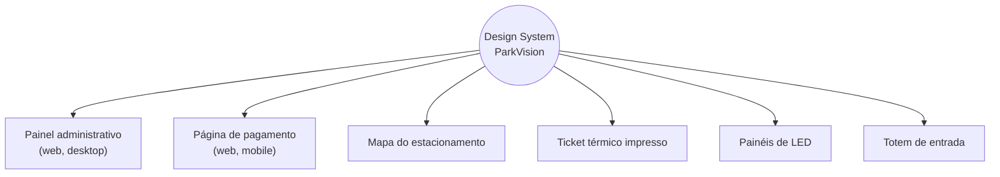

# 06 — Tecnologia Sorteada: Design System

> Prática sorteada para a equipe: **Design System — Planejamento e Design**. A especificação completa (tokens, componentes, estados, regras) está em [04-design-system.md](04-design-system.md). Este documento explica o conceito, a escolha e a aplicação no ParkVision.

## 1. O que é um Design System

Um **Design System** é o conjunto de **decisões de design documentadas e reutilizáveis** — princípios, tokens, componentes, padrões e regras de uso — que serve como **fonte única da verdade** para construir todas as interfaces de um produto.

Ele é mais do que um guia de estilo ou uma biblioteca de componentes:

| Camada | O que contém | No ParkVision |
|---|---|---|
| **Princípios** | Por que as decisões são tomadas | "Cor nunca é o único sinal", "âmbar = caminho", "funciona sem smartphone" |
| **Design tokens** | Decisões atômicas nomeadas (cor, espaço, tipo, sombra…) | 107 primitivos, 68 semânticos × 2 temas, 68 de componente em `tokens.json` |
| **Componentes** | Peças de interface reutilizáveis com variantes e estados | Button, StatusBadge, ParkingSpot, OccupancyMeter, SignagePanel… |
| **Padrões** | Como os componentes se combinam para resolver problemas | Layout de dashboard, fluxo de pagamento em 3 passos, legenda do mapa |
| **Documentação e governança** | Como usar, como mudar, quem decide | Este documento, o 04, a vitrine no protótipo, regras de versionamento |

Analogia direta com o próprio projeto: assim como a **sinalização de trânsito** é padronizada para que qualquer motorista entenda qualquer placa em qualquer cidade, o Design System padroniza a interface para que qualquer tela, painel ou ticket "fale a mesma língua".

## 2. Por que o Design System faz sentido para o ParkVision

O ParkVision não tem *uma* interface — tem **seis pontos de contato** que precisam comunicar a mesma coisa:

| Problema sem Design System | Como o Design System resolve |
|---|---|
| "Vaga livre" verde-claro no dashboard e verde-escuro no mapa; "erro" e "ocupada" confundidos | Um único mapa de estados (`status-*` + ícone + código) usado em todos os lugares |
| Daltônicos não distinguem verde/vermelho no mapa | Regra obrigatória: cor + ícone + rótulo + código + padrão |
| Cada integrante cria seu botão, sua tabela, seu modal | Catálogo de componentes com contrato definido |
| Tema escuro (sala de operação 24 h) exigiria reescrever o CSS | Camada semântica: trocar tema = trocar só os tokens semânticos |
| Painel de LED e ticket "não combinam" com o sistema | `tokens.resolved.json` leva as mesmas decisões ao hardware e à impressão |
| Mudança de cor da marca exige caçar hex em dezenas de arquivos | Mudar o primitivo `vision-600` propaga para tudo |
| Planta real chega depois e muda zonas/vagas | Mapa construído com `ParkingSpot` e `ZoneOverlay` genéricos — a planta muda dados, não componentes |

Além disso, o sorteio **coincide com o maior risco de UX do produto**: um sistema de estacionamento falha se o motorista ou o operador interpreta mal um estado. Padronizar a comunicação visual é requisito funcional aqui, não estética.

## 3. Como será aplicado

### 3.1 No planejamento (esta entrega) — feito

| Entregável | Arquivo |
|---|---|
| Identidade visual (conceito, logo, paleta, tipografia, hierarquia, diretrizes) | [04-design-system.md §1–2](04-design-system.md), [`design-system/brand/`](../design-system/brand/) |
| Tokens em 3 camadas, formato W3C Design Tokens | [`design-system/tokens/tokens.json`](../design-system/tokens/tokens.json) |
| Pipeline de build (JSON → CSS + JSON resolvido) | [`design-system/scripts/build-tokens.mjs`](../design-system/scripts/build-tokens.mjs) |
| Verificação automática de contraste WCAG | [`design-system/scripts/check-contrast.mjs`](../design-system/scripts/check-contrast.mjs) |
| Padronização dos 7 estados visuais | [04-design-system.md §4](04-design-system.md#4-estados-visuais) |
| Catálogo e contratos de componentes | [04 §5](04-design-system.md#5-componentes), [`design-system/components/README.md`](../design-system/components/README.md) |
| Vitrine viva + 6 telas construídas **só com os tokens** | [`prototype/index.html`](../prototype/index.html) |
| Regras de uso, acessibilidade, governança | [04 §6–9](04-design-system.md#6-regras-de-utilização) |

### 3.2 No desenvolvimento (fases seguintes)

1. **Fase 1 — Protótipo React:** implementar os componentes como pacote (`design-system/react/`), cada um com histórias no **Storybook** (variantes × estados) e teste de acessibilidade automático (axe). As telas do protótipo HTML são reconstruídas compondo esses componentes.
2. **Lint de tokens:** stylelint bloqueia cores hex e valores mágicos fora do Design System; revisão de código checa uso de componentes existentes.
3. **Fase 2/3 — Hardware e impressão:** firmware dos painéis e o layout do ticket leem `tokens.resolved.json` (cores, textos de estado, códigos de seta), mantendo a coerência tela ↔ rua.
4. **Integração com a planta:** a planta real vira dados (`posX/posY`, polígonos de zona, grafo) desenhados pelos componentes de domínio, sem criar estilos novos.
5. **Governança contínua:** mudanças via tarefa no Geproj, revisão do papel de UX, SemVer e changelog ([04 §9.3](04-design-system.md#93-governança-e-manutenção)).

## 4. Como contribuirá para o projeto

| Benefício | Efeito concreto no ParkVision |
|---|---|
| **Consistência** | Mesmo estado, mesma aparência no dashboard, mapa, tabela, ticket e painel de LED |
| **Velocidade** | Telas novas montadas com peças prontas; menos decisão repetida, menos retrabalho |
| **Acessibilidade por padrão** | Contraste já validado nos tokens; regra "não só cor" embutida no componente — quem usa o componente herda a acessibilidade |
| **Trabalho em equipe** | Vocabulário comum entre design, front, back (enum `EstadoVaga` = token `status-*`) e documentação |
| **Manutenibilidade** | Mudança visual em um lugar (token) propaga para todo o sistema |
| **Escalabilidade** | Novos pavimentos, tipos de vaga ou estabelecimentos viram variantes, não reescritas |
| **Qualidade da apresentação** | Banca e usuários percebem um produto coeso, não um conjunto de telas |

## 5. Exemplos práticos dentro do ParkVision

**Exemplo 1 — Um estado, cinco lugares.** Uma vaga entra em `ERRO` (sensor offline):

| Onde | Como aparece | Token/regra |
|---|---|---|
| Mapa | Vaga com borda tracejada magenta, letra **E**, ícone de alerta | `status-erro-*`, padrão "tracejado" |
| Dashboard | Card "Saúde dos sensores" incrementa "1 com erro" | `StatusBadge estado="ERRO"` |
| Tabela de sensores | Badge "⚠ Erro de sensor" | mesmo componente |
| Distribuição | Saúde da zona cai; zona pode ficar inelegível com o motivo escrito | `ZoneCard motivoInelegivel` |
| Painel de LED | A vaga deixa de contar como livre (número cai) | regra de negócio + `SignagePanel` |

**Exemplo 2 — Tema escuro para a sala de operação.** `[data-theme="dark"]` redefine só `--pv-bg-*`, `--pv-text-*`, `--pv-status-*-bg/fg`. Nenhum componente muda de código. Contraste validado também no escuro.

**Exemplo 3 — Recomendação legível.** A Tela 3 usa `ScoreBreakdown` + `ZoneCard` + `RouteLine`: o operador vê *por que* a zona foi escolhida, com a mesma linguagem visual do mapa, e a rota aparece em âmbar — o mesmo âmbar das setas físicas que o motorista verá.

**Exemplo 4 — Ticket coerente com a tela.** O ticket impresso usa Barlow para "ZONA Z2 · SETOR B", a mesma seta e o mesmo código curto em Plex Mono mostrados na Tela 4 e na página de pagamento.

**Exemplo 5 — Trocar a marca para outro shopping (multiunidade).** Alterar `primitive.color.vision.*` em `tokens.json` e rodar o build: todas as telas, gráficos e o ticket assumem a nova cor, mantendo estados e contraste (a verificação roda junto).

## 6. Referências

- W3C Design Tokens Community Group — *Design Tokens Format Module*.
- WCAG 2.2 — Web Content Accessibility Guidelines (W3C).
- Atomic Design — Brad Frost (organização de componentes em níveis).
- Exemplos públicos de Design Systems de referência: Material Design (Google), Carbon (IBM), GOV.BR Design System (Governo Federal).
