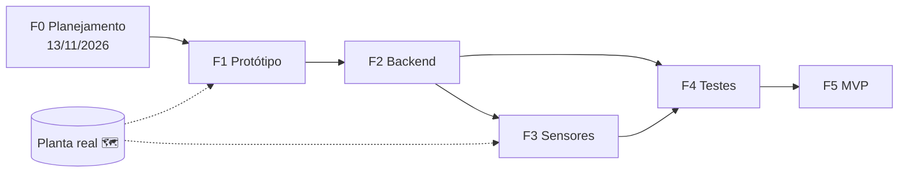
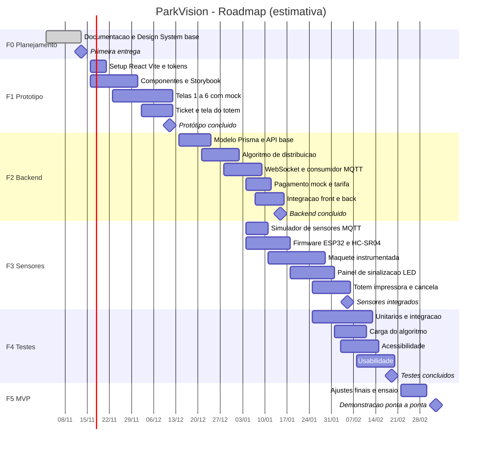

# 07 — Cronograma e Roadmap

> **Projeto:** ParkVision — Estacionamento Inteligente · **Marco zero:** 13/11/2026 (1ª entrega — Planejamento Técnico)
> ⚠️ **Datas a partir da Fase 1 são estimativas — ajustar ao calendário da disciplina.** A semana S1 começa em 16/11/2026; o recesso de fim de ano e os feriados podem deslocar as fases.
> **Planta recebida em 13/11/2026** — tarefas que dependem de dados ainda não presentes nela (contagens, distâncias, grafo definitivo) seguem marcadas com 🗺️ (ver [10-analise-planta.md](10-analise-planta.md)).

---

## Sumário

1. [Visão geral das fases](#1-visão-geral-das-fases)
2. [Detalhamento das fases](#2-detalhamento-das-fases)
3. [Diagrama de Gantt](#3-diagrama-de-gantt)
4. [Riscos e mitigação](#4-riscos-e-mitigação)
5. [Gestão no Geproj (To Host)](#5-gestão-no-geproj-to-host)

---

## 1. Visão geral das fases

| Fase | Nome | Semanas (estimativa) | Período estimado | Resultado principal |
|------|------|----------------------|------------------|---------------------|
| F0 | Primeira entrega — Planejamento técnico | S0 | **13/11/2026** (data fixa) | Documentação técnica, Design System (tokens, marca), especificação de telas |
| F1 | Protótipo | S1–S4 | 16/11 – 11/12/2026 | Front React com Design System + Storybook, dados simulados |
| F2 | Backend | S5–S9 | 14/12/2026 – 15/01/2027 | API NestJS + Prisma + PostgreSQL, WebSocket, algoritmo de distribuição |
| F3 | Integração de sensores | S8–S12 | 04/01 – 05/02/2027 | Simulador MQTT → ESP32 + HC-SR04 em maquete, painel de sinalização |
| F4 | Testes | S11–S14 | 25/01 – 19/02/2027 | Testes unitários, integração, carga, acessibilidade e usabilidade |
| F5 | MVP | S15–S16 | 22/02 – 05/03/2027 | Demonstração ponta a ponta |

> As fases F2/F3 e F3/F4 se sobrepõem de propósito: o simulador MQTT (início da F3) fica pronto antes do fim do backend e os testes começam assim que há partes integradas. Testes unitários acompanham todas as fases desde a F1.

---

## 2. Detalhamento das fases

### F0 — Primeira entrega: Planejamento técnico (13/11/2026)

**Objetivo:** apresentar o planejamento técnico completo e a base do Design System (tecnologia sorteada).

| Entregáveis | Arquivo / pasta |
|-------------|-----------------|
| Visão geral, requisitos, arquitetura | [01-visao-geral.md](01-visao-geral.md), [02-requisitos.md](02-requisitos.md), [03-arquitetura.md](03-arquitetura.md) |
| Design System: tokens (primitive → semantic → component), CSS gerado, validação de contraste, logo | [04-design-system.md](04-design-system.md), `design-system/` |
| Especificação/protótipo das telas | [05-telas.md](05-telas.md), `prototype/` |
| Tecnologia sorteada | [06-tecnologia-sorteada.md](06-tecnologia-sorteada.md) |
| Cronograma e roadmap | este documento |
| Decisões técnicas e algoritmo | [08-decisoes-tecnicas.md](08-decisoes-tecnicas.md), [09-distribuicao-inteligente.md](09-distribuicao-inteligente.md) |
| Procedimento de adaptação à planta | [adaptacao-planta.md](adaptacao-planta.md) |

**Critérios de pronto (DoD):**
- [ ] Todos os documentos acima publicados no repositório, em português, com links funcionando.
- [ ] `node design-system/scripts/check-contrast.mjs` sem falhas (todos os pares ≥ 4.5:1).
- [ ] Zonas/mapas rotulados como "EXEMPLO — será substituída após análise da planta".
- [ ] Projeto, fases e tarefas cadastrados no Geproj.

### F1 — Protótipo (S1–S4)

**Objetivo:** validar a interface e o Design System com dados simulados, antes do backend.

| Entregáveis |
|-------------|
| Projeto React 19 + TypeScript + Vite com React Router (rotas `/` painel e `/t/:token` página mobile). |
| Pacote de componentes do Design System consumindo os tokens `--pv-*` (CSS Modules): botões, badges de estado de vaga, cards de zona, tabela, alertas, navegação lateral, skeleton. |
| Storybook 9 com todas as variações de estado (6 estados de vaga + Carregamento; faixas Normal/Alta/Lotada; tema claro/escuro). |
| Telas 1–6 navegáveis com *mock* de dados (ver [05-telas.md](05-telas.md)); mapa rotulado como EXEMPLO 🗺️. |
| Layout do ticket impresso (80 mm) e da tela do totem. |

**Critérios de pronto:**
- [ ] Todas as telas consomem apenas tokens (nenhuma cor "solta" no CSS).
- [ ] Storybook publicado/executável com documentação de uso e acessibilidade de cada componente.
- [ ] Checagem automática de acessibilidade (addon a11y do Storybook) sem violações críticas.
- [ ] Revisão de usabilidade interna (time) registrada.

### F2 — Backend (S5–S9)

**Objetivo:** implementar o núcleo do sistema e conectar o protótipo a dados reais do backend.

| Entregáveis |
|-------------|
| API NestJS (Node.js 24 LTS) com módulos de estrutura, vagas/ocupação, entradas/tickets, distribuição, pagamentos, auth (RBAC), auditoria. |
| Esquema Prisma + PostgreSQL 16 (hierarquia Estabelecimento → Pavimento → Zona → Setor → Vaga, grafo de circulação, tickets, pagamentos, snapshots). |
| Gateway WebSocket (Socket.IO) com eventos de ocupação, vaga, sensores e alertas. |
| Algoritmo de distribuição (`Score(z)`, elegibilidade, LivresEfetivas) com testes unitários. |
| `PaymentProvider` + `MockProvider`; cálculo de tarifa configurável. |
| Consumidor MQTT (assinatura dos tópicos oficiais), testado com publicações manuais. |
| Docker Compose (postgres, mosquitto, backend, frontend). |

**Critérios de pronto:**
- [ ] Fluxo entrada → recomendação → ticket → pagamento simulado → saída funcionando via API (ocupação alimentada por publicações MQTT de teste).
- [ ] Telas 1–6 consumindo API/WebSocket em vez de *mock*.
- [ ] Cobertura ≥ 80% no algoritmo de distribuição e no cálculo de tarifa.
- [ ] `docker compose up` sobe o ambiente completo em máquina limpa.

### F3 — Integração de sensores (S8–S12)

**Objetivo:** substituir parte do simulador por hardware real em maquete.

| Entregáveis |
|-------------|
| **Simulador de sensores** em Node (`simulator/`) publicando nos tópicos oficiais (entradas, saídas, falhas) — primeiro passo da fase. |
| Firmware ESP32 (HC-SR04): leitura a cada 1 s, debounce 3 s, publicação MQTT QoS 1, heartbeat 30 s, LWT, autenticação no broker. |
| Maquete com uma zona instrumentada (quantidade de vagas a definir pelo orçamento) e demais zonas simuladas. |
| Painel de sinalização (ESP32 + matriz de LED/display) assinando tópico retido `parkvision/{unidade}/painel/{painelId}/display`. |
| Protótipo de totem (navegador em modo quiosque) e impressão em impressora térmica, se disponível; cancela simulada (servo/LED). |
| Cadastro da estrutura real a partir da planta, **se recebida** 🗺️. |

**Critérios de pronto:**
- [ ] Mudança física na maquete aparece no painel admin em ≤ 2 s e no painel de LED.
- [ ] Sensor desligado vira "Erro de sensor" em ≤ 90 s.
- [ ] Painel de LED reiniciado volta a exibir o último estado.

### F4 — Testes (S11–S14)

**Objetivo:** verificar requisitos funcionais e não funcionais ([02-requisitos.md](02-requisitos.md)).

| Tipo de teste | Escopo | Ferramentas sugeridas |
|---------------|--------|-----------------------|
| Unitários | Algoritmo, tarifa, regras de negócio, componentes | Jest/Vitest, Testing Library |
| Integração | API + banco + MQTT + WebSocket | Supertest, Testcontainers/Docker Compose |
| Carga do algoritmo | Entradas simultâneas, milhares de sensores simulados (RNF03, RNF31) | k6 ou script Node + simulador |
| Acessibilidade | WCAG 2.2 AA, teclado, leitor de tela, daltonismo, contraste | axe, Lighthouse, NVDA, script de contraste |
| Usabilidade | Totem, ticket, página mobile, painel (hipóteses H2–H4) | Teste moderado com 5+ participantes de perfis variados |
| Resiliência | Sem internet, provedor de pagamento fora, sensor offline | Cenários manuais roteirizados |

**Critérios de pronto:**
- [ ] Todos os RF *Must* com teste aprovado.
- [ ] RNF01, RNF02, RNF03, RNF06 medidos e registrados.
- [ ] Nenhuma violação WCAG AA crítica pendente.
- [ ] Relatório de usabilidade com ajustes priorizados.

### F5 — MVP (S15–S16)

**Objetivo:** demonstrar a solução ponta a ponta.

| Entregáveis |
|-------------|
| Roteiro de demonstração: veículo (maquete) chega → categoria no totem → recomendação → ticket → painel de LED guia → sensor detecta ocupação → painel admin atualiza → QR Code → pagamento simulado → saída. |
| Demonstração do fluxo **sem smartphone** (ticket + caixa). |
| Ambiente publicado (frontend em Vercel; backend em Render/Railway) ou local via Docker Compose. |
| Documentação atualizada, vídeo curto da demonstração, relatório final de testes. |

**Critérios de pronto:**
- [ ] Demonstração executada do início ao fim sem intervenção no código.
- [ ] Todos os RF *Must* atendidos; pendências registradas como evolução.
- [ ] Documentação e Geproj atualizados.

---

## 3. Diagrama de Gantt

> Estimativa — ajustar ao calendário da disciplina.

---

## 4. Riscos e mitigação

| ID | Risco | Prob. | Impacto | Mitigação | Responsável (papel) |
|----|-------|:-----:|:-------:|-----------|---------------------|
| R01 | **Planta real atrasa ou não é entregue** 🗺️ | Alta | Alto | Modelo de dados genérico (hierarquia + grafo); mapas rotulados como EXEMPLO; procedimento em [adaptacao-planta.md](adaptacao-planta.md); cadastro da estrutura via configuração, sem código. | Arquiteto |
| R02 | Planta revela restrições (mão única, rampas, ausência de energia/rede nos pontos) que afetam sensores e painéis | Média | Alto | Circulação como grafo dirigido; alternativas de sensor (magnetômetro sem fio, câmera por zona); revisão da arquitetura após a planta. | Arquiteto / IoT |
| R03 | Atraso na compra/entrega de hardware (ESP32, sensores, LED, impressora) | Média | Médio | Simulador MQTT cobre 100% do fluxo; compra antecipada em S1; impressora térmica opcional (ticket em PDF/tela como plano B). | IoT |
| R04 | Leituras imprecisas do HC-SR04 (reflexos, ângulo, ruído) | Média | Médio | Debounce 3 s, mediana de leituras, calibração por vaga, limiar configurável; magnetômetro como alternativa de produção. | IoT |
| R05 | Escopo maior que a capacidade do time | Alta | Alto | Priorização MoSCoW; MVP restrito aos RF *Must*; reserva de vaga, CSV e barreira IR como *Should/Could*. | Arquiteto / Documentação |
| R06 | Recesso de fim de ano e indisponibilidade de integrantes | Alta | Médio | Sobreposição planejada de fases; tarefas pequenas e independentes no Geproj; pareamento e documentação contínua. | Todos |
| R07 | Curva de aprendizado (NestJS, Prisma, MQTT, ESP32) | Média | Médio | TypeScript como linguagem única; *spikes* curtos no início de cada fase; exemplos de referência no repositório. | Backend / IoT |
| R08 | Inconsistência visual ou de acessibilidade entre telas | Média | Médio | Design System obrigatório (tokens + Storybook); script de contraste e addon a11y no fluxo de revisão. | UX/UI |
| R09 | Falhas de integração entre front, back e IoT (contratos divergentes) | Média | Alto | Tipos TypeScript compartilhados para MQTT/WebSocket/API; testes de contrato; integração contínua desde F2. | Backend / QA |
| R10 | Exposição de dados pessoais ou credenciais no protótipo | Baixa | Alto | QR com token opaco; placa opcional; segredos em variáveis de ambiente; MQTT autenticado; revisão de segurança na F4. | Backend / QA |
| R11 | Complexidade de pagamento real | Baixa | Médio | Fora do escopo: `MockProvider` atrás de `PaymentProvider`; gateway real como evolução. | Backend |
| R12 | Calendário da disciplina diferente das datas estimadas | Média | Médio | Datas relativas em semanas; replanejamento no Geproj a cada entrega. | Documentação |

---

## 5. Gestão no Geproj (To Host)

**Ferramenta:** [Geproj — To Host](https://geproj.tohost.io) (ferramenta patrocinadora).

> **Uso manual.** Este planejamento **não presume API nem integração automática** entre o Geproj e o repositório. Projeto, fases, tarefas e status são cadastrados e atualizados manualmente pelo time; a ligação com o repositório é feita citando o caminho do arquivo (ou link) no campo de descrição/anexo de cada tarefa. Os nomes exatos de menus e campos devem seguir a interface do Geproj.

### 5.1 Estrutura do projeto

| Elemento no Geproj | Uso no ParkVision |
|--------------------|-------------------|
| **Projeto** | "ParkVision — Estacionamento Inteligente". |
| **Etapas / marcos** | Uma etapa por fase (F0 a F5); um marco no fim de cada fase (datas da seção 1). |
| **Tarefas** | Itens de trabalho de até ~1 semana, cada um com responsável, prazo, fase e entregável. |
| **Quadro de tarefas** | Colunas: **A fazer → Em andamento → Em revisão → Concluído** (+ **Bloqueado**, ex.: aguardando planta 🗺️). |
| **Etiquetas** (se disponíveis) | `docs`, `design-system`, `frontend`, `backend`, `iot`, `testes`, `planta`, IDs de requisito (`RF09`, `RNF24`…). |
| **Cronograma** | Datas de início/fim por tarefa, alinhadas ao Gantt da seção 3. |
| **Anexos / links** | Caminho do arquivo no repositório (ex.: `docs/02-requisitos.md`) ou link do Storybook/demonstração. |

### 5.2 Papéis e responsáveis

**Equipe:** Eliton de Sousa Pereira, Marcos Feliphe Freitas Moraes, Gustavo Araújo Lopes, Arthur Santos Coelho.

São 6 papéis para 4 integrantes, então cada pessoa pode acumular mais de um. A distribuição abaixo será definida pela equipe e registrada também no Geproj.

| Papel | Integrante | Responsabilidades principais |
|-------|------------|------------------------------|
| Arquiteto de Software | A definir | Arquitetura, decisões técnicas, modelo de dados, adaptação à planta, revisão técnica. |
| UX/UI (Design System e Frontend) | A definir | Design System, tokens, componentes, Storybook, telas, acessibilidade visual. |
| Documentação | A definir | Documentos do repositório, requisitos, roadmap, atualização do Geproj, relatórios de entrega. |
| Backend | A definir | API NestJS, Prisma, WebSocket, algoritmo de distribuição, pagamento simulado, auditoria. |
| IoT | A definir | Firmware ESP32, sensores, broker MQTT, simulador, painel de LED, totem e maquete. |
| QA (Qualidade e Testes) | A definir | Plano de testes, testes automatizados, acessibilidade, usabilidade, carga. |

> Um integrante pode acumular papéis. Substituir os placeholders pelos nomes reais ao cadastrar no Geproj.

### 5.3 Rotina de gestão

| Rotina | Frequência | Descrição |
|--------|------------|-----------|
| Atualização do quadro | Contínua | Cada responsável move suas tarefas ao mudar de status. |
| Reunião de acompanhamento | Semanal | Revisão do quadro, impedimentos, replanejamento; registro curto na tarefa "Acompanhamento semanal". |
| Atualização do cronograma | Semanal | Ajustar datas no Geproj e, se necessário, o Gantt deste documento. |
| Revisão de fase | Fim de cada fase | Conferir critérios de pronto da fase (seção 2) e fechar o marco. |

**Definição de pronto (DoD) de uma tarefa:**
1. Entregável no repositório (arquivo/pasta indicado na tarefa) e link registrado no Geproj.
2. Revisado por outro integrante (status "Em revisão" → "Concluído").
3. Para código: build e testes passando; interface usando apenas tokens do Design System.
4. Para documentação: português revisado, links relativos funcionando, pendências da planta sinalizadas.
5. Requisitos atendidos (IDs RF/RNF) citados na tarefa.

### 5.4 Lista inicial de tarefas para cadastrar

| # | Tarefa | Fase | Responsável (papel) | Entregável |
|---|--------|:----:|---------------------|------------|
| 1 | Cadastrar projeto, etapas F0–F5, marcos e papéis no Geproj | F0 | Documentação | Projeto no Geproj |
| 2 | Redigir visão geral do produto | F0 | Documentação | `docs/01-visao-geral.md` |
| 3 | Levantar requisitos (RF, RNF, RN) e matriz de rastreabilidade | F0 | Documentação | `docs/02-requisitos.md` |
| 4 | Definir arquitetura e modelo de dados | F0 | Arquiteto | `docs/03-arquitetura.md` |
| 5 | Criar tokens do Design System e validar contraste | F0 | UX/UI | `design-system/tokens/`, `docs/04-design-system.md` |
| 6 | Criar logo e identidade visual | F0 | UX/UI | `design-system/brand/` |
| 7 | Especificar telas 1–6 e protótipo navegável | F0 | UX/UI | `docs/05-telas.md`, `prototype/` |
| 8 | Documentar a tecnologia sorteada (Design System) | F0 | UX/UI / Documentação | `docs/06-tecnologia-sorteada.md` |
| 9 | Elaborar cronograma, riscos e roadmap | F0 | Documentação | `docs/07-roadmap.md` |
| 10 | Registrar decisões técnicas | F0 | Arquiteto | `docs/08-decisoes-tecnicas.md` |
| 11 | Especificar algoritmo de distribuição | F0 | Arquiteto / Backend | `docs/09-distribuicao-inteligente.md` |
| 12 | Documentar procedimento de adaptação à planta 🗺️ | F0 | Arquiteto | `docs/adaptacao-planta.md` |
| 13 | Solicitar e acompanhar o recebimento da planta real 🗺️ | F0–F1 | Documentação | Planta anexada no Geproj |
| 14 | Configurar projeto React + Vite + TypeScript + Router | F1 | UX/UI | `frontend/` |
| 15 | Implementar componentes base do Design System | F1 | UX/UI | `frontend/src/` (componentes) |
| 16 | Configurar Storybook 9 com addon de acessibilidade | F1 | UX/UI | Storybook |
| 17 | Implementar telas 1–6 com dados simulados | F1 | UX/UI | `frontend/src/features/` |
| 18 | Desenhar layout do ticket 80 mm e tela do totem | F1 | UX/UI | Layout no `prototype/` ou `frontend/` |
| 19 | Comprar/separar hardware (ESP32, HC-SR04, LEDs, impressora) | F1 | IoT | Lista de materiais |
| 20 | Modelar esquema Prisma e migrações | F2 | Backend | `backend/prisma/schema.prisma` |
| 21 | Implementar API de estrutura, entradas, tickets e ocupação | F2 | Backend | `backend/` |
| 22 | Implementar algoritmo de distribuição + testes unitários | F2 | Backend | `backend/` (módulo distribuição) |
| 23 | Implementar gateway WebSocket | F2 | Backend | `backend/` (módulo realtime) |
| 24 | Implementar `PaymentProvider`, `MockProvider` e cálculo de tarifa | F2 | Backend | `backend/` (módulo pagamentos) |
| 25 | Implementar autenticação, RBAC e auditoria | F2 | Backend | `backend/` (módulos auth/auditoria) |
| 26 | Criar simulador de sensores MQTT | F3 | IoT | `simulator/` |
| 27 | Montar Docker Compose do ambiente | F2 | Backend / Arquiteto | `docker-compose.yml` |
| 28 | Integrar frontend com API e WebSocket | F2 | UX/UI / Backend | `frontend/` |
| 29 | Desenvolver firmware ESP32 + HC-SR04 | F3 | IoT | `firmware/` |
| 30 | Construir maquete com zona instrumentada | F3 | IoT | Maquete + fotos |
| 31 | Desenvolver painel de sinalização LED | F3 | IoT | `firmware/` (painel) |
| 32 | Montar protótipo de totem, impressão e cancela | F3 | IoT | Totem/maquete |
| 33 | Cadastrar estrutura real a partir da planta 🗺️ | F3 | Arquiteto | Configuração/seed |
| 34 | Elaborar plano de testes | F4 | QA | `docs/` (plano de testes) |
| 35 | Executar testes de integração e carga | F4 | QA / Backend | Relatório de testes |
| 36 | Executar auditoria de acessibilidade WCAG 2.2 AA | F4 | QA / UX/UI | Relatório de acessibilidade |
| 37 | Conduzir testes de usabilidade | F4 | QA / UX/UI | Relatório de usabilidade |
| 38 | Preparar roteiro e ensaio da demonstração | F5 | Documentação / Todos | Roteiro de demonstração |
| 39 | Publicar ambiente de demonstração | F5 | Backend / Arquiteto | URL da demo |
| 40 | Atualizar documentação final e Geproj | F5 | Documentação | `docs/`, Geproj |

---

**Documentos relacionados:** [01-visao-geral.md](01-visao-geral.md) · [02-requisitos.md](02-requisitos.md) · [03-arquitetura.md](03-arquitetura.md) · [08-decisoes-tecnicas.md](08-decisoes-tecnicas.md)
