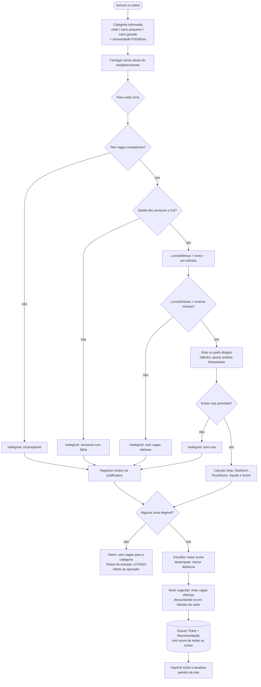

# 09 — Lógica de Distribuição Inteligente

> **Status:** algoritmo v1 proposto na 1ª entrega. As zonas usadas no exemplo (Z1–Z4) são **fictícias e provisórias** — servem apenas para demonstrar o cálculo. Distâncias, rotas e sentidos reais virão da planta do estacionamento 🗺️ ([adaptacao-planta.md](adaptacao-planta.md)).

## 1. Recomendação de zona × reserva de vaga

| | **Recomendação de zona** (v1) | **Reserva de vaga específica** (evolução) |
|---|---|---|
| O que o motorista recebe | "Zona Z2 · Setor B" | "Vaga Z2-B-17" |
| Garante uma vaga? | **Não.** Indica a região com melhor chance e menor esforço | **Sim**, por tempo limitado (TTL de 5 min) |
| Exige sensor por vaga? | Não necessariamente — funciona com contagem por zona | Sim, para confirmar que a vaga reservada foi ocupada |
| Sinalização necessária | Painéis por zona/corredor | Painéis + indicador individual por vaga |
| Risco | Motorista pode não achar vaga se a zona encher no trajeto (mitigado pelo desconto de "veículos em trânsito") | Vagas ficam "presas" se o motorista não for até elas (mitigado pelo TTL) |
| Complexidade | Baixa | Média |

**Decisão:** a v1 entrega **recomendação de zona + setor sugerido**. A estrutura de dados (`ReservaVaga`, estado `RESERVADA`) já está prevista para a evolução sem mudança de modelo.

## 2. Critérios

| # | Critério | Variável | Como é medido | Peso padrão |
|---|---|---|---|---|
| 1 | Compatibilidade veículo × vaga | filtro | Só entram vagas com `VagaCategoria` compatível com a categoria do ticket (e tipo PcD/idoso quando solicitado) | eliminatório |
| 2 | Vagas disponíveis | `Disp(z)` | `LivresEfetivas(z) / TotalCompatível(z)` | **0,40** |
| 3 | Distância até a zona | `DistNorm(z)` | Distância **pela rota permitida** (grafo dirigido, menor caminho) do acesso até a entrada da zona ÷ maior distância entre as zonas do estabelecimento | **0,25** |
| 4 | Fluxo de veículos | `FluxoNorm(z)` | Recomendações emitidas para a zona nos últimos 5 min ÷ capacidade de vazão da zona no mesmo período (limitado a 1) | **0,25** |
| 5 | Situação dos sensores | `Saude(z)` | Sensores online e coerentes ÷ total de sensores da zona | **0,10** (+ eliminatório se < 0,6) |

Os pesos ficam em **Configurações → Distribuição** e podem ser recalibrados com dados reais.

### Definições

```
LivresEfetivas(z) = LivresCompatíveis(z) − EmTrânsito(z)
EmTrânsito(z)     = recomendações para z ainda não convertidas em ocupação e não expiradas (expira em 10 min)
```

O desconto de **veículos em trânsito** é o mecanismo que evita direcionar muitos carros, ao mesmo tempo, para uma zona que só comporta poucos.

## 3. Fórmula

```
Score(z) = 0,40 · Disp(z)
         + 0,25 · (1 − DistNorm(z))
         + 0,25 · (1 − FluxoNorm(z))
         + 0,10 · Saude(z)
```

- Cada termo está normalizado em [0, 1] → `Score ∈ [0, 1]`; maior é melhor. Casos de borda: `FluxoNorm` é limitado a 1 quando as entradas superam a vazão; `DistNorm = 0` quando há uma só zona (maior distância = 0); `Disp` nunca divide por zero porque zonas sem vagas compatíveis já são inelegíveis.
- **Elegibilidade** (antes do score): `TotalCompatível > 0`, `LivresEfetivas > ReservaMínima` (padrão 0, configurável por zona) e `Saude ≥ 0,6`.
- **Desempate:** menor distância; persistindo, menor `FluxoNorm`.
- **Sem zona elegível:** totem informa "Sem vagas para esta categoria no momento", painel da entrada exibe `LOTADO` para a categoria, operador é alertado. Nenhum ticket com recomendação inválida é emitido.

## 4. Algoritmo



Fonte: [diagrams/03-distribuicao-inteligente.md](diagrams/03-distribuicao-inteligente.md).

### Pseudocódigo (TypeScript)

```ts
type Pesos = { disp: number; dist: number; fluxo: number; saude: number }; // soma = 1
const PESOS_PADRAO: Pesos = { disp: 0.40, dist: 0.25, fluxo: 0.25, saude: 0.10 };

function recomendarZona(entrada: Entrada, zonas: ZonaEstado[], grafo: Grafo, p = PESOS_PADRAO): Resultado {
  const distMax = Math.max(...zonas.map(z => grafo.menorCaminho(entrada.acessoNoId, z.noEntradaId)?.distancia ?? 0));
  const avaliacoes = zonas.map(z => {
    const total = z.totalCompativel(entrada.categoria, entrada.tipoVaga);
    if (total === 0) return inelegivel(z, 'Sem vagas compatíveis com a categoria');
    const saude = z.sensoresOk / Math.max(z.sensoresTotal, 1);
    if (saude < 0.6) return inelegivel(z, `Saúde dos sensores ${pct(saude)} (< 60%)`);
    const efetivas = z.livresCompativeis(entrada.categoria, entrada.tipoVaga) - z.emTransito;
    if (efetivas <= z.reservaMinima) return inelegivel(z, 'Sem vagas efetivas (considerando veículos em trânsito)');
    const rota = grafo.menorCaminho(entrada.acessoNoId, z.noEntradaId); // respeita sentido e bloqueios
    if (!rota) return inelegivel(z, 'Sem rota permitida a partir deste acesso');

    const disp = efetivas / total;
    const distNorm = distMax > 0 ? rota.distancia / distMax : 0; // zona única ou distâncias zeradas
    const fluxoNorm = Math.min(z.recomendacoesUltimos5min / (z.capacidadeVazaoPorMin * 5), 1);
    const score = p.disp * disp + p.dist * (1 - distNorm) + p.fluxo * (1 - fluxoNorm) + p.saude * saude;
    return { zona: z, elegivel: true, score, criterios: { disp, distNorm, fluxoNorm, saude }, rota };
  });

  const elegiveis = avaliacoes.filter(a => a.elegivel)
    .sort((a, b) => b.score - a.score || a.rota.distancia - b.rota.distancia);
  if (elegiveis.length === 0) return { tipo: 'SEM_VAGAS', avaliacoes };
  const escolhida = elegiveis[0];
  return { tipo: 'RECOMENDADA', zona: escolhida.zona, setor: escolhida.zona.setorComMaisVagas(entrada), avaliacoes };
}
```

**Leitura e cálculo** usam o estado já mantido em memória pelo módulo `ocupacao` (contadores por zona). A **gravação** acontece numa transação curta que bloqueia as linhas das zonas candidatas, reconta as recomendações em trânsito e só então grava ticket + recomendação (seção 6); se a recontagem mudar a elegibilidade da zona escolhida, o cálculo é refeito. Meta: ≤ 500 ms incluindo a gravação.

**Setor sugerido:** dentro da zona escolhida, o setor com mais vagas compatíveis livres **descontando as recomendações em trânsito daquele setor** (`Recomendacao.setorSugeridoId`), para não mandar todos os carros ao mesmo corredor.

## 5. Exemplo numérico (dados fictícios)

Veículo: **carro pequeno**, entrando pelo acesso principal. Distância máxima entre zonas (pela rota): 140 m.

| Zona (exemplo) | Total compat. | Livres | Em trânsito | Efetivas | Rota (m) | Recom. 5 min / capacidade | Saúde |
|---|---|---|---|---|---|---|---|
| Z1 | 120 | 30 | 6 | 24 | 40 | 5 / 30 | 98% |
| Z2 | 160 | 70 | 4 | 66 | 95 | 3 / 40 | 100% |
| Z3 | 100 | 7 | 7 | 0 | 60 | 9 / 30 | 95% |
| Z4 | 80 | 40 | 0 | 40 | 140 | 0 / 30 | **50%** |

| Zona | Disp | 1 − DistNorm | 1 − FluxoNorm | Saúde | **Score** | Resultado |
|---|---|---|---|---|---|---|
| Z1 | 0,200 | 0,714 | 0,833 | 0,98 | 0,40·0,200 + 0,25·0,714 + 0,25·0,833 + 0,10·0,98 = **0,565** | 2º |
| Z2 | 0,413 | 0,321 | 0,925 | 1,00 | 0,165 + 0,080 + 0,231 + 0,100 = **0,577** | ✅ **Recomendada** |
| Z3 | — | — | — | — | — | ❌ Inelegível: 0 vagas efetivas (as 7 livres já têm veículos a caminho) |
| Z4 | — | — | — | — | — | ❌ Inelegível: saúde dos sensores 50% |

**Leitura:** Z1 é mais próxima, mas já está com pouca folga e recebendo mais carros; Z2 fica mais longe porém tem o dobro de disponibilidade e fluxo baixo. O sistema prefere Z2 — distribuindo a ocupação e evitando fila em Z1. Essa justificativa é exatamente o que a **Tela 3 — Distribuição inteligente** exibe.

## 6. Evitando direcionamento simultâneo para a mesma vaga

1. **Nível zona (v1):** cada recomendação incrementa `EmTrânsito(z)` imediatamente, dentro da mesma transação que cria o ticket. A próxima entrada (mesmo um segundo depois) já vê a zona com uma vaga efetiva a menos. Recomendações expiram em 10 min se o sensor nunca confirmar ocupação.
2. **Serialização por acesso:** cada totem processa uma entrada por vez; entre totens diferentes, a decisão é tomada em transação no PostgreSQL que bloqueia as linhas das zonas candidatas (`SELECT … FROM zona WHERE … FOR UPDATE`) antes de contar as recomendações em trânsito e gravar a nova — duas entradas simultâneas são serializadas e a segunda já enxerga a primeira.
3. **Nível vaga (evolução):** reserva por `UPDATE … WHERE estado = 'LIVRE' … FOR UPDATE SKIP LOCKED RETURNING id` ([03-arquitetura.md §6.3](03-arquitetura.md#63-concorrência)). Duas requisições simultâneas nunca recebem a mesma vaga: a segunda pula a linha bloqueada e pega a próxima.
4. **Conversão:** quando um sensor da zona recomendada muda para `OCUPADA` dentro da janela, a recomendação mais antiga em trânsito da mesma categoria é marcada como convertida (correlação aproximada na v1; exata quando houver reserva por vaga).
5. **Expiração:** job periódico (30 s) expira recomendações e reservas vencidas e devolve vagas reservadas para `LIVRE`.

## 7. Rotas e circulação 🗺️

- A circulação é um **grafo dirigido**: nós (acessos, bifurcações, rampas, entradas de zona, pontos de painel) e arestas com **sentido**, distância e possível bloqueio. Mão dupla = duas arestas.
- A rota sugerida é o menor caminho permitido (Dijkstra) do acesso de entrada até o nó de entrada da zona. Arestas bloqueadas (obra, evento) são ignoradas automaticamente.
- Os painéis nos nós da rota recebem a seta correspondente à próxima aresta.
- **Pendência:** o grafo só pode ser montado com a planta real — entradas, saídas, sentidos, rampas e restrições (altura, motos) precisam ser identificados nela. Nada disso foi inventado nesta entrega.

## 8. Parâmetros configuráveis

| Parâmetro | Padrão | Onde ajustar |
|---|---|---|
| Pesos (disp, dist, fluxo, saúde) | 0,40 / 0,25 / 0,25 / 0,10 | Configurações → Distribuição |
| Saúde mínima da zona | 60% | Configurações → Sensores |
| Reserva mínima por zona | 0 vaga (folga opcional, ex.: 2 vagas para operação) | Configurações → Zonas |
| Janela de fluxo | 5 min | Configurações → Distribuição |
| Expiração de recomendação em trânsito | 10 min | Configurações → Distribuição |
| TTL de reserva de vaga (evolução) | 5 min | Configurações → Distribuição |
| Capacidade de vazão da zona | 6 veículos/min | Configurações → Zonas (por zona, a partir da planta) |

## 9. Como validar (fase de testes)

- **Testes unitários** da função de score com cenários tabelados (como o da seção 5).
- **Simulação:** o simulador MQTT gera chegadas (ex.: pico de 1 carro a cada 10 s) e mede: desvio de ocupação entre zonas, nº de motoristas enviados a zona sem vaga efetiva, tempo de resposta.
- **Comparação** com estratégia ingênua ("zona mais próxima com vaga") para mostrar ganho de distribuição.
