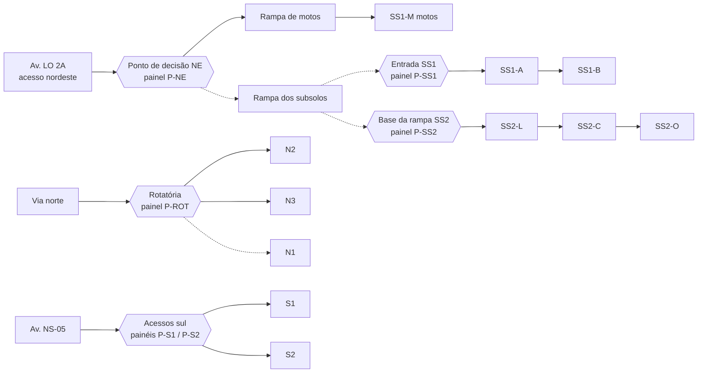

# 10 — Análise da Planta e Proposta de Zonas

> **Planta recebida em 13/11/2026.** Este documento registra o que foi identificado na planta, a proposta inicial de zonas e setores, os pontos estratégicos para sensores e sinalização e o que **não** pode ser extraído do arquivo. Nenhuma dimensão, quantidade ou estrutura foi inventada: o que não está legível na planta aparece como pendência.
>
> Visualização: [`prototype/index.html#mapa`](../prototype/index.html) → painel **Planta real: proposta de zonas**.

## 1. Documento analisado

| Item | Conteúdo |
|---|---|
| Arquivo | [`docs/planta/2026_11_CDS_MIX.pdf`](planta/2026_11_CDS_MIX.pdf) (3 folhas) — imagens em [`docs/planta/`](planta/) |
| Estabelecimento | Capim Dourado Shopping (Palmas–TO) |
| Título / autoria | Planta Mix — Operações, Capim Dourado Shopping |
| Data | Novembro/2026 |
| Área informada | 38.800,50 m² |
| Folha 1/1 | Implantação geral + recortes do **Subsolo 1**, **Subsolo 2** e Planta Baixa L2 (esc. 1/500) |
| Folha 1/2 | **1º pavimento — Térreo** (lojas e pátios descobertos de estacionamento) |
| Folha 2/2 | **2º pavimento — Praça de alimentação** (sem estacionamento) |

**Natureza do documento:** é uma planta comercial de *mix* de lojas, não um projeto executivo de estacionamento. Por isso traz a disposição das vagas e o sentido de circulação, mas não traz cotas dos subsolos, escala da implantação geral nem infraestrutura elétrica/rede.

## 2. Estrutura identificada

### 2.1 Pavimentos com estacionamento

| Pavimento | O que a planta mostra | Vagas (texto da planta) |
|---|---|---|
| **Térreo — pátio norte** (descoberto) | Fileiras de vagas em leque entre a fachada da C&A, a rotatória da via norte e o bloco Big / Wow Park / Morofit. Corredores com setas de sentido. Vagas de **idoso** e **PNE** junto ao acesso da C&A. | Quantidade **não escrita** |
| **Térreo — pátio sul** (descoberto) | Bolsões de vagas dos dois lados do retorno de embarque/desembarque em frente à entrada principal (Alameda das Cores), com acesso pela Av. NS-05. Vagas de **idoso** próximas à Marisa. | Quantidade **não escrita** |
| **Subsolo 1** (coberto) | Quatro ilhas de vagas com **corredores de mão única alternados**, faixa de vagas no lado leste em "L", **estacionamento de motos** com **rampa de motos (desce)**, **bicicletário** com entrada própria, escadas rolantes/elevadores para o shopping e loja (Maria Express). | **140 vagas** — 3 PNE · 11 idoso · 2 neurodiverso · 4 gestante e criança |
| **Subsolo 2** (coberto) | Pavimento retangular com **circulação em anel** (sentido anti-horário pelas setas), três blocos de ilhas centrais, vagas no perímetro, sinalização **PARE** nas junções, **rampa de acesso de mão dupla** no lado leste e núcleos de escada/elevador. | **216 vagas** — 5 PNE · 8 idoso · 1 neurodiverso · 4 gestante e criança |

Total confirmado pela planta: **356 vagas cobertas** (Subsolos 1 e 2). Pátios descobertos e motos: a contar.

### 2.2 Vias e acessos

| Elemento | Localização na planta | Uso no ParkVision |
|---|---|---|
| Av. JK | Lado oeste | Referência; acesso veicular não identificado com clareza neste lado |
| Av. NS-05 | Lado sul | Dois acessos curvos ao retorno de embarque e ao **pátio sul** |
| Av. LO 2A | Lado leste | Canto nordeste: **"Acesso motos"**, **"Acesso pedestres/ciclistas"** e faixas de entrada/saída com setas — interpretado como o acesso aos **subsolos** (a rampa do Subsolo 2 sobe nesse sentido) |
| Via norte (nome não legível) | Diagonal ao norte, com **rotatória** | Acesso ao **pátio norte** |
| Acessos de pedestres ao shopping | Entrada principal (sul), entrada da C&A (norte), escadas rolantes "sobe/desce" e "acesso galeria subterrânea" (ligação com o subsolo) | Pontos de destino a pé — critério de proximidade para vagas especiais |

### 2.3 Circulação

- **Subsolo 1:** corredores de mão única que se alternam (sobe/desce), percorridos em serpentina a partir da entrada no canto noroeste do recorte.
- **Subsolo 2:** anel contínuo no sentido anti-horário; a rampa no lado leste conecta o pavimento ao nível superior.
- **Pátio norte:** corredores com setas a partir da via perimetral e da rotatória.
- **Pátio sul:** retorno de embarque/desembarque com dois ramos ligados à Av. NS-05.
- **Motos:** fluxo separado (acesso e rampa próprios).

## 3. Proposta de zonas

**Critérios usados:** (1) respeitar barreiras físicas (pavimento, coberto/descoberto, ilhas e corredores); (2) uma zona deve ser alcançável por um único trecho de circulação, para que a seta do painel faça sentido; (3) nome curto, legível em painel de LED e no ticket; (4) não subdividir onde a planta não dá informação suficiente.

**Nomenclatura:** `N` = pátio norte · `S` = pátio sul · `SS1` / `SS2` = subsolos. Nos subsolos, a letra indica a posição (O = oeste, C = centro, L = leste) ou o uso (M = motos). **Setor** = ilha ou fileira dentro da zona, identificado por letra após o levantamento no local.

| Zona | Pavimento | Referência física | Vagas | Vagas especiais | Justificativa |
|---|---|---|---|---|---|
| **N1** | Térreo, pátio norte | Fileiras a oeste da C&A (lado Polo Wear) | a contar | idoso/PNE próximas à C&A (a confirmar quais) | Bloco de fileiras com acesso pela via perimetral oeste |
| **N2** | Térreo, pátio norte | Fileiras curtas acima da C&A, até a rotatória | a contar | idoso junto à entrada da C&A | Mais próximas da entrada norte; acesso direto pela rotatória |
| **N3** | Térreo, pátio norte | Fileiras longas entre a rotatória e o bloco Big/Wow Park | a contar | — | Maior bloco do pátio; corredores com sentido próprio |
| **S1** | Térreo, pátio sul | Bolsões a oeste do retorno (frente Renner/Centauro) | a contar | — | Separado de S2 pelo retorno de embarque |
| **S2** | Térreo, pátio sul | Bolsões a leste do retorno (frente Madero/Marisa) | a contar | idoso próximas à Marisa | Separado de S1 pelo retorno de embarque |
| **SS1-A** | Subsolo 1 | Quatro ilhas com corredores de mão única | parte das 140 | PNE, idoso, neurodiverso e gestante estão neste bloco | Ilhas percorridas em sequência pela serpentina |
| **SS1-B** | Subsolo 1 | Faixa leste em "L" | parte das 140 | — | Trecho de circulação próprio (subida pelo lado leste) |
| **SS1-M** | Subsolo 1 | Estacionamento de motos | a contar | — | Exclusivo para motos, com rampa e acesso próprios |
| **SS2-O** | Subsolo 2 | Bloco oeste do anel | parte das 216 | PNE e idoso no bloco | Último trecho do anel a partir da rampa |
| **SS2-C** | Subsolo 2 | Bloco central do anel | parte das 216 | PNE, idoso, neurodiverso, gestante | Concentra vagas especiais, próximo ao núcleo de elevadores |
| **SS2-L** | Subsolo 2 | Bloco leste, junto à rampa | parte das 216 | — | Primeiro bloco ao descer a rampa |

> A divisão exata das 140 e das 216 vagas entre as zonas de cada subsolo será feita contando as vagas desenhadas zona a zona (tarefa da Fase 1). O total por subsolo é o que a planta informa.

### 3.1 Efeito na distribuição inteligente

- **Motos** → somente `SS1-M` (categoria incompatível com as demais zonas).
- **Carros** → `N1–N3`, `S1–S2`, `SS1-A/B`, `SS2-O/C/L`, conforme o score ([09](09-distribuicao-inteligente.md)).
- **Vagas especiais** (PNE, idoso, gestante e criança, neurodiverso): quando o motorista indicar a necessidade no totem, só entram zonas que possuem esse tipo de vaga livre, priorizando as mais próximas de elevadores/escadas.
- **Distância** passa a ser medida pela rota real do grafo (seção 4). Como a planta não tem escala geral nem cotas dos subsolos, as distâncias serão medidas no local ou a partir do projeto executivo.
- **Parâmetro sugerido (a validar):** preferência configurável por vagas **cobertas** (subsolos), relevante no clima de Palmas. Entraria como critério opcional no score; não está na fórmula da v1.

## 4. Grafo de circulação (rascunho)

Linhas tracejadas = ligações que a planta sugere mas não mostra com clareza.

O grafo definitivo (nós, arestas com sentido e distâncias) será cadastrado nas tabelas `NoCirculacao` / `ArestaCirculacao` ([schema.prisma](../backend/prisma/schema.prisma)) após a confirmação das ligações.

## 5. Pontos estratégicos para sensores e sinalização

| Ponto | Local (planta) | Equipamento proposto | Função |
|---|---|---|---|
| **P-NE** | Acesso nordeste (Av. LO 2A), antes da divisão motos/subsolos/pátio | Painel de LED com zonas + setas; totem de entrada se houver cancela neste acesso | Primeira decisão do motorista |
| **P-ROT** | Rotatória da via norte | Painel com N1/N2/N3 e vagas livres | Direcionar dentro do pátio norte |
| **P-S1 / P-S2** | Acessos curvos pela Av. NS-05 | Painéis com S1/S2 | Direcionar no pátio sul e evitar retorno de embarque congestionado |
| **P-SS1** | Entrada do Subsolo 1 | Painel por corredor (cabeceira) | Indicar o corredor com vaga na serpentina |
| **P-SS2** | Base da rampa do Subsolo 2 (junção com "PARE") | Painel com SS2-L/C/O | Decisão no anel |
| Cabeceiras de corredor | Subsolos e pátio norte | Painéis pequenos (contagem do corredor) | Evitar entrar em corredor cheio |
| **Sensores — subsolos** | Cada vaga das 356 vagas cobertas | Ultrassônico de teto com LED indicador | Ambiente coberto favorece sensor de teto; LED ajuda a achar a vaga |
| **Sensores — pátios descobertos** | Vagas de N1–N3 e S1–S2 | Magnetômetro de piso **ou** contagem de entrada/saída por zona | Sol e chuva diretos; contagem por zona é alternativa de menor custo para a v1 |
| **Motos** | SS1-M | Contagem na rampa de motos | Vagas pequenas; contagem por zona é suficiente |
| Rede | Subsolos | Cabeamento por corredor ou LoRaWAN | Wi-Fi tende a ser fraco em subsolo (confirmar com a operação) |

## 6. Limitações da planta (não inventar)

| Informação | Situação |
|---|---|
| Escala da implantação geral | ❌ Não informada (só a Planta Baixa L2 tem escala 1/500) |
| Cotas e dimensões dos subsolos | ❌ Não informadas |
| Quantidade de vagas dos pátios norte e sul | ❌ Não escrita — contar no desenho ou no local |
| Quantidade de vagas de motos | ❌ Não escrita |
| Ligação entre Subsolo 1, Subsolo 2 e o térreo (posição exata das rampas de carros) | ⚠️ Parcial — rampa leste do SS2 visível; ligação com SS1 não legível |
| Posição de cancelas e totens | ⚠️ Símbolos próximos aos acessos sul e nordeste sugerem controle de acesso; confirmar |
| Nome da via norte | ❌ Não legível |
| Infraestrutura elétrica e de rede | ❌ Fora do escopo da planta |
| Sentido de circulação nos pátios descobertos | ⚠️ Setas presentes mas pequenas; confirmar no local |

## 7. Próximos passos

1. Validar a proposta de zonas e a nomenclatura com a operação do shopping.
2. Contar as vagas dos pátios descobertos e de motos (desenho + visita).
3. Confirmar acessos, cancelas, rampas e sentidos; fechar o grafo de circulação.
4. Medir distâncias das rotas (ou obter o projeto executivo com escala).
5. Cadastrar estrutura real no seed do banco e trocar a simulação Z1–Z4 do protótipo pelas zonas reais.
