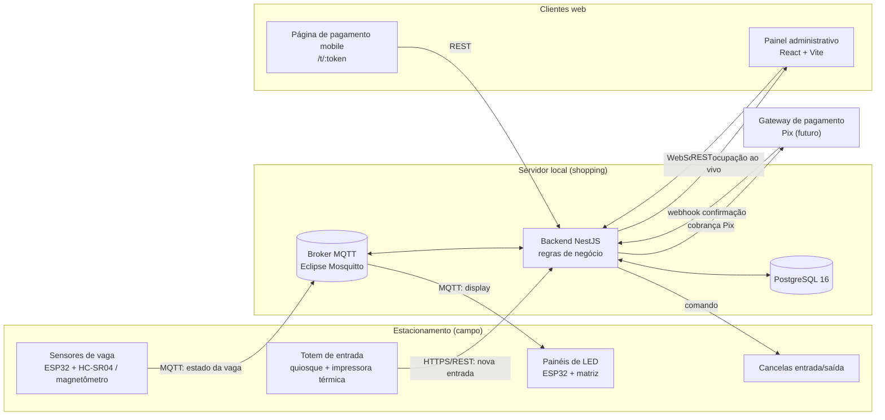

# Diagrama de arquitetura geral

Visão dos componentes de campo, servidor local, clientes web e gateway.

> Usado em [03-arquitetura.md](../03-arquitetura.md). Diagramas de localização/circulação serão atualizados após a análise da planta real.

