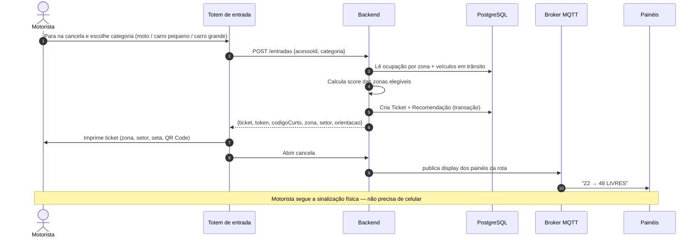

# Fluxo de entrada do veículo

Do totem à sinalização, sem exigir smartphone.

> Usado em [03-arquitetura.md](../03-arquitetura.md). Diagramas de localização/circulação serão atualizados após a análise da planta real.

