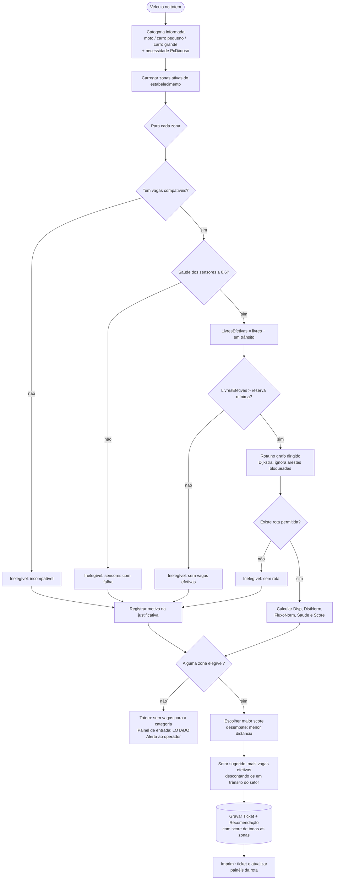

# Distribuição inteligente

Elegibilidade, score e escolha da zona (v1: recomendação de zona).

> Usado em [09-distribuicao-inteligente.md](../09-distribuicao-inteligente.md). Diagramas de localização/circulação serão atualizados após a análise da planta real.

