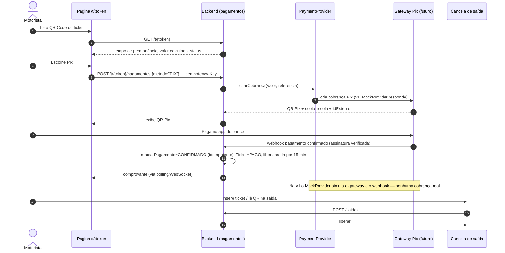

# Pagamento por QR Code

QR com token opaco → página mobile → Pix via PaymentProvider (mock nesta fase) → liberação da saída.

> Usado em [03-arquitetura.md](../03-arquitetura.md). Diagramas de localização/circulação serão atualizados após a análise da planta real.

