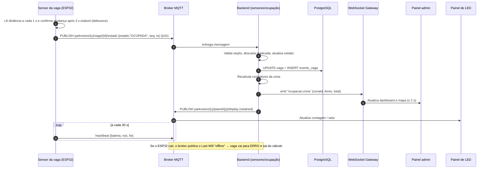

# Comunicação sensores ↔ backend ↔ painel

MQTT (dispositivos) e WebSocket (telas), com debounce, heartbeat e Last Will.

> Usado em [03-arquitetura.md](../03-arquitetura.md). Diagramas de localização/circulação serão atualizados após a análise da planta real.

