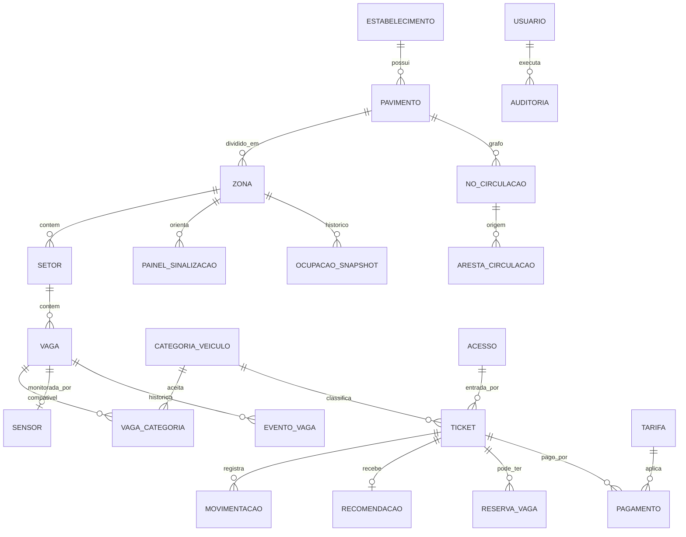

# Modelo de dados (conceitual)

Entidades principais. Esquema físico: backend/prisma/schema.prisma.

> Usado em [03-arquitetura.md](../03-arquitetura.md). Diagramas de localização/circulação serão atualizados após a análise da planta real.

