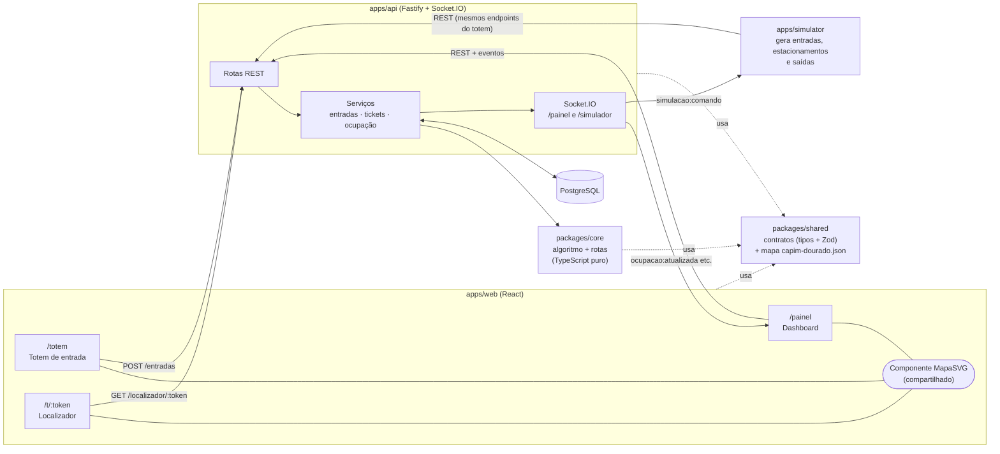
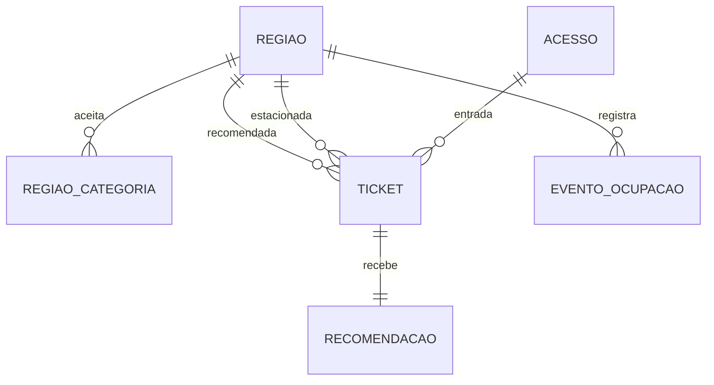

# MVP 01 — Arquitetura proposta

> Etapa 0 · proposta para validação da equipe. Nada aqui foi implementado ainda.

## 1. O que muda em relação ao planejamento da 1ª entrega

O novo enunciado redefine o escopo do MVP. A tabela registra cada mudança e o motivo, para a equipe aprovar antes de os documentos 03, 08 e 09 serem atualizados.

| Tema | 1ª entrega (planejamento) | MVP (proposta) | Motivo |
|---|---|---|---|
| Interfaces | 6 telas + pagamento | **3 interfaces:** totem, dashboard, localizador | Enunciado do MVP |
| Backend | NestJS (planejado, não implementado) | **Fastify** | Enunciado sugere Express/Fastify; Fastify é mais simples que NestJS para um MVP e tem validação por schema embutida. Nada de NestJS chegou a ser escrito |
| ORM | Prisma (esquema de planejamento) | **Prisma**, com esquema novo e menor | Tecnologia já escolhida; o esquema antigo modela itens fora do MVP (pagamento, reserva, sensores) |
| Estilo | CSS Modules + tokens | **Tailwind CSS ligado aos tokens `--pv-*`** | Enunciado pede Tailwind; o Design System continua sendo a fonte das cores, espaços e fontes |
| Sensores | MQTT + ESP32 | **Simulador** (processo próprio) | Sem hardware no MVP |
| Algoritmo | 4 critérios (40/25/25/10) + recomendações em trânsito | **3 critérios (50/30/20)**; saúde da região vira filtro de elegibilidade | Enunciado do MVP |
| Reserva de vaga | Prevista como evolução | **Proibida** no MVP | Enunciado do MVP |
| Pagamento | Pix simulado | **Fora do escopo** | Enunciado do MVP |
| Unidade de distribuição | Zona / setor | **Região** (sem setores no MVP) | Enunciado do MVP |

## 2. Stack

| Área | Tecnologia | Observação |
|---|---|---|
| Linguagem | TypeScript em todo o projeto | Tipos compartilhados entre web, api e simulador |
| Monorepo | pnpm workspaces | pnpm 10 já está instalado |
| Front-end | React 19 + Vite + React Router | Uma única app web com 3 rotas |
| Estilo | Tailwind CSS 4, com `@theme` apontando para `var(--pv-*)` | Reaproveita `design-system/tokens/build/tokens.css` |
| Mapa | Componente React em **SVG** lendo o JSON do mapa | Permite destacar e colorir cada região, desenhar rotas e atualizar só o que mudou |
| QR Code | `qrcode` (gera SVG/PNG no servidor ou no cliente) | |
| API | Node.js 24 + **Fastify 5** | Validação de entrada e saída com Zod |
| Tempo real | **Socket.IO 4** | Namespaces separados para painel e simulador |
| Banco | **PostgreSQL 16** em Docker | Docker está instalado, mas o serviço estava parado no diagnóstico |
| ORM | Prisma 6 | Versão já usada para validar o esquema na 1ª entrega |
| Testes | **Vitest** (unidade e integração) + **Playwright** (ponta a ponta) | |
| Versionamento | Git + GitHub (`gh` já autenticado) | Commits só com autorização da equipe |

**Plano B para a apresentação:** se o Docker falhar no dia, a API pode subir com **PGlite** (PostgreSQL em processo, sem servidor), mantendo o mesmo Prisma. Fica documentado e testado na Etapa 6.

## 3. Visão geral



**Decisões principais**

1. **O algoritmo fica num pacote isolado (`packages/core`)**, sem banco e sem HTTP: recebe o estado das regiões e o grafo e devolve a recomendação com a justificativa. Isso permite testá-lo à exaustão com Vitest e mostrar os cenários na apresentação.
2. **O mapa é dado, não código.** Um único arquivo `capim-dourado.json` (rascunho em [`mapa/capim-dourado.rascunho.json`](mapa/capim-dourado.rascunho.json)) contém regiões, polígonos, acessos e o grafo de vias. O front desenha a partir dele e o back calcula distâncias a partir dele. Assim o mapa da tela e a distância usada no algoritmo nunca divergem.
3. **O simulador usa os mesmos endpoints do totem.** Ele é um cliente como qualquer outro. Quando houver sensores reais, eles substituem o simulador sem mexer na API.
4. **Sem reserva:** a recomendação não altera a ocupação. A ocupação muda apenas na confirmação de estacionamento e na saída.

## 4. Organização de pastas

```
parkvision/
├── apps/
│   ├── api/                    # Fastify + Socket.IO + Prisma
│   │   ├── prisma/schema.prisma   # esquema do MVP (substitui backend/prisma)
│   │   └── src/
│   │       ├── rotas/          # regioes, entradas, tickets, localizador, indicadores, simulacao
│   │       ├── servicos/       # regras de aplicação (chamam packages/core)
│   │       ├── tempo-real/     # Socket.IO
│   │       └── seed/           # regiões do Capim Dourado + dados simulados
│   ├── web/                    # React + Vite + Tailwind
│   │   └── src/
│   │       ├── paginas/        # Totem, Painel, Localizador
│   │       ├── componentes/    # MapaSVG, CardRegiao, Indicador, Ticket...
│   │       └── estilos/        # tailwind + tokens.css
│   └── simulator/              # CLI Node: cenários de entrada/saída
├── packages/
│   ├── core/                   # algoritmo de distribuição, rotas (Dijkstra), justificativas + testes
│   └── shared/                 # contratos (tipos + Zod) e dados do mapa
├── design-system/              # (existente) tokens, marca, contratos de componentes
├── prototype/                  # (existente) protótipo da 1ª entrega — mantido como referência
├── docs/                       # (existente) + docs/mvp/
└── tests/e2e/                  # Playwright
```

As pastas `backend/` (esquema de planejamento) e `prototype/` ficam como estão até a equipe aprovar. Na Etapa 1, o esquema muda para `apps/api/prisma/`.

## 5. Modelo de dados do MVP



| Tabela | Campos principais | Observação |
|---|---|---|
| `regiao` | `id` (N1…SS2L), `nome`, `nivel`, `capacidade`, `ocupadas`, `operacional`, `fonteCapacidade` (`planta` · `desenho` · `simulada`), `atualizadoEm` | `livres = capacidade − ocupadas` (calculado); `fonteCapacidade` deixa explícito o que é simulado |
| `regiao_categoria` | `regiaoId`, `categoria` | Compatibilidade |
| `acesso` | `id`, `nome`, `noMapa` | Totem fica associado a um acesso |
| `ticket` | `codigo` (ex.: `PV-0042`), `tokenPublico`, `categoria`, `acessoId`, `entradaEm`, `regiaoRecomendadaId`, `regiaoEstacionadaId?`, `estacionadoEm?`, `saidaEm?`, `status` | Status: `AGUARDANDO` → `ESTACIONADO` → `SAIU` (ou `CANCELADO`) |
| `recomendacao` | `ticketCodigo`, `regiaoId`, `pontuacao`, `avaliacoes` (JSON com todas as regiões), `justificativa`, `rota` (JSON), `pesos` | Guardar todas as avaliações permite auditar e mostrar o "porquê" no painel |
| `evento_ocupacao` | `regiaoId`, `tipo` (`ENTRADA_VAGA` · `SAIDA_VAGA` · `AJUSTE`), `origem` (`totem` · `simulador` · `operador`), `ocorridoEm` | Base do histórico, do fluxo e das métricas |

O mapa (polígonos e grafo) **não** vai para o banco no MVP. Ele é um arquivo versionado em `packages/shared`, mais simples de revisar.

## 6. Algoritmo de distribuição

### 6.1 Filtros (antes da pontuação)

Uma região só é avaliada se:

1. **aceita a categoria** do veículo;
2. está **operacional** (o operador ou o simulador pode marcá-la como indisponível);
3. tem **capacidade disponível** (`livres > 0`);
4. tem **dados válidos**: ocupação entre 0 e a capacidade, capacidade maior que zero e última atualização há menos de `X` segundos (padrão 60 s, configurável);
5. é **alcançável** a partir do acesso do totem pelo grafo de vias.

Cada região reprovada aparece na justificativa com o motivo.

### 6.2 Pontuação

```
Score(r) = 0,50 · Disp(r) + 0,30 · (1 − DistNorm(r)) + 0,20 · (1 − FluxoNorm(r))

Disp(r)      = livres(r) / capacidade(r)
DistNorm(r)  = custoRota(acesso → r) / maior custoRota(acesso → região elegível)
FluxoNorm(r) = mín(1, recomendações e entradas para r nos últimos 5 min / vazão de referência de r)
```

- `custoRota` é o comprimento do menor caminho no grafo do mapa, em unidades relativas da planta. Por exemplo, do acesso nordeste: N3 = 477, N2 = 666, N1 = 899.
- **Fluxo** mede concentração recente. As recomendações entram na conta para que o sistema espalhe os carros, mas **não** bloqueiam nem reservam vagas.
- **Pesos** configuráveis (padrão 50/30/20).
- **Desempate** (diferença de score < 0,01): menor distância → mais vagas livres → ordem alfabética do código.

### 6.3 Justificativa

O texto é gerado comparando a vencedora com a segunda colocada, critério por critério. Exemplo:

> "Região N2 recomendada: tem 41% das vagas livres (N3 tem 12%) e recebeu menos carros nos últimos 5 minutos. Fica um pouco mais longe que N3, mas a diferença de distância pesa menos que a disponibilidade."

Quando sobra uma única região elegível, o texto diz isso. Quando nenhuma é elegível, o totem informa "Sem vagas para esta categoria no momento" e lista os motivos.

### 6.4 Ocupação

- **Recomendação:** não altera a ocupação.
- **Confirmação de estacionamento:** `ocupadas + 1` na região confirmada, que por padrão é a recomendada; o operador ou o simulador pode informar outra.
- **Saída:** `ocupadas − 1` na região onde o veículo estava.
- Toda mudança gera um `evento_ocupacao` e um evento em tempo real.

## 7. Simulador

Processo separado (`apps/simulator`) controlado pelo painel:

| Comando | Efeito |
|---|---|
| Iniciar / pausar / reiniciar | Controla o relógio da simulação; reiniciar volta ao estado inicial do cenário |
| Cenário `normal` | Chegadas espaçadas, permanências variadas |
| Cenário `pico` | Muitas chegadas seguidas: o fluxo passa a pesar |
| Cenário `regiao-lotada` | Enche uma região escolhida: o algoritmo passa a evitá-la |
| Cenário `regiao-indisponivel` | Marca uma região como fora de operação |
| Velocidade | 1×, 5× ou 20× |

O simulador também roda o **modo tradicional** como comparação: cada motorista vai para a região mais próxima com vaga. As duas estratégias são comparadas com métricas **rotuladas como simuladas**: tempo estimado de procura, desvio da ocupação entre regiões, pico de concentração e número de recomendações.

## 8. Segurança e dados

- O QR Code leva só a `/t/{tokenPublico}`, um token aleatório sem placa nem dado pessoal.
- Placa é opcional e não é exibida no localizador.
- Capacidades que não vêm da planta aparecem com o selo **"simulado"** em todas as telas.
