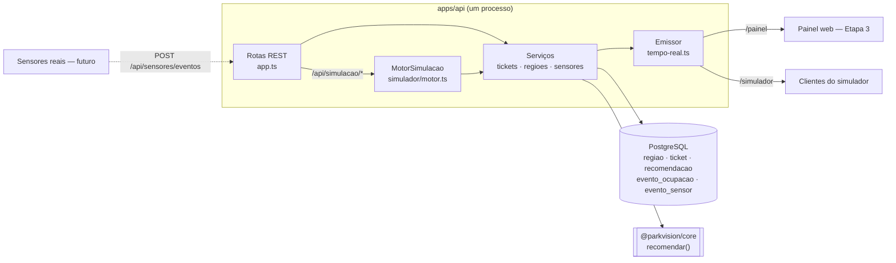
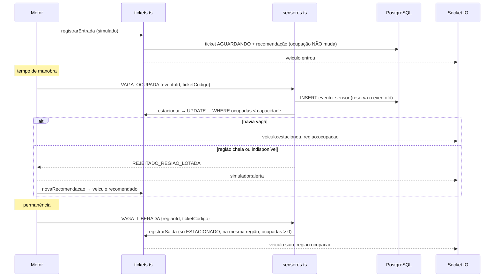

# MVP 08 — Simulador do estacionamento (Etapa 2)

> Todos os números gerados pelo simulador são **dados de demonstração** (`simulado: true`). Eles não são dados oficiais do Capim Dourado Shopping.

## 1. Arquitetura



- **O motor roda dentro da API.** Ele chama as mesmas funções de serviço que as rotas REST. Por isso as regras de entrada, confirmação, saída e capacidade valem do mesmo jeito para veículos simulados e reais. A Etapa 0 previa um processo separado. Mudamos isso porque, dentro do mesmo processo, o reinício seguro e a idempotência ficam numa transação só, e os testes não precisam de um segundo serviço. O contrato HTTP (`/api/sensores/eventos` e `/api/simulacao/*`) continua aberto, então um simulador externo ou sensores reais podem usar os mesmos endpoints depois.
- **O simulador trabalha por eventos discretos e tem relógio próprio.** O tempo avança em `processarAte(alvo)`, que executa em ordem cada evento devido: chegada, confirmação, saída, evento de cenário e verificação de falha de sensor.
- **Os resultados são reproduzíveis.** O gerador pseudoaleatório tem semente (mulberry32): com a mesma semente e os mesmos passos, o resultado é o mesmo (há teste para isso).
- **Há dois modos de execução.** No modo **automático**, um timer de 250 ms avança `250 ms × velocidade` de tempo simulado a cada tique. No modo **passo a passo**, o relógio só anda com `avancar`, e é esse que os testes usam.
- **A fonte da verdade é a ocupação da região.** Não existe modelo de vaga individual.

### Arquivos

| Arquivo | Papel |
|---|---|
| `apps/api/src/simulador/motor.ts` | Motor: ciclo de vida, relógio, gerador, agenda, preenchimento, reinício seguro |
| `apps/api/src/simulador/cenarios.ts` | Cenários A–E (configuração, ocupação inicial, eventos agendados) |
| `apps/api/src/servicos/sensores.ts` | Processamento idempotente dos eventos de sensor |
| `apps/api/src/servicos/tickets.ts` | Entrada, nova recomendação, confirmação, saída, cancelamento |
| `apps/api/src/servicos/regioes.ts` | Regiões, fluxo (recomendações + sensores), indicadores |
| `apps/api/src/tempo-real.ts` | Envelope de eventos e Socket.IO |
| `packages/shared/src/esquemas.ts` | Schemas Zod: config, eventos manuais, eventos de sensor |
| `packages/shared/src/eventos.ts` | Tipos e nomes dos eventos em tempo real |
| `apps/api/test/simulador.test.ts` | Testes da Etapa 2 (os 16 itens obrigatórios) |

## 2. Fluxo dos eventos



Cada veículo simulado percorre estes passos:

1. Chegada (intervalo exponencial com média de `60 / entradasPorMinuto` s).
2. Categoria sorteada pela proporção configurada e acesso com totem sorteado.
3. Tempo de manobra: `tempoManobraSeg` × 0,6 a 1,4.
4. Com a chance `chanceIgnorarRecomendacao`, o motorista vai para outra região compatível.
5. Confirmação.
6. Permanência (exponencial com média de `permanenciaMediaMin`).
7. Saída.

Quando a confirmação é rejeitada, o veículo recebe uma nova recomendação e tenta de novo. Depois de 3 rejeições, ou se não houver região elegível, o ticket vira `CANCELADO` (desistência).

## 3. As seis regras e onde são garantidas

| Regra | Garantia |
|---|---|
| Sem reserva temporária | A entrada só grava o ticket e a recomendação. Nenhuma linha de `regiao` muda (teste 6). |
| A recomendação não altera a ocupação | Vale para `registrarEntrada` e `novaRecomendacao`, que não tocam em `ocupadas`. |
| A ocupação só muda na confirmação ou na saída | Mudam `ocupadas` apenas `estacionar` (+1), `registrarSaida` (−1), o ajuste do operador (`PATCH`) e o preenchimento/reinício do simulador (que só criam ou removem veículos simulados). |
| A confirmação revalida a disponibilidade | No momento da confirmação, `estacionar` confere a categoria, `operacional` (`REGIAO_INDISPONIVEL`) e a capacidade, com incremento atômico condicionado. |
| Região cheia rejeita | `UPDATE ... WHERE ocupadas < capacidade` devolve 0 linhas, o que gera `REGIAO_LOTADA` (409). No simulador, o veículo recebe nova recomendação. |
| Valores sempre consistentes | `0 ≤ ocupadas ≤ capacidade`: a saída exige `ocupadas > 0`, o preenchimento exige `ocupadas + n ≤ capacidade` e o reinício decrementa com `GREATEST(0, …)`. O teste 4 confere que a ocupação é igual ao número de veículos estacionados. |

## 4. Sensores virtuais

O formato é o mesmo que os sensores reais usarão (`esquemaEventoSensor`). O campo `eventoId` é a chave de idempotência.

| Tipo | Efeito |
|---|---|
| `VAGA_OCUPADA` | Representa a leitura na região (ex.: QR ou placa lidos na entrada da região). Com `ticketCodigo`, chama `estacionar` com todas as validações. Sem ticket, o resultado é `IGNORADO_SEM_TICKET` e nada muda (para não contar em dobro). |
| `VAGA_LIBERADA` | Com `ticketCodigo`, chama `registrarSaida`, exigindo que `regiaoId` seja a região registrada do veículo. Sem ticket, o resultado é `IGNORADO_SEM_TICKET`. |
| `SEM_COMUNICACAO` / `LEITURA_INCONSISTENTE` | `statusSensores` da região passa a `sem-comunicacao` ou `inconsistente`. O algoritmo marca a região como `DADOS_INVALIDOS` e não a recomenda. |
| `SENSOR_NORMALIZADO` | `statusSensores` volta a `ok`. |
| `FLUXO` | Veículos em circulação medidos por `duracaoMin`. O valor soma no critério de fluxo, que continua com peso de 20%. |
| `DISPONIBILIDADE` | Quando simulado, liga ou desliga o `bloqueioSimulado`, sem mexer no `operacional` do operador. Quando real, altera `operacional`. |

**Idempotência.** O primeiro processamento insere a linha de `evento_sensor` (com `eventoId` como chave primária) antes de aplicar o efeito. Se o mesmo id chegar de novo, em sequência ou ao mesmo tempo, o resultado é `DUPLICADO` com o `resultadoOriginal`, e o efeito não é aplicado outra vez. Se ocorrer um erro inesperado, a linha é removida e o mesmo id pode ser reenviado.

**Resultados possíveis:** `APLICADO`, `DUPLICADO`, `IGNORADO_SEM_TICKET` ou `REJEITADO_<CODIGO>` (por exemplo, `REJEITADO_REGIAO_LOTADA` ou `REJEITADO_TRANSICAO_INVALIDA`). O evento rejeitado também fica registrado.

## 5. Estrutura dos dados (mudanças no Prisma)

| Modelo | Campos novos |
|---|---|
| `Regiao` | `bloqueioSimulado`, `statusSensores`, `statusSensoresSimulado`, `fluxoSensor`, `fluxoSensorAte`, `fluxoSimulado` |
| `Ticket` | `simulado` (com índice); `recomendacoes` agora é 1:N (uma por tentativa) |
| `Recomendacao` | `ticketNumero` deixou de ser único (permite nova recomendação) |
| `EventoOcupacao` | `simulado`; apagado em cascata com o ticket |
| `EventoSensor` (novo) | `eventoId` (PK), `sensorId`, `regiaoId`, `tipo`, `ticketCodigo`, `payload`, `resultado`, `simulado`, `recebidoEm` |

Na API, `Regiao` passou a trazer `statusSensores` e `fluxo { recente, vazaoReferencia, nivel: 'baixo' | 'moderado' | 'elevado' }`. O campo `operacional` agora é o **efetivo**: operador **e** simulação.

## 6. Endpoints

As rotas de controle e de sensores exigem o cabeçalho `x-simulador-token: <SIMULADOR_TOKEN>`. Sem ele, a resposta é `401 NAO_AUTORIZADO`.

| Método | Rota | Corpo | Resposta |
|---|---|---|---|
| `GET` | `/api/simulacao` | — | estado (status, modo, cenário, relógio, config, estatísticas, veículos, agendados, últimos alertas) + `veiculosSimuladosAtivos` (veículos simulados ainda no banco) |
| `GET` | `/api/simulacao/cenarios` | — | lista dos cenários (id, nome, descrição, ocupação inicial, chegadas por minuto), usada pelo painel |
| `POST` | `/api/simulacao/iniciar` | `{ cenario?, config? }` | estado (`409 SIMULACAO_ESTADO_INVALIDO` se já estiver rodando) |
| `POST` | `/api/simulacao/pausar` | — | estado |
| `POST` | `/api/simulacao/retomar` | — | estado |
| `POST` | `/api/simulacao/encerrar` | — | estado (para a simulação e mantém os dados simulados para análise) |
| `POST` | `/api/simulacao/reiniciar` | — | `{ removidos: { tickets, eventosSensor, vagasLiberadas }, estado }` |
| `PATCH` | `/api/simulacao/config` | `ConfigSimulacao` parcial | estado (velocidade, frequências, proporções e outros campos, a qualquer momento) |
| `POST` | `/api/simulacao/cenario` | `{ cenario: 'A'..'E', config? }` | estado (reinicia os dados simulados e começa o cenário) |
| `POST` | `/api/simulacao/eventos` | evento manual (ver §8) | resultado da ação |
| `POST` | `/api/sensores/eventos` | `EventoSensor` | `{ eventoId, resultado, mensagem?, resultadoOriginal? }` |
| `POST` | `/api/tickets/:codigo/recomendacao` | — | `{ ticket, recomendacao, motivo }` (só tickets `AGUARDANDO`) |
| `POST` | `/api/tickets/:codigo/cancelar` | — | `{ ticket }` (`AGUARDANDO` → `CANCELADO`) |

**Mudanças de comportamento em relação à Etapa 1** (todas documentadas e cobertas por testes):

- `POST /tickets/:codigo/saida` agora exige ticket `ESTACIONADO`. Antes, aceitava `AGUARDANDO` e marcava `SAIU`. Saída duplicada ou de veículo não estacionado devolve `409 TRANSICAO_INVALIDA`. Para quem desistiu antes de estacionar, use `cancelar`.
- `POST /tickets/:codigo/estacionar` recusa região fora de operação com `409 REGIAO_INDISPONIVEL`.
- Enquanto há simulação ativa, `GET /regioes`, `GET /indicadores` e as operações REST usam o **relógio simulado**, para que o fluxo e os indicadores fiquem coerentes com a simulação acelerada. Com a simulação parada, volta o relógio real.

## 7. Eventos em tempo real

Todos os eventos usam o envelope abaixo:

```json
{ "id": "uuid", "tipo": "veiculo:entrou", "ocorridoEm": "2026-11-13T15:00:00.000Z", "entidadeId": "PV-0042", "simulado": true, "dados": { } }
```

Cada evento é emitido no canal com o nome do `tipo` e também no canal agregado `evento`, no namespace `/painel`. Os eventos `simulador:*` também vão para o namespace `/simulador`, que exige `auth: { token }`.

| Tipo | `entidadeId` | `dados` | Substitui (Etapa 1) |
|---|---|---|---|
| `veiculo:entrou` | código do ticket | `{ ticket, recomendacao }` | `ticket:criado` |
| `veiculo:recomendado` | código do ticket | `{ ticket, recomendacao, motivo }` | — |
| `veiculo:estacionou` | código do ticket | `{ ticket, regiao }` | `ticket:estacionado` |
| `veiculo:saiu` | código do ticket | `{ ticket, regiao \| null }` (com `null` no cancelamento) | `ticket:saida` |
| `regiao:ocupacao` | id da região | `Regiao` | `regiao:atualizada` |
| `regiao:fluxo` | id da região | `Regiao` | — |
| `regiao:status` | id da região | `Regiao` (operação ou sensores) | `regiao:atualizada` |
| `simulador:estado` | `simulador` | `{ status, cenario, relogioSimulado, velocidade, acao }` | `simulacao:estado` |
| `simulador:cenario` | `simulador` | `{ cenario, descricao }` | — |
| `simulador:sensor` | id da região | `{ eventoId, tipo, regiaoId, resultado }` | — |
| `simulador:alerta` | ticket, região ou `simulador` | `{ codigo, mensagem, ticketCodigo?, regiaoId? }` | — |
| `indicadores:atualizados` | `indicadores` | `Indicadores` | (igual) |

O padrão de nomes (`entidade:acao`, em português) é o mesmo da Etapa 1. Os nomes do enunciado foram adaptados: `VEICULO_ENTROU` virou `veiculo:entrou`, `OCUPACAO_ATUALIZADA` virou `regiao:ocupacao`, e assim por diante.

## 8. Configurações e eventos manuais

| Campo | Padrão | Faixa | Efeito |
|---|---|---|---|
| `modo` | `automatico` | `automatico` \| `manual` | No modo manual não há chegadas, confirmações nem saídas automáticas. O relógio continua andando, e os eventos agendados e as falhas de sensor continuam valendo. |
| `velocidade` | 60 | 0,1–600 | Multiplicador do relógio (60 = 1 minuto simulado por segundo) |
| `entradasPorMinuto` | 6 | 0–120 | Frequência de entradas |
| `permanenciaMediaMin` | 90 | 1–600 | Define a frequência de saídas |
| `maxVeiculos` | 0 (sem limite) | 0–100000 | Total de veículos gerados automaticamente |
| `proporcaoCategorias` | 0,60 / 0,25 / 0,15 | 0–1 cada | Carro pequeno / carro grande / moto (os valores são normalizados) |
| `chanceIgnorarRecomendacao` | 0,10 | 0–1 | Motorista estaciona em outra região compatível |
| `tempoManobraSeg` | 90 | 0–1800 | Tempo entre o ticket e a confirmação |
| `chanceFalhaSensorPorMin` | 0 | 0–1 | Falha aleatória de sensor (volta em 2 a 10 min) |
| `chanceEventoDuplicado` | 0 | 0–1 | Reenvia o mesmo `eventoId` (para exercitar a idempotência) |
| `semente` | 42 | inteiro | Semente do gerador |

Os eventos manuais vão no corpo de `POST /api/simulacao/eventos`:

```json
{ "acao": "entrada", "categoria": "MOTO", "acessoId": "A_NE" }
{ "acao": "confirmar", "codigo": "PV-0007", "regiaoId": "S2" }
{ "acao": "saida", "codigo": "PV-0007" }
{ "acao": "fluxo", "regiaoId": "SS1", "veiculosEmCirculacao": 40, "duracaoMin": 30 }
{ "acao": "disponibilidade", "regiaoId": "N3", "disponivel": false }
{ "acao": "sensor", "regiaoId": "S1", "status": "sem-comunicacao" }
{ "acao": "avancar", "segundos": 300 }
```

Em `saida`, o `codigo` é opcional: sem ele, sai um veículo simulado sorteado. O simulador só opera **tickets simulados**: um ticket real devolve `400 DADOS_INVALIDOS`.

## 9. Cenários de demonstração

| Cenário | Ocupação inicial | Chegadas | O que mostra |
|---|---|---|---|
| **A — tranquilo** | 30% | 2/min | Distribuição com folga |
| **B — pico** | 55% | 30/min | Fluxo alto, carros espalhados entre as regiões |
| **C — região lotada** | 45%, com N3 e N2 a 100% | 8/min, 25% ignoram a recomendação | Regiões cheias nunca são recomendadas. Quem tenta confirmar nelas é rejeitado e recebe nova recomendação. |
| **D — congestionamento** | 45% | 8/min | `FLUXO` de 40 veículos no SS1 por 60 min. Quem entra pelo acesso nordeste deixa de ser mandado para o SS1, sem mudança nos pesos. |
| **E — indisponibilidade** | 45% | 8/min | N3 fechada de 0 a 15 min e sensores do S1 sem comunicação de 5 a 20 min |

O preenchimento inicial completa a ocupação de cada região até o alvo com veículos simulados já estacionados (códigos `PVS-…`). A ocupação que já existia, inclusive a real, entra na conta e nunca é removida.

## 10. Como executar

Pré-requisitos: banco no ar e com o schema atualizado (`pnpm db:up`, `pnpm db:push`, `pnpm db:seed`). Depois, suba a API:

```bash
pnpm dev:api
```

Os comandos abaixo usam o token de `apps/api/.env` (`SIMULADOR_TOKEN`). No Git Bash:

```bash
export T=troque-este-token
```

Iniciar o cenário B:

```bash
curl -X POST localhost:3333/api/simulacao/cenario -H "x-simulador-token: $T" -H "content-type: application/json" -d '{"cenario":"B"}'
```

Acompanhar o estado:

```bash
curl localhost:3333/api/simulacao
```

Mudar a velocidade durante a execução:

```bash
curl -X PATCH localhost:3333/api/simulacao/config -H "x-simulador-token: $T" -H "content-type: application/json" -d '{"velocidade":120}'
```

Pausar:

```bash
curl -X POST localhost:3333/api/simulacao/pausar -H "x-simulador-token: $T"
```

Retomar:

```bash
curl -X POST localhost:3333/api/simulacao/retomar -H "x-simulador-token: $T"
```

Reiniciar com segurança (apaga só o que é simulado):

```bash
curl -X POST localhost:3333/api/simulacao/reiniciar -H "x-simulador-token: $T"
```

Modo manual, passo a passo:

```bash
curl -X POST localhost:3333/api/simulacao/iniciar -H "x-simulador-token: $T" -H "content-type: application/json" -d '{"config":{"modo":"manual"}}'
```

```bash
curl -X POST localhost:3333/api/simulacao/eventos -H "x-simulador-token: $T" -H "content-type: application/json" -d '{"acao":"entrada","categoria":"CARRO_PEQUENO","acessoId":"A_NE"}'
```

Para ouvir os eventos em tempo real (Node, com `socket.io-client`):

```js
import { io } from 'socket.io-client';
io('http://localhost:3333/painel').on('evento', (ev) => console.log(ev.tipo, ev.entidadeId, ev.simulado));
```

### Testes

```bash
pnpm test
```

Só os testes do simulador:

```bash
pnpm --filter @parkvision/api exec vitest run test/simulador.test.ts
```

## 11. Separação entre dados simulados e reais

- Tudo o que o simulador grava leva `simulado = true`: tickets, eventos de ocupação, eventos de sensor e envelopes em tempo real. Os estados de região têm marcas próprias: `bloqueioSimulado`, `statusSensoresSimulado` e `fluxoSimulado`.
- O simulador não opera tickets reais e não altera o `operacional` definido pelo operador.
- O **reinício** apaga só os registros simulados e **decrementa** a ocupação de cada região pelo número de veículos simulados estacionados nela. A ocupação não é recalculada do zero, então tickets reais e ajustes do operador ficam intactos (teste 14).
- `encerrar` para a simulação sem apagar os dados, para análise. `reiniciar` limpa.
- `pnpm db:seed --limpar` é um comando de desenvolvimento e apaga **tudo**. Não use em produção.

## 12. Limitações conhecidas

- **Desempenho em pico.** Cada evento passa pelo banco, com transação e consultas de ocupação e fluxo. No cenário B (30 chegadas/min) com velocidade 60, o motor avançou cerca de 4 minutos simulados em 10 segundos reais, em vez de 10. A velocidade efetiva fica abaixo da configurada, e o atraso por tique é limitado a 5 minutos simulados. Isso é suficiente para a demonstração; para ir além, seria preciso agrupar escritas ou guardar o fluxo em cache.
- **Sensores de vaga sem ticket são ignorados.** Não existe modelo de vaga individual, e contar a leitura duplicaria a confirmação. Um sensor real por vaga exigirá decidir como casar a leitura com o ticket (placa, QR ou contagem por região).
- **Um status de sensor por região.** Um `SENSOR_NORMALIZADO` simulado pode sobrescrever uma falha real da mesma região. Não há sensores reais no MVP.
- **Relógio simulado na API.** Durante a simulação, operações reais feitas pela API recebem o horário simulado. Para dados reais, pare a simulação antes.
- **Estado do motor em memória.** Se a API reiniciar, `iniciar` sem cenário retoma os veículos simulados que estão no banco, mas com novos tempos de saída.
- **Credencial de sensor real.** Os eventos de sensor hoje só são aceitos com o token do simulador, e por isso entram como `simulado: true`. Sensores reais precisarão de credencial própria, com `simulado: false`.
