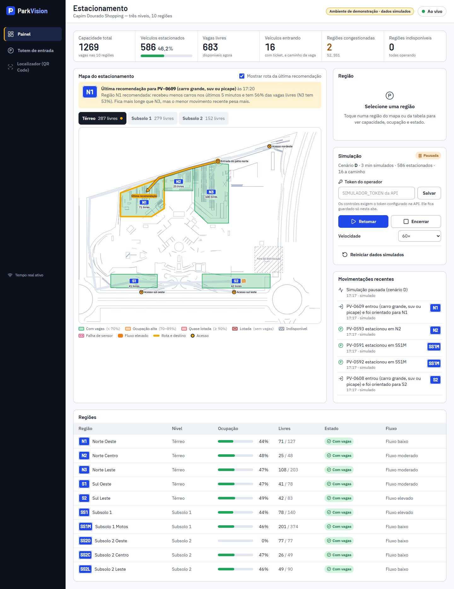
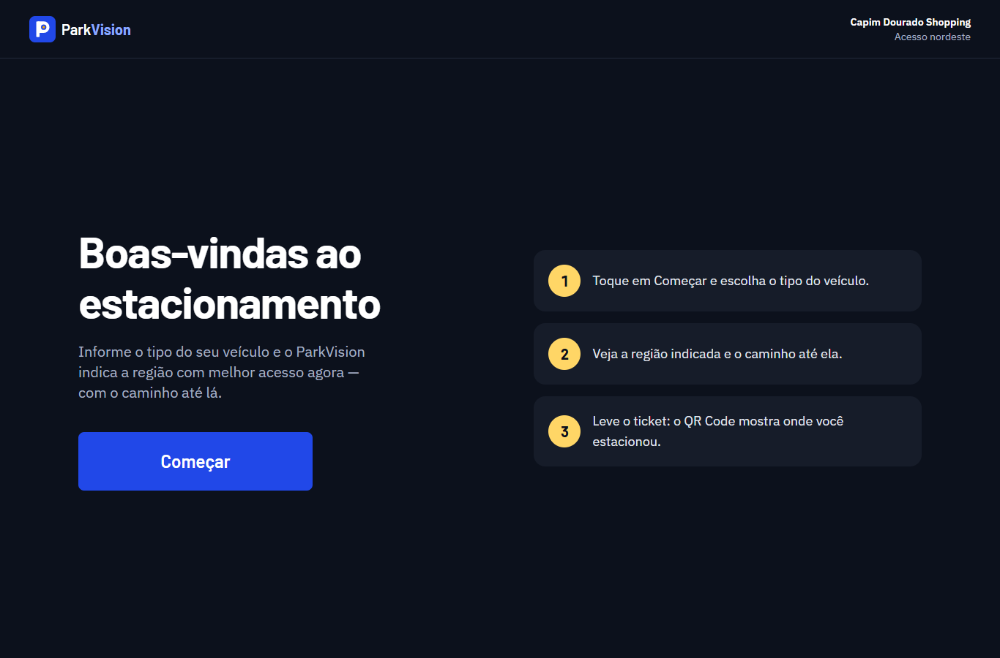
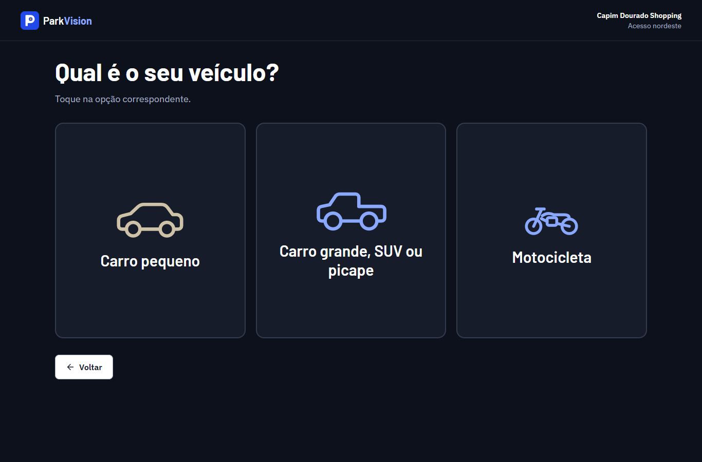
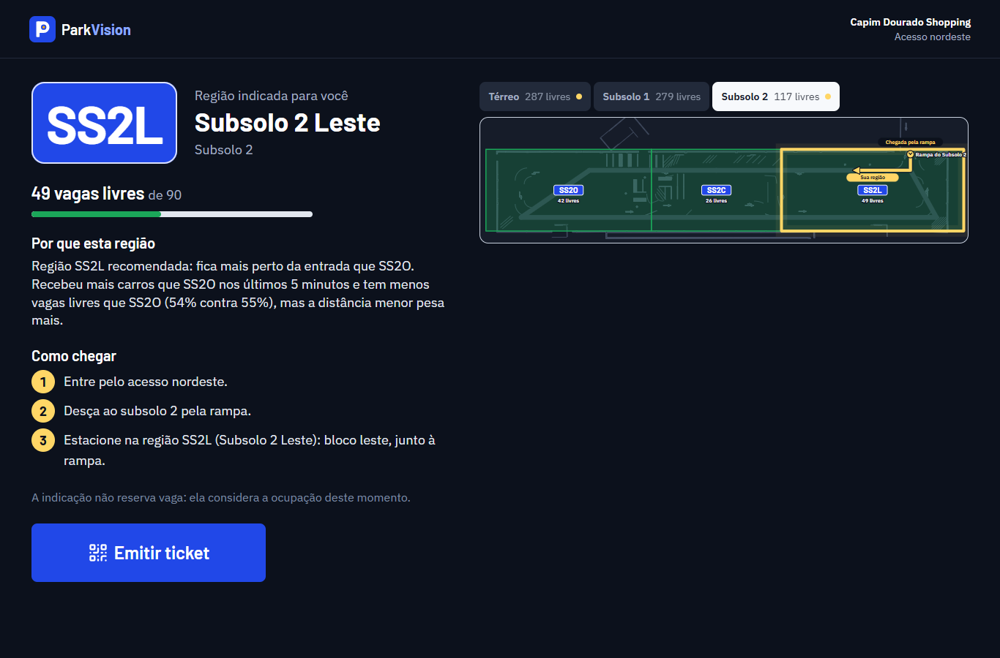
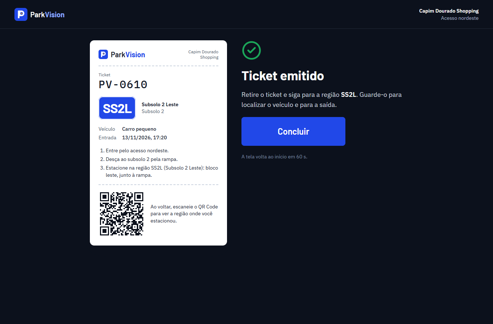
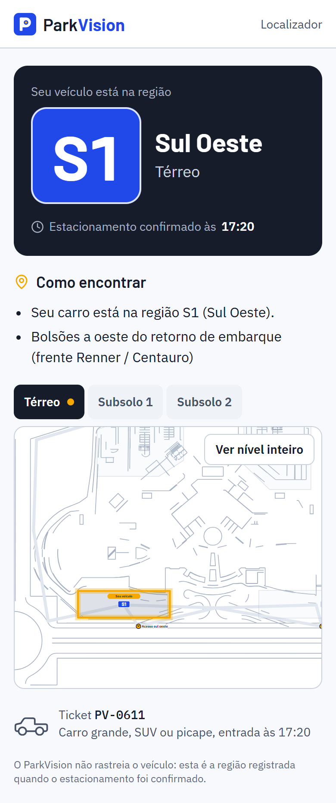
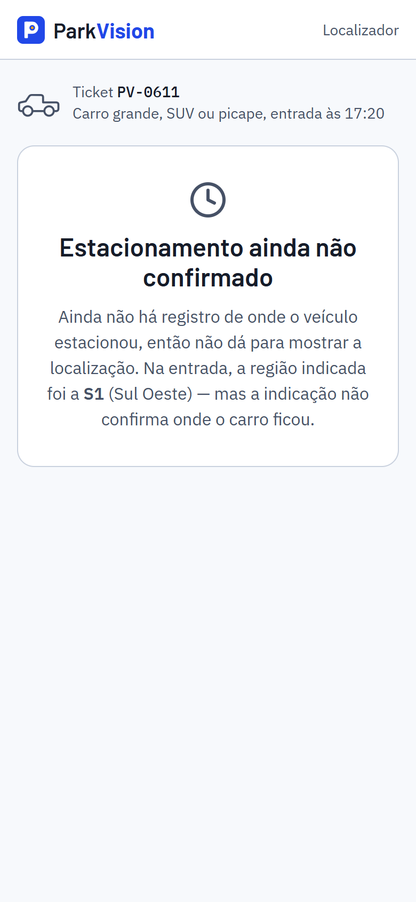
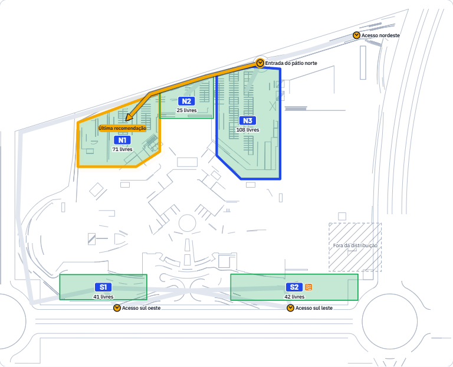
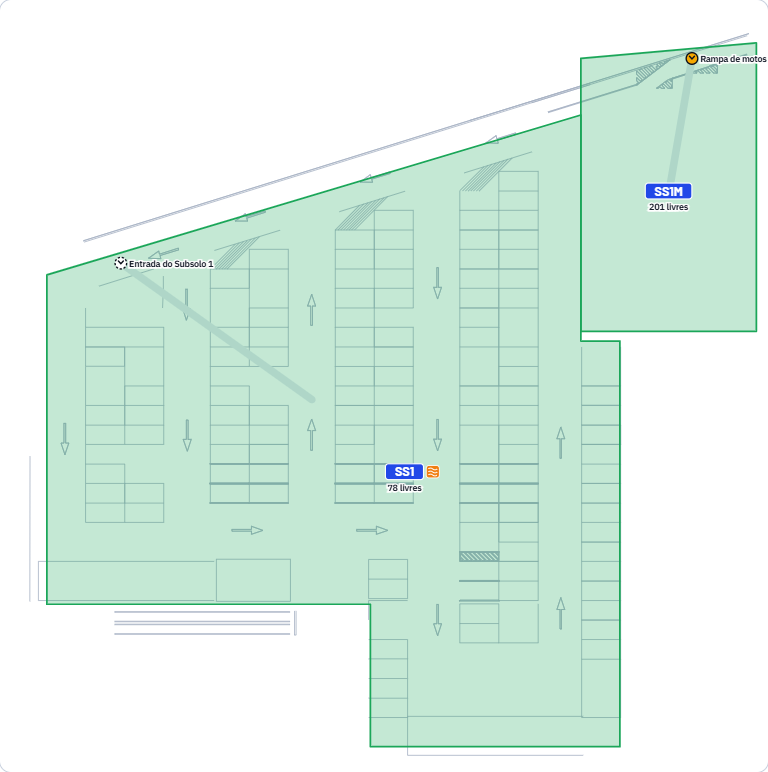
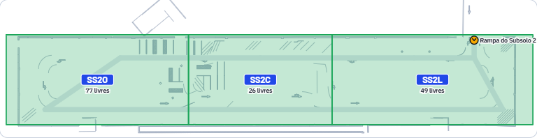

# MVP 11 — Relatório da Etapa 3: interfaces e mapa interativo

> Status: **concluída e commitada, aguardando a avaliação do grupo.** A Etapa 4 não foi iniciada.
> Detalhes técnicos: [10-interfaces.md](10-interfaces.md).

## 1. Interfaces desenvolvidas

| Interface | Rota | Destaques |
|---|---|---|
| **Totem de entrada** | `/totem?acesso=A_NE` | Tela de toque escura; início → categoria → processamento → recomendação (placa da região, vagas livres, justificativa do backend, passos e mapa com a rota) → ticket com QR Code real; trata falta de vagas e falta de conexão |
| **Dashboard administrativo** | `/painel` | Mapa como centro: ocupação ao vivo por região, última recomendação com rota, seleção de região; seis indicadores; controles do simulador; movimentações em tempo real; tabela de regiões |
| **Localizador de veículo** | `/t/:token` | Para celular: região **registrada na confirmação**, horário, orientações e mapa aproximado; trata ticket inexistente, QR inválido, sem confirmação, já saiu, cancelado e sem conexão |



| Totem — início | Totem — categoria |
|---|---|
|  |  |

| Totem — recomendação | Totem — ticket |
|---|---|
|  |  |

| Localizador — confirmado | Localizador — sem confirmação |
|---|---|
|  |  |

## 2. Design System implementado

O Design System da 1ª entrega (tokens `--pv-*`) foi aplicado no código, sem criar um paralelo:
- **Paleta:** asfalto, Vision `#2148E8` e o âmbar Faixa, reservado a rotas, destino e passos.
- **Tipografia:** Barlow, IBM Plex Sans e IBM Plex Mono.
- **Medidas:** grade de 4 px; raios de 8, 12 e 16 px.
- **Estados:** carregando, erro, sucesso e vazio.
- **Navegação:** barra lateral escura com indicador âmbar.

**Extensões da Etapa 3:**
- **Placa da região:** o código numa placa azul de estacionamento, presente nas três interfaces.
- **Novas faixas de ocupação:** "quase lotada" (≥ 90% com vagas) e "lotada" (0 vagas, com padrão xadrez); indisponível com hachura e falha de sensor com pontos.
- **Tokens de mapa** que acompanham o tema.

Tabela completa em [10-interfaces.md §2](10-interfaces.md).

## 3. Componentes reutilizáveis

- **Base** (`componentes/base.tsx`): `Simbolo`, `Marca`, `Placa`, `Botao`, `Cartao`, `Selo`, `Medidor`, `Aviso`, `EstadoVazio`, `Esqueleto`, `Carregando`, `SeloDemonstracao`.
- **Ícones:** `IconeCategoria`, com silhuetas próprias.
- **Mapa:** `MapaEstacionamento` (o **mesmo** componente no totem, no painel e no localizador) e `LegendaMapa`.
- **Painel:** `FaixaIndicadores`, `RecomendacaoAtual`, `DetalheRegiao`, `ControleSimulador`, `ListaMovimentacoes`, `TabelaRegioes`.
- **Serviços:** `api` (REST com erros padronizados) e `useTempoReal` (Socket.IO).

## 4. Tecnologias utilizadas

Stack definida na Etapa 0, sem substituições:
- React 19, Vite 8 e React Router 8;
- Tailwind CSS 4 ligado aos tokens;
- `socket.io-client`;
- `qrcode`, que gera o SVG no navegador a partir do `qrUrl` real;
- `lucide-react` (ícones do Design System);
- Vitest e Testing Library (testes de componente);
- Playwright usando o Microsoft Edge já instalado (nenhum navegador baixado).

## 5. Estrutura dos arquivos

```
apps/web/
├── index.html · vite.config.ts · playwright.config.ts · tsconfig.json
├── public/favicon.svg
├── src/
│   ├── main.tsx · App.tsx                 rotas /totem, /painel, /t/:token
│   ├── estilos/global.css                 Tailwind + tokens + faixas de ocupação
│   ├── servicos/api.ts · tempo-real.ts    camada de serviços (REST e Socket.IO)
│   ├── componentes/base.tsx · IconeCategoria.tsx
│   ├── mapa/MapaEstacionamento.tsx · dados.ts · estado.ts · planta-base.json
│   ├── paginas/totem/Totem.tsx
│   ├── paginas/painel/Painel.tsx · componentes.tsx · eventos.ts
│   ├── paginas/localizador/Localizador.tsx
│   ├── testes/preparar.ts · apoio.tsx
│   └── **/*.test.tsx                      testes de componente
└── e2e/fluxos.spec.ts · capturas.spec.ts · preparar.ts · apoio.ts
```

**Alterados fora do app web:**
- `apps/api/src/app.ts`: `GET /simulacao/cenarios` e `veiculosSimuladosAtivos` no estado.
- `apps/api/src/servicos/tickets.ts`: o localizador devolve `estacionadoEm` e `saidaEm`.
- `apps/api/src/simulador/motor.ts`: emite a ocupação depois do preenchimento do cenário.
- Testes da API.
- Configuração: `package.json` (scripts `dev:web` e `e2e`), `.claude/launch.json`, `.gitignore`.
- Documentação: `docs/mvp/02-contratos.md`, `08-simulador.md`, `docs/04-design-system.md`, `README.md`.

## 6. Endpoints integrados

| Endpoint | Uso |
|---|---|
| `GET /api/regioes` e `GET /api/indicadores` | Ocupação e indicadores |
| `GET /api/recomendacoes?limite=1` | Recomendação mais recente |
| `POST /api/entradas` | Totem: entrada, recomendação e ticket |
| `GET /api/localizador/:token` | Localizador |
| `GET /api/simulacao` e `GET /api/simulacao/cenarios` | Estado do simulador e lista de cenários |
| `POST /api/simulacao/cenario` · `POST /api/simulacao/{pausar,retomar,encerrar,reiniciar}` · `PATCH /api/simulacao/config` | Controles do simulador, com `x-simulador-token` |

A confirmação de estacionamento e a saída acontecem na região (sensor, simulador ou API). Elas não fazem parte de nenhuma das três interfaces, e o painel as acompanha em tempo real.

## 7. Eventos em tempo real utilizados

O painel ouve o namespace `/painel`, no canal agregado `evento`, com o envelope padronizado da Etapa 2:
- `veiculo:entrou`, `veiculo:recomendado`, `veiculo:estacionou`, `veiculo:saiu`;
- `regiao:ocupacao`, `regiao:status`, `regiao:fluxo`;
- `indicadores:atualizados`;
- `simulador:estado`, `simulador:cenario`, `simulador:alerta`.

A marca `simulado` dos eventos também acende o selo de ambiente de demonstração.

## 8. Como o mapa foi construído

O componente é um SVG feito a partir do **mapa digital aprovado na Etapa 0**. Esse é o mesmo arquivo que a API usa para calcular as rotas, então a tela e o algoritmo não divergem. O SVG tem seis camadas:

1. traçado vetorial extraído do próprio PDF da planta;
2. área fora da distribuição;
3. vias do grafo;
4. polígonos das regiões, coloridos pela ocupação ao vivo;
5. rota em âmbar, desenhada nó a nó pelo grafo (trechos que não existem no grafo são descartados);
6. acessos.

Outras características:
- tem abas por nível e se ajusta à tela (`viewBox` do recorte do PDF, largura de 100%, proporção preservada);
- no localizador, abre enquadrado na região;
- regiões são selecionáveis por clique e por teclado.

Detalhes em [10-interfaces.md §3](10-interfaces.md).

| Térreo | Subsolo 1 | Subsolo 2 |
|---|---|---|
|  |  |  |

## 9. Como a planta foi simplificada

**Removido:** vagas individuais, pilares, logotipos e nomes de lojas, sinalização miúda e texturas.

**Mantido:**
- o traçado de fileiras e bolsões;
- as setas de circulação desenhadas na planta;
- o contorno do prédio, das rotatórias e das avenidas;
- a posição e o formato das 10 regiões;
- os 7 acessos;
- o pátio de serviço, marcado como fora da distribuição.

A unidade de distribuição é a região, não a vaga.

## 10. Comparação entre a planta original e o mapa

| Planta original | Mapa implementado |
|---|---|
| Térreo: pátios norte (leque oeste, bolsões da entrada norte, fileiras longas até o Big/Wow Park) e sul (bolsões a oeste e a leste do retorno de embarque) | N1, N2, N3, S1 e S2 sobre as próprias fileiras do traçado |
| Subsolo 1: quatro ilhas de mão única + faixa leste em L; motos com rampa própria no nordeste | SS1 em L e SS1M; ilhas e setas visíveis |
| Subsolo 2: anel anti-horário com rampa a leste | SS2O, SS2C e SS2L ao longo do anel |
| Acessos: Av. LO 2A (nordeste), rotatória norte, dois pela Av. NS-05, entradas dos subsolos | 7 acessos com o nome da planta; o do SS1 aparece tracejado (confiança baixa) |
| Pátio de serviço leste (Cinemark) | Hachurado como "Fora da distribuição" |

Para comparar visualmente, use `docs/planta/pagina-2.png` (térreo) e `pagina-1.png` (subsolos) ao lado das capturas acima. A sobreposição exata, com a planta raster por baixo, está em `docs/mvp/mapa/proposta-mapa.html` (Etapa 0).

## 11. Resultado dos testes

```text
pnpm typecheck  → shared, core, api e web sem erros
pnpm test
  packages/shared    4 testes ✔
  packages/core     89 testes ✔
  apps/api          44 testes ✔   (+1: lista de cenários; e o teste do cenário A passou a conferir o evento de ocupação)
  apps/web          34 testes ✔   (Vitest + Testing Library)
pnpm e2e            5 testes ✔    (Playwright + Edge; API real no banco de teste)
```

| Exigência | Onde está coberta |
|---|---|
| **Totem:** categorias, pedido de recomendação, dados exibidos, ticket, QR Code, indisponibilidade | `Totem.test.tsx` (7). O QR é comparado módulo a módulo com o gerado a partir do `qrUrl`. Ponta a ponta: totem → ticket → localizador com a API real, conferindo que o ticket não ocupa vaga |
| **Dashboard:** indicadores, regiões, atualização de ocupação, eventos em tempo real, seleção, simulador, erros de conexão | `Painel.test.tsx` (8). Ponta a ponta: eventos reais pelo Socket.IO e ciclo completo dos controles do simulador (iniciar → pausar → retomar → encerrar → reiniciar) |
| **Localizador:** ticket válido, inexistente, região efetivamente registrada, destaque no mapa, sem confirmação, celular | `Localizador.test.tsx` (7), com a recomendada diferente da registrada de propósito. Ponta a ponta: o motorista parou em outra região (S2) e o mapa destaca S2; celular em 375 px sem rolagem horizontal |
| **Mapa:** correspondência com a planta, seleção, ocupação, rotas válidas, redimensionamento, reutilização | `MapaEstacionamento.test.tsx` (12): `viewBox`, traçado e vértices idênticos ao mapa aprovado; nenhuma região inventada; toda rota usa só trechos do grafo. Ponta a ponta: o mapa ocupa a largura e mantém a proporção em 768, 1024 e 1920 px, e é o mesmo componente no painel e no localizador |

## 12. Problemas encontrados

1. **A rota e os marcadores de acesso bloqueavam o clique** nas regiões que ficavam por baixo (encontrado pelo teste ponta a ponta). Corrigido: essas camadas não interceptam mais o ponteiro.
2. **O preenchimento inicial dos cenários não avisava os painéis abertos** (bug da Etapa 2, encontrado na revisão visual: uma região aparecia com 0%). O motor agora emite a ocupação de todas as regiões depois do preenchimento, e há teste para isso.
3. **O painel trocava de nível sozinho** a cada recomendação, o que desorientava durante a simulação. Agora só o totem e o localizador acompanham o destino.
4. **Variáveis de cor do mapa** não acompanhavam o tema escuro dentro do totem. Elas foram ligadas aos tokens semânticos e recalculadas em `[data-theme]`.
5. **Limites do backend descobertos na integração**, corrigidos sem quebrar o contrato:
   - faltava o horário do estacionamento no localizador;
   - faltava uma lista de cenários para o painel;
   - faltava um jeito de saber se ainda há dados simulados no banco com o motor parado.

## 13. Limitações restantes

- **Grafo de vias simplificado (validação pendente).** No Subsolo 1 e no último trecho até cada região do térreo, a rota é uma reta entre os nós do grafo aprovado e passa por cima das fileiras. Refinar o grafo mudaria as distâncias do algoritmo, então depende do grupo. Ver [10-interfaces.md §3](10-interfaces.md).
- **Ligações térreo ↔ subsolos estimadas (D4).** A interface indica "desça pela rampa", mas não desenha a rampa no térreo.
- **Sem setas de sentido no térreo.** O sentido continua "a confirmar".
- **Token do operador.** Os controles do simulador pedem o token, que fica guardado só na aba (sessionStorage). Ainda não há login de operador.
- **Sem botão para confirmar estacionamento ou registrar saída** nas interfaces. Isso fica com os sensores e o simulador, como definido; uma tela de operador para isso seria uma tela a mais.
- **Imagens do mapa nos subsolos:** o desenho do SS2 é muito largo (proporção de cerca de 4:1). No totem, ele fica baixo.
- **Ticket sem regra de expiração**, porque o backend não tem essa regra.
- **Fontes do Google Fonts:** sem internet, a interface usa as fontes de reserva do sistema.

## 14. Linguagem adicional (roleta diária)

O grupo **não informou** a linguagem sorteada hoje. O resultado não foi inventado e a Etapa 3 seguiu com a stack atual (TypeScript, React, Vite, Tailwind). Quando a linguagem for informada, ela será avaliada separadamente, com custo de integração e manutenção, e só entra com aprovação do grupo.

## 15. Como executar e demonstrar

```bash
pnpm db:up
```

```bash
pnpm dev:api
```

```bash
pnpm dev:web
```

Abra:
- `http://localhost:5173/painel`;
- `http://localhost:5173/totem?acesso=A_NE`;
- o localizador, pelo link do QR Code do ticket.

Roteiro sugerido:
1. No painel, informe o token do operador (`SIMULADOR_TOKEN` de `apps/api/.env`) e inicie um cenário.
2. Use o totem para gerar um ticket.
3. Abra o QR Code: o localizador dirá "Estacionamento ainda não confirmado".
4. Confirme o estacionamento pela API (`POST /api/tickets/<código>/estacionar`).
5. Atualize o localizador: a região aparece destacada.
6. No fim, use "Reiniciar dados simulados", que apaga só o que é simulado.

Passo a passo completo e comandos de teste: [10-interfaces.md §5](10-interfaces.md).

## Pendências para a avaliação do grupo

1. Aprovar ou ajustar o visual das três interfaces e a "placa da região" como elemento de identidade.
2. Decidir sobre o refinamento do grafo de vias (rotas mais fiéis, que mudam as distâncias do algoritmo).
3. Confirmar as ligações térreo ↔ subsolos (D4) e o sentido de circulação no térreo (D6).
4. Informar a linguagem da roleta diária, se houver.
