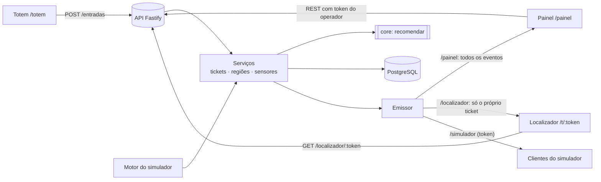

# MVP 12 — Integração completa do sistema (Etapa 4)

> O backend é a fonte da verdade. Totem, painel, localizador e simulador leem e alteram o estado só pela API (REST) e recebem as mudanças pelo Socket.IO. Nenhuma interface calcula ocupação por conta própria.

## 1. Visão geral



| Módulo | Como está ligado |
|---|---|
| Totem | `POST /api/entradas`: o algoritmo recomenda e o backend cria o ticket com o QR (sem ocupar vaga) |
| Algoritmo | `packages/core`, chamado pelo serviço de entrada e de nova recomendação, com ocupação, fluxo, sensores e operação lidos do banco |
| Banco | Ocupação, tickets, recomendações (1:N), histórico (`evento_ocupacao`) e eventos de sensor (`evento_sensor`) |
| Simulador | Usa os mesmos serviços (entrada, confirmação e saída via sensores); controlado pelo painel |
| Sensores virtuais | `POST /api/sensores/eventos`, idempotentes pelo `eventoId` |
| Painel | Estado pela API ao abrir, ao reconectar e a cada 30 s; atualizações pelo Socket.IO; operação de tickets e simulador com o token do operador |
| Mapa | Mesmo componente no painel (estado geral, recomendação e rota) e no localizador (região registrada) |
| Tickets e QR | Token aleatório de 16 bytes; o banco guarda só o hash; o QR leva `WEB_URL/t/<token>` |
| Localizador | `GET /api/localizador/:token` + Socket.IO `/localizador` (sala do próprio ticket) |

## 2. Fluxo do motorista

| Passo | O que acontece |
|---|---|
| 1. Entrada | Totem → `POST /api/entradas { acessoId, categoria }` |
| 2. Recomendação | O backend lê ocupação, fluxo, sensores e operação; o core filtra (categoria, operação, vagas, dados, rota) e pontua 50/30/20 |
| 3. Ticket | Ticket `AGUARDANDO` ligado à recomendação; o QR traz o token. Eventos `veiculo:entrou`, `ticket:atualizado` e `indicadores:atualizados`. **A ocupação não muda** |
| 4. Estacionamento | Painel → Operação de tickets → **Confirmar estacionamento** (`POST /api/tickets/:codigo/estacionar`), ou sensor `VAGA_OCUPADA` com o ticket. O backend revalida categoria, operação e capacidade. Região cheia gera `409 REGIAO_LOTADA`, e o operador clica em **Solicitar nova recomendação** |
| 5. Painel | `regiao:ocupacao` (com a versão), `veiculo:estacionou`, `ticket:atualizado` e `indicadores:atualizados`; histórico gravado em `evento_ocupacao` |
| 6. Localização | Localizador → `GET /api/localizador/:token`; mostra a região **registrada** e destaca no mapa. A página atualiza sozinha quando o ticket muda |
| 7. Saída | Painel → **Registrar saída** (`POST /api/tickets/:codigo/saida`), ou sensor `VAGA_LIBERADA`. Saída duplicada gera `409` |

**Sem reserva:** a recomendação e o ticket não alteram nada na região. Duas pessoas podem ser indicadas para a mesma região enquanto houver vagas registradas. A capacidade só é conferida na confirmação.

## 3. Consistência e concorrência

| Garantia | Como |
|---|---|
| Ocupação nunca acima da capacidade | `UPDATE regiao SET ocupadas = ocupadas + 1 … WHERE ocupadas < capacidade` (atômico, sob a trava da linha) |
| Ocupação nunca negativa | `… WHERE ocupadas > 0` na saída; o preenchimento e o reinício do simulador também são condicionados |
| Confirmação não duplicada (**novo**) | `UPDATE ticket SET status='ESTACIONADO' WHERE numero=? AND status='AGUARDANDO'` antes de mexer na região. Duas confirmações simultâneas do mesmo ticket: só uma passa |
| Saída não duplicada (**novo**) | `UPDATE ticket SET status='SAIU' WHERE … status='ESTACIONADO' AND regiaoEstacionadaId=?` |
| Atomicidade | Status do ticket, ocupação e histórico na **mesma transação**. Uma rejeição (ex.: região lotada) desfaz tudo e o ticket continua `AGUARDANDO` |
| Sem deadlock | Ordem das travas sempre ticket → região |
| Ticket ↔ região | `regiaoEstacionadaId` gravado na mesma transação da ocupação; a saída usa essa região |
| Histórico preservado | `evento_ocupacao` com origem (totem, operador, simulador, sensor) e marca `simulado` |
| Eventos de sensor repetidos | `evento_sensor.eventoId` é chave primária; o mesmo id devolve `DUPLICADO` sem aplicar |

### Tempo real

- **Envelope:** `id` (UUID), `sequencia` (crescente por processo), `tipo`, `ocorridoEm`, `entidadeId`, `simulado` e `dados`.
- **Versão por região:** `regiao.versao` sobe a cada mudança gravada, sob a trava da linha. O painel **ignora** um evento de região com versão menor que a já exibida, o que resolve eventos fora de ordem. Os indicadores usam a `sequencia`.
- **Repetidos:** a camada de tempo real descarta ids já vistos. Na lista de movimentações, cada fato tem um id estável (`estacionou-PV-0042`), igual ao do histórico.
- **Reconexão:** o Socket.IO reconecta sozinho. Ao reconectar, o painel **busca o estado atual no backend** (regiões, indicadores, histórico e simulador), sem depender dos eventos perdidos. O mesmo vale a cada 30 s, como reconciliação. O localizador recarrega o ticket ao reconectar.
- **Durante a queda:** o painel avisa que os números são do horário da última sincronização.
- **Novo evento `ticket:atualizado`** (`{ codigo, status, regiaoRecomendadaId, regiaoEstacionadaId }`): vai para o painel e para a sala do ticket no namespace `/localizador`.
- **Privacidade:** eventos públicos não levam placa nem token.

## 4. Segurança

| Ponto | Medida |
|---|---|
| Operações administrativas | Confirmar, sair, cancelar, nova recomendação, consultar tickets, ajustar região, sensores e simulador exigem `x-operador-token` (ou o `x-simulador-token`, mantido por compatibilidade). Sem o token: `401 NAO_AUTORIZADO`. O segredo é `OPERADOR_TOKEN` (padrão: `SIMULADOR_TOKEN`) |
| Rotas públicas | Totem (`POST /entradas`), localizador (pelo token do QR) e leitura agregada (regiões, indicadores, mapa, recomendações, histórico) |
| Identificador do ticket | Token aleatório de 128 bits; o banco guarda o hash SHA-256. O código impresso (PV-0042) **não** abre o localizador |
| Outros veículos | O localizador só recebe o próprio ticket (sala do Socket.IO validada pelo token); a lista de tickets exige o operador; eventos sem placa |
| Validação | Zod em todos os corpos; código do ticket e token do QR validados por formato (`400`) |
| CORS | Só a origem `WEB_URL`; cabeçalhos e métodos explícitos; `X-Content-Type-Options: nosniff` |
| Erros | Banco fora do ar: `503 BANCO_INDISPONIVEL` com mensagem clara, sem endereço, usuário ou senha. Erro inesperado: `500` genérico. Rota inexistente: `404 ROTA_NAO_ENCONTRADA` |
| Variáveis de ambiente | `.env` fora do Git; `.env.example` sem segredos reais |

## 5. Ambiente de demonstração

- **`MODO_DEMONSTRACAO=true`** em `apps/api/.env`: tudo o que for criado pela API, inclusive pelo totem, leva `simulado = true`.
  - O painel, o totem e o ticket mostram "Ambiente de demonstração".
  - **Reiniciar dados simulados** limpa o ambiente inteiro da demonstração.
- **Ambiente com dados reais:** use `MODO_DEMONSTRACAO=false`. O reinício só apaga registros `simulado = true` do próprio banco, nunca de outro ambiente (cada ambiente tem o seu banco).
- **Sem equipamento físico:**
  - a entrada pelo totem é por toque;
  - a confirmação e a saída são feitas pelo painel (leitura do ticket) ou pelo simulador (sensores virtuais).

### Como iniciar a demonstração

Primeira vez (sobe o banco, aplica o schema e carrega regiões e acessos):

```bash
pnpm demo:preparar
```

Sobe a API (3333) e a web (5173) juntas:

```bash
pnpm demo
```

Roteiro:

1. Abra `http://localhost:5173/painel` e informe o token do operador (`SIMULADOR_TOKEN` ou `OPERADOR_TOKEN` de `apps/api/.env`).
2. Em **Simulação**, escolha um cenário (A–E) e clique em **Iniciar cenário**. O mapa, os indicadores e as movimentações começam a mudar.
3. Abra `http://localhost:5173/totem?acesso=A_NE` (outra aba ou um tablet na mesma rede), escolha o veículo e emita o ticket.
4. Abra o link do QR Code (celular na mesma rede ou outra aba): "Estacionamento ainda não confirmado".
5. No painel, em **Operação de tickets**, digite o código (ex.: PV-0001) e clique em **Confirmar estacionamento**. O mapa, os indicadores e o localizador atualizam sozinhos.
6. Para mostrar a regra de região cheia: confirme numa região com 0 vagas. A operação é recusada, e **Solicitar nova recomendação** indica outra região.
7. **Registrar saída**: a ocupação volta, e o localizador mostra "Este veículo já saiu".
8. No fim, use **Reiniciar dados simulados**.

## 6. Testes de integração

| # | Caso | Onde |
|---|---|---|
| 1–4 | Totem → backend registra → algoritmo recomenda → ticket criado | e2e `integracao.spec.ts` (fluxo completo) |
| 5 | QR Code consulta o ticket | e2e (fluxo completo); `Localizador.test.tsx` |
| 6 | Recomendação não modifica a ocupação | e2e (fluxo completo); `simulador.test.ts` (6) |
| 7 | Confirmação modifica a ocupação | e2e (fluxo completo, pelo painel); `api.test.ts` |
| 8 | Painel recebe a atualização | e2e (fluxo completo, sem recarregar) |
| 9 | Mapa destaca a região correta | e2e (painel e localizador); `MapaEstacionamento.test.tsx` |
| 10 | Localizador mostra a região efetivamente ocupada | e2e (o motorista parou em outra região; o localizador atualizou sozinho) |
| 11–12 | Saída modifica a ocupação; o ticket vira `SAIU` | e2e (fluxo completo); `integracao.test.ts` |
| 13 | Eventos em tempo real | e2e; `integracao.test.ts` (ordem, `ticket:atualizado`, sala do localizador) |
| 14 | Reconexão recupera o estado atual | e2e (queda real do WebSocket + rede); `painel/Integracao.test.tsx` |
| 15 | Região lotada rejeita e pede nova recomendação | e2e (pelo painel); `integracao.test.ts` |
| 16 | Confirmações simultâneas não passam da capacidade | e2e; `api.test.ts`; `integracao.test.ts` (mesmo ticket) |
| 17 | Eventos repetidos não alteram duas vezes | e2e (sensor); `simulador.test.ts` (11); `painel/Integracao.test.tsx` |
| 18 | Simulador atualiza todos os módulos | e2e (cenário C: painel, mapa, totem, localizador) |
| 19 | Reinício não apaga dados fora da demonstração | e2e; `simulador.test.ts` (14); `integracao.test.ts` (modo demonstração) |

Comandos:

```bash
pnpm test
```

```bash
pnpm e2e
```
