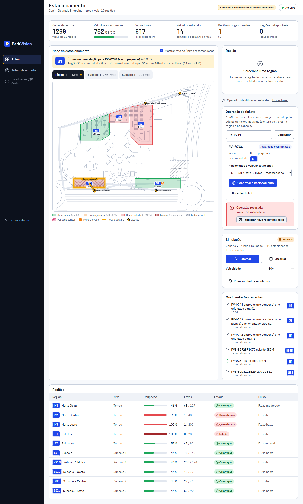
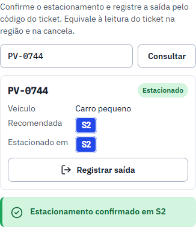
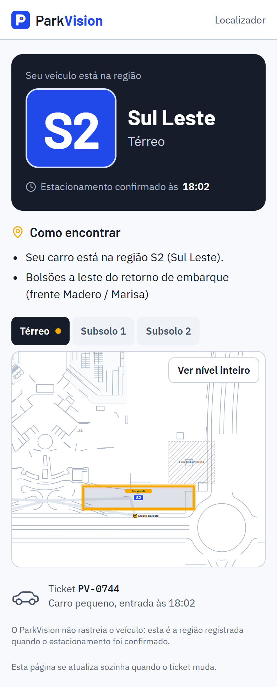

# MVP 13 — Relatório da Etapa 4: integração completa

> Status: **concluída e commitada, aguardando a validação do grupo.** A Etapa 5 não foi iniciada.
> Detalhes técnicos: [12-integracao.md](12-integracao.md).

## 1. Resumo da integração

Totem, painel, localizador, simulador, sensores virtuais, algoritmo, banco e tempo real passam a funcionar como um sistema único. O backend é a fonte da verdade.

A análise inicial encontrou 9 lacunas entre as etapas anteriores. Todas foram corrigidas dentro da arquitetura atual:
1. a confirmação e a saída não tinham caminho nas telas;
2. havia uma corrida em confirmações e saídas duplicadas do mesmo ticket;
3. as rotas administrativas estavam abertas;
4. não havia ressincronização após reconexão;
5. eventos fora de ordem podiam sobrescrever estados mais novos;
6. o localizador não atualizava sozinho;
7. os tickets do totem na demonstração não eram marcados como simulados;
8. banco fora do ar aparecia como "Erro interno";
9. a placa ia nos eventos públicos.

## 2. Módulos conectados

| Módulo | Ligação |
|---|---|
| Totem | `POST /entradas` → algoritmo → ticket com QR |
| Painel | REST + Socket.IO `/painel`; operação de tickets e simulador com o token do operador |
| Localizador | REST + Socket.IO `/localizador` (sala do próprio ticket) |
| Simulador e sensores | Os mesmos serviços de entrada, confirmação e saída |
| Algoritmo, mapa e banco | O mesmo mapa digital e as mesmas regras |

## 3. Fluxo completo funcionando

O fluxo foi testado ponta a ponta com as três telas abertas ao mesmo tempo:

1. **Entrada no totem:** gera a recomendação e o ticket com QR, sem alterar a ocupação.
2. **Tempo real:** o painel mostra a entrada, e o mapa destaca a região.
3. **QR Code:** abre o localizador, que mostra "Estacionamento ainda não confirmado".
4. **Confirmação pelo painel, em outra região:** a ocupação sobe, o painel atualiza sem recarregar e o localizador mostra sozinho a região efetivamente ocupada.
5. **Saída:** a ocupação volta, o ticket vira `SAIU` e o localizador mostra "Este veículo já saiu". Uma saída repetida devolve 409.



| Operação confirmada | Localizador atualizado ao vivo |
|---|---|
|  |  |

## 4. Alterações no backend

- **Transições de status atômicas e condicionadas** (estacionar, saída, cancelar, nova recomendação), na mesma transação da ocupação, sempre travando ticket → região.
- **Versão da região** a cada mudança e `sequencia` no envelope dos eventos.
- **Novo evento `ticket:atualizado`** e namespace `/localizador` com sala por ticket.
- **Rotas novas:** `GET /api/historico`, `GET /api/tickets/:codigo` (operador) e `GET /api/saude` com checagem do banco.
- **Acesso do operador** (`x-operador-token`, `OPERADOR_TOKEN`) em todas as rotas administrativas.
- **Validação de formato** do código do ticket e do token do QR.
- **Erros:** `503 BANCO_INDISPONIVEL` e `404 ROTA_NAO_ENCONTRADA` no formato padrão.
- **Modo demonstração** (`MODO_DEMONSTRACAO`).
- **Privacidade:** eventos públicos sem placa.

## 5. Alterações no frontend

- **Painel:**
  - estado recarregado do backend ao abrir, ao reconectar e a cada 30 s;
  - descarta eventos de região mais antigos (pela versão) e indicadores atrasados (pela sequência);
  - movimentações iniciadas pelo histórico, com id estável por fato;
  - novo card **Operação de tickets**: consultar, confirmar estacionamento (escolhendo a região), cancelar, registrar saída e, se a região estiver lotada, **Solicitar nova recomendação**;
  - acesso do operador único para tickets e simulador.
- **Localizador:** atualiza sozinho e mostra o selo "Demonstração".
- **Totem:** identifica o ambiente de demonstração e trata a falha do QR Code, orientando o uso do código no atendimento.
- **Camada de serviços:** novos endpoints; 502–504 viram "servidor fora do ar".
- **Aviso:** a ação fica abaixo do texto, para caber em colunas estreitas.

## 6. Alterações no banco de dados

- Coluna nova `regiao.versao` (`Int`, padrão 0), aplicada com `db push` não destrutivo.
- Nenhuma tabela removida.

## 7. Eventos em tempo real

| Grupo | Eventos |
|---|---|
| Veículos | `veiculo:entrou`, `veiculo:recomendado`, `veiculo:estacionou`, `veiculo:saiu` |
| Regiões | `regiao:ocupacao`, `regiao:status`, `regiao:fluxo` |
| Tickets | `ticket:atualizado` (**novo**) |
| Agregados | `indicadores:atualizados` |
| Simulador | `simulador:estado`, `simulador:cenario`, `simulador:sensor`, `simulador:alerta` |

Todos usam o envelope `id`, `sequencia`, `tipo`, `ocorridoEm`, `entidadeId`, `simulado` e `dados`. A reconexão é automática, com ressincronização pelo backend.

## 8. Consistência e concorrência

As garantias estão em [12-integracao.md §3](12-integracao.md). Resultados testados:
- **Mesmo ticket:** 6 confirmações simultâneas resultam em 1 aceita; 6 saídas simultâneas, em 1 aceita.
- **Região com 2 vagas:** 6 confirmações de tickets diferentes resultam em 2 aceitas.
- **Rejeição por lotação:** o ticket continua `AGUARDANDO`.
- **Sensor:** um evento repetido é aplicado uma única vez.

## 9. Segurança

Detalhes em [12-integracao.md §4](12-integracao.md):
- token do operador nas operações administrativas;
- token do QR de 128 bits, com hash no banco;
- localizador isolado por ticket;
- validação com Zod e por formato;
- CORS restrito;
- erros sem detalhes internos;
- `.env` fora do Git.

## 10. Testes e resultados

```text
pnpm typecheck  → shared, core, api e web sem erros
pnpm test       → shared 4 · core 89 · api 56 (+12 da Etapa 4) · web 42 (+8) = 191 ✔
pnpm e2e        → 12 ✔ (7 novos de integração + 5 da Etapa 3), 2 de captura pulados
```

Os 19 casos obrigatórios estão mapeados um a um em [12-integracao.md §6](12-integracao.md).

## 11. Problemas encontrados

1. **Corrida real no mesmo ticket:** duas confirmações simultâneas podiam contar duas vagas. Corrigido com a troca de status condicionada.
2. **O modo offline do Playwright não derruba o WebSocket já aberto.** Para testar a reconexão, o teste corta o WebSocket do Socket.IO de verdade (interceptação) e bloqueia a rede.
3. **Duplicidade entre histórico e eventos ao vivo** na lista de movimentações. Corrigido com ids estáveis por fato.
4. **Na demonstração, os tickets do totem não eram simulados.** Corrigido com o modo demonstração.

## 12. Limitações restantes

- **Token do operador único**, sem login nem perfis (adequado ao MVP).
- **Sem limite de requisições** no totem público.
- **Ordem dos indicadores:** é garantida pela sequência dentro de um processo da API. Com mais de uma instância, seria preciso uma sequência compartilhada.
- **Pendências de validação da Etapa 3 seguem em aberto:**
  - grafo de vias simplificado;
  - rampas térreo ↔ subsolos (D4);
  - sentido de circulação no térreo (D6).
- **Sem hospedagem online:** a API e o banco não estão hospedados. Isso fica para a Etapa 6.
- **`docs/mvp/02-contratos.md` ainda não lista as rotas e os eventos novos desta etapa.** Eles estão documentados em `12-integracao.md`.

## 13. Como iniciar a demonstração completa

```bash
pnpm demo:preparar
```

```bash
pnpm demo
```

Depois:
1. Abra `http://localhost:5173/painel` e informe o token do operador.
2. Inicie um cenário.
3. Use o totem em `http://localhost:5173/totem?acesso=A_NE`.
4. Abra o QR Code do ticket.
5. Confirme o estacionamento e registre a saída pela Operação de tickets.
6. No fim, reinicie os dados simulados.

Roteiro completo em [12-integracao.md §5](12-integracao.md).

## 14. Linguagem adicional (roleta diária)

O grupo não informou a linguagem sorteada. O resultado não foi inventado, e a stack atual foi mantida.

## 15. Pendências para a próxima etapa

**Para o grupo validar:**
- a Operação de tickets no painel como forma de confirmar e registrar saídas sem hardware;
- o token único do operador;
- o modo demonstração.

**Ainda por fazer:**
- atualizar `02-contratos.md` com as rotas e os eventos da Etapa 4;
- decidir as pendências do mapa que vêm da Etapa 3.
