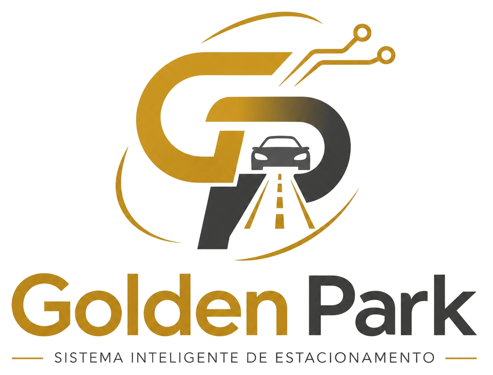
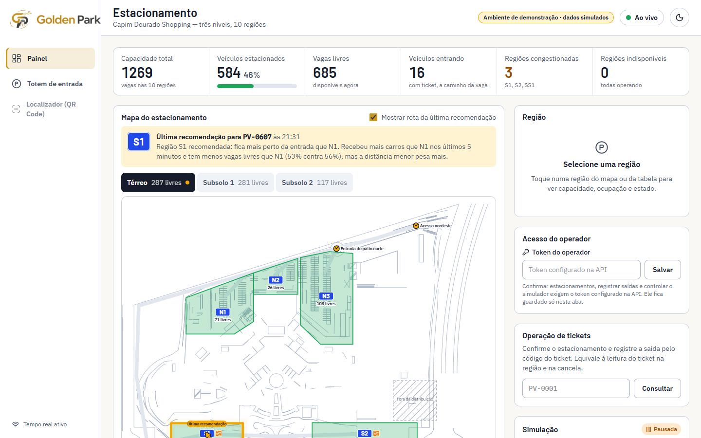
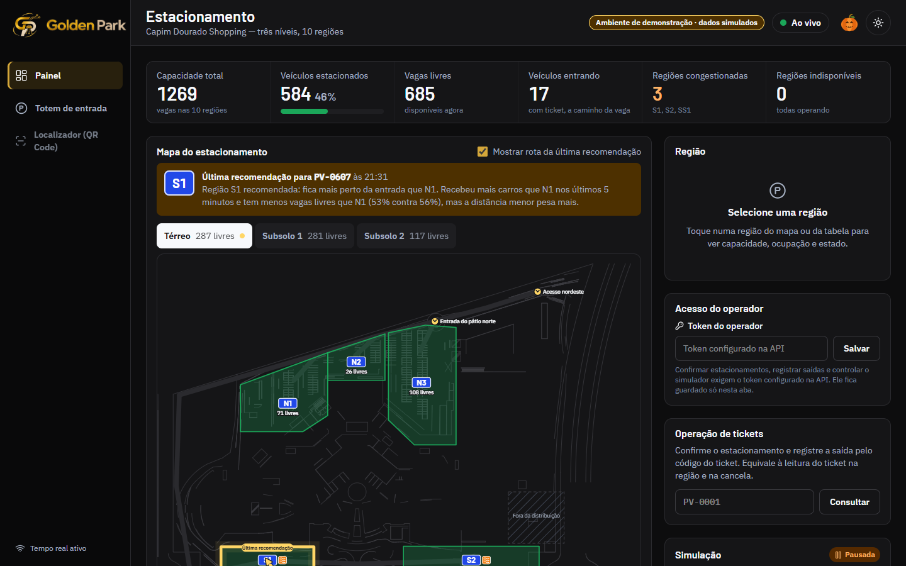
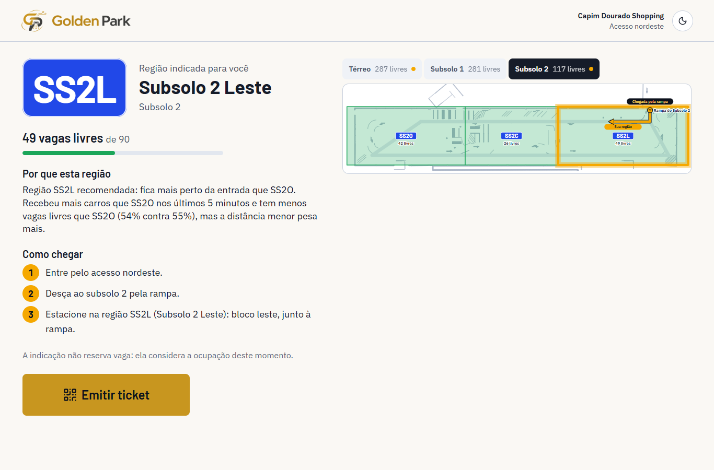
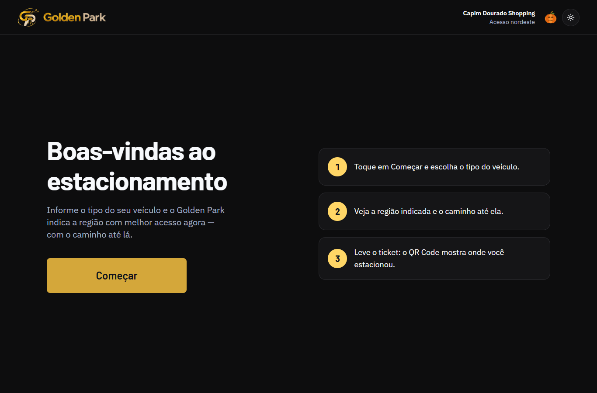
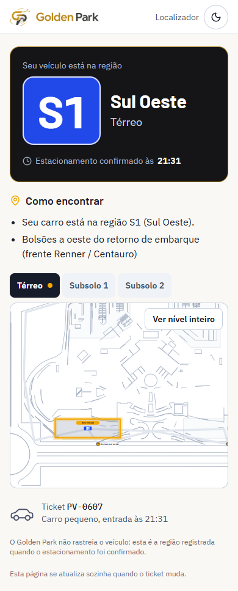
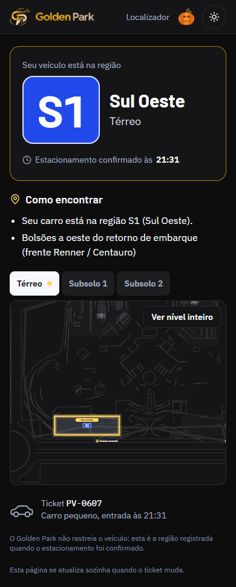
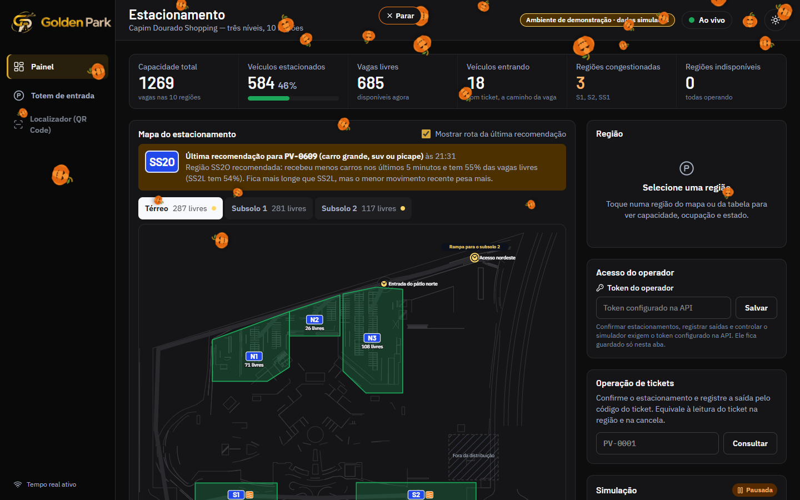

# MVP 14 — Golden Park: identidade visual, temas e easter egg

> Status: **concluída e commitada, aguardando a avaliação da equipe.** Nenhuma regra de negócio, rota, API ou dado foi alterado.

<p align="center">
  
</p>

## 1. Arquivos criados

| Arquivo | Para quê |
|---|---|
| `apps/web/src/tema/tema.tsx` | `ProvedorTema`, `useTema` e `BotaoTema` (ThemeToggle): claro como padrão, alternância e persistência |
| `apps/web/src/tema/BrandLogo.tsx` | `BrandLogo`: escolhe a logo pelo tema; variantes `completo`, `simbolo`, `nome` e `horizontal` |
| `apps/web/src/tema/AboboraEasterEgg.tsx` | `AboboraEasterEgg` (PumpkinEasterEgg), `ChuvaDeAboboras` (PumpkinRainAnimation), `Abobora` (desenho) e `sortearGotas` |
| `apps/web/src/tema/ControlesTema.tsx` | Canto dos controles (abóbora + botão de tema), usado nas três interfaces |
| `apps/web/src/tema/tema.test.tsx` | 10 testes de tema, logos e easter egg |
| `apps/web/e2e/golden.spec.ts` | 4 testes ponta a ponta no navegador (marca, temas, chuva, celular, movimento reduzido) |
| `apps/web/public/marca/*` | Logos para a web (cópias reduzidas) e `favicon.png` |
| `design-system/brand/golden-park-{claro,escuro}-original.jpg` | Logos fornecidas pela equipe, guardadas sem alteração |
| `design-system/brand/golden-park-{claro,escuro}-{completo,simbolo,nome}.png` | Logos sem fundo, em alta resolução |
| `design-system/scripts/preparar-logos.py` | Remove o fundo creme e recorta as logos (reproduzível) |
| `docs/mvp/14-golden-park.md` e `docs/mvp/capturas/golden-*.png` | Este relatório e as capturas |

## 2. Arquivos modificados

- **Tokens:** `design-system/tokens/tokens.json` e os arquivos gerados `build/tokens.css` e `build/tokens.resolved.json`.
- **Base da web:** `apps/web/index.html` (título, descrição, favicon, tema aplicado antes de pintar) e `apps/web/src/App.tsx` (provedor de tema).
- **Componentes:** `componentes/base.tsx` (a `Marca` agora é a logo oficial), `estilos/global.css` (animações da abóbora e da chuva) e `mapa/MapaEstacionamento.tsx` (o contorno da região selecionada deixou de ser dourado, para não se confundir com a rota).
- **Telas:**
  - `paginas/painel/Painel.tsx`: logo, navegação que segue o tema e controles de tema;
  - `paginas/totem/Totem.tsx`: deixou de ser sempre escuro e segue o tema;
  - `paginas/localizador/Localizador.tsx`: logo, controles e textos.
- **Mensagens:** `servicos/api.ts` (mensagens de erro com o novo nome).
- **Testes:** `Localizador.test.tsx` (texto renomeado) e `e2e/capturas.spec.ts` (capturas dos temas).
- **Documentação:** `README.md` e `docs/04-design-system.md` (nova identidade).
- **Removido:** `apps/web/public/favicon.svg`, o símbolo antigo, substituído pelo favicon do Golden Park.

## 3. Alterações na identidade visual

- **Nome:** "Golden Park" em todos os lugares visíveis.
  - Telas: título da página, cabeçalhos, menu, totem (texto de boas-vindas), painel, localizador e ticket.
  - Mensagens de erro.
  - README e documentação de identidade.
- **O que foi preservado** (para não quebrar o projeto):
  - identificadores técnicos (pacotes `@parkvision/*`, tokens `--pv-*`, rotas, banco, API, nome do repositório);
  - documentos das etapas 0–4, mantidos como registro histórico com o nome antigo.
- **Paleta:**
  - **ouro** (`#C8961F` no claro e `#D4A73A` no escuro), amostrado das logos, para ações primárias, item ativo e destaques;
  - **grafite** (`#0D0D0E` a `#3A3A3F`) para o modo escuro;
  - **creme** `#FAF8F4` como fundo do modo claro, no mesmo tom do papel das logos.
- **Continuam como antes:**
  - a placa azul da região (sinalização de estacionamento);
  - as cores de estado (verde, laranja, vermelho, magenta);
  - o âmbar das rotas.
- **Contraste:** 26/26 pares de texto ≥ 4,5:1 nos dois temas (`node design-system/scripts/check-contrast.mjs`). Os botões dourados usam texto quase preto (7,05:1 no claro, 8,44:1 no escuro).

| Modo claro | Modo escuro |
|---|---|
|  |  |
|  |  |
|  |  |

## 4. Implementação dos temas

- **Base:** o Design System já tinha os dois temas em tokens (`[data-theme="light"|"dark"]`). Trocar o tema é só mudar `data-theme` no `<html>`, então **todos** os componentes mudam juntos: cartões, tabelas, mapa, formulários, botões, indicadores, menu e avisos.
- **Claro é o padrão.** Novos acessos abrem no claro, independentemente do tema do sistema operacional.
- **Persistência:** a escolha fica no `localStorage` (`gp-tema`) e vale para as três interfaces. Um script no `index.html` aplica o tema antes da primeira pintura, para a página não piscar no tema errado.
- **Alternância:** botão sol/lua no canto superior direito das três interfaces, com `aria-pressed` e rótulo. Funciona sem recarregar.
- **Navegação do painel:** agora acompanha o tema (branca no claro, preta no escuro). Antes era escura nos dois. Sem isso, a logo dourada e preta ficaria sobre fundo preto no modo claro.
- **Totem:** era sempre escuro e passou a seguir o tema. As cores fixas foram trocadas por tokens semânticos.
- **Ticket:** continua "papel" claro nos dois temas e por isso usa a logo dourada e preta, como acontece num ticket impresso. É a única exceção à regra de logo por tema, e foi intencional.

## 5. Integração das logos

**Fundo creme.** As duas logos vieram em JPG com fundo creme opaco. Usadas direto, apareceriam como um quadrado claro no modo escuro.

**O que o script `preparar-logos.py` faz:**
1. **Remove o fundo:** transparência proporcional à distância da cor do fundo, com correção da mistura nas bordas para não sobrar halo.
2. **Recorta** em três partes, **sem redesenhar nem mudar proporções:**
   - logo completa;
   - símbolo GP;
   - nome "Golden Park".
3. **Gera cópias reduzidas para a web** (50 a 190 KB cada). As versões em alta resolução ficam no Design System.

**Associação respeitada:**
- modo claro → dourada e preta;
- modo escuro → dourada e bege.

O `BrandLogo` só define a altura; a largura segue a proporção natural do arquivo (verificado no teste ponta a ponta).

**Onde a logo aparece:**
- barra lateral do painel (símbolo + nome; só o símbolo na barra recolhida);
- cabeçalho do totem;
- cabeçalho do localizador;
- ticket;
- favicon;
- README.

## 6. Chuva de abóboras

**Abóbora**
- Desenho próprio em SVG: abóbora de Halloween laranja com rosto de "jack-o'-lantern" e caule no dourado da marca.
- Aparece **só no modo escuro**, ao lado do botão de tema, no canto superior direito das três interfaces. Por ficar no fluxo do cabeçalho, nunca cobre conteúdo.
- Entra com um pequeno "salto" e mostra cursor de mão e brilho laranja ao passar o mouse.
- Ao clicar, balança.

**Chuva**
- **Camada:** própria, criada num portal no `<body>`, fixa e com `pointer-events: none`. Não captura nenhum clique: o mapa, os formulários e a operação de tickets continuam funcionando durante a chuva (testado).
- **Quantidade:** 26 abóboras, ou 16 em telas com menos de 640 px.
- **Variações sorteadas:**
  - posição, uma por faixa da tela, para distribuir sem amontoar;
  - tamanho, de 18 a 48 px;
  - velocidade de queda, de 3,2 a 6,2 s;
  - atraso de entrada, de 0 a 1,6 s;
  - rotação inicial e final;
  - deriva lateral e balanço.
- **Animação:** só CSS (`transform`, `rotate` e `translate`, aceleradas pela GPU), com duas animações combinadas: queda com aceleração e giro com balanço lateral.
- **Fim e controle:**
  - termina sozinha quando a última abóbora sai da tela (cerca de 8 s) e tudo é removido do DOM;
  - pode ser dispensada pelo botão **Parar** (no topo) ou pela tecla **Esc**;
  - voltar ao modo claro também encerra;
  - uma chuva por vez: cliques durante a chuva são ignorados.
- **Movimento reduzido** (`prefers-reduced-motion`): 8 abóboras apenas aparecem e somem suavemente por 2 s, sem queda nem giro. A entrada e o balanço da abóbora também são desligados.
- **Isolamento:** não chama a API, não toca no simulador, nos tickets nem na ocupação.



## 7. Tecnologias utilizadas

- **Na web:** React, CSS e Tailwind ligados aos tokens, e `lucide-react` (ícones sol/lua/parar), que já eram usados no projeto. **Nenhuma dependência nova.**
- **No preparo das logos:** Python com Pillow, num script de apoio do Design System, fora da aplicação.

## 8. Testes e resultados

```text
pnpm typecheck  → shared, core, api e web sem erros
pnpm test       → shared 4 · core 89 · api 56 · web 52 (+10 de tema/logos/easter egg) = 201 ✔
pnpm e2e        → 16 ✔ (4 novos do Golden Park + 7 de integração da Etapa 4 + 5 da Etapa 3), 3 de captura pulados
contraste       → 26/26 pares ✔ nos dois temas
```

| Exigência | Coberto por |
|---|---|
| Nome aplicado | e2e: título "Golden Park" e nenhum "ParkVision" na tela |
| Logos por tema, proporção e qualidade | unit (src por tema, largura/altura) e e2e (imagem carregada, proporção natural = exibida) |
| Claro como padrão | unit e e2e |
| Alternância sem recarregar | e2e (marcador em `window` preservado) |
| Preferência salva | unit e e2e (recarregar e trocar de interface) |
| Componentes respeitam o tema | e2e (cor de fundo dos cartões e do mapa no escuro) |
| Abóbora só no escuro | unit e e2e |
| Clique ativa a chuva | unit e e2e |
| Variação de velocidade e rotação | unit (mais de 15 durações e giros diferentes) e e2e (posição muda com o tempo) |
| Termina sozinha, sem resíduo | unit (relógio simulado) e e2e |
| Dispensar | unit (Parar e Esc) e e2e (Parar) |
| Sem chuvas simultâneas | unit e e2e (segundo clique não empilha) |
| Não bloqueia cliques | unit e e2e (selecionar região do mapa durante a chuva) |
| Resoluções diferentes | e2e no celular (375 px, sem rolagem lateral) e capturas em 1440/1366/390 |
| Acessibilidade | unit e e2e com `prefers-reduced-motion`; botões com rótulo; `aria-pressed` |
| Integridade (backend, API, banco, algoritmo, simulador, tickets/QR, mapa, tempo real) | toda a suíte anterior continua passando (API 56, core 89, e2e da Etapa 4) |

## 9. Problemas encontrados e soluções

1. **As logos tinham fundo creme opaco** → remoção do fundo com bordas suaves e sem halo, por script reproduzível. Os originais foram guardados intactos.
2. **A navegação escura do painel quebraria a regra da logo** (dourada e preta sobre preto no modo claro) → a navegação passou a acompanhar o tema.
3. **O tema seguia o sistema operacional** → claro fixo como padrão, com escolha explícita do usuário e aplicada antes de pintar.
4. **O dourado da marca é parecido com o âmbar das rotas** → a seleção de região no mapa passou a usar contorno escuro; o âmbar continua exclusivo para rota e destino.
5. **O Docker Desktop estava desligado** durante os testes ponta a ponta: a API respondeu 503 em `/api/saude`, como previsto na Etapa 4. O Docker foi iniciado e os testes rodaram normalmente.

## 10. Pendências e melhorias recomendadas

- **Para a equipe validar:**
  - a navegação clara no modo claro (mudança em relação ao Design System anterior);
  - o ticket sempre com a logo dourada e preta (papel claro).
- **Protótipo da 1ª entrega** (`prototype/`): mantido com a identidade antiga, como registro histórico. Se quiserem, dá para atualizar.
- **Logos vetoriais:** as atuais são imagens geradas em JPG. Se a equipe tiver os arquivos em SVG, a qualidade em telas grandes e na impressão melhora sem nenhuma mudança de código, porque o `BrandLogo` já isola o arquivo.
- **Data comemorativa (opcional):** o easter egg poderia aparecer automaticamente em sextas-feiras 13 ou no Halloween. Não foi feito, porque o pedido era aparecer no modo escuro.
- **Pendências da Etapa 4 que continuam:** atualizar o `02-contratos.md`, o grafo de vias e as rampas (D4/D6).

## Como ver

```bash
pnpm demo
```

Abra `http://localhost:5173/painel`, `/totem?acesso=A_NE` ou um link de localizador. Use o botão sol/lua no canto superior direito. No modo escuro, clique na abóbora.
