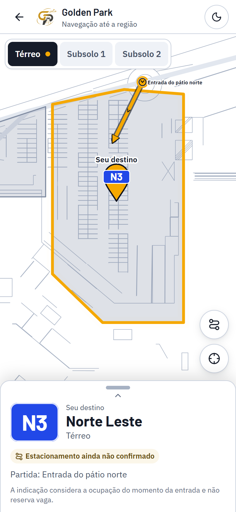
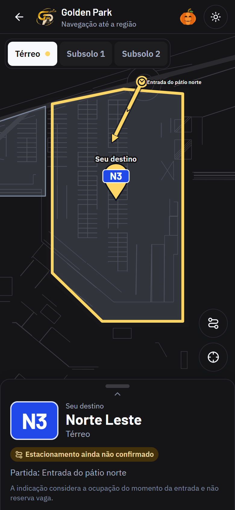
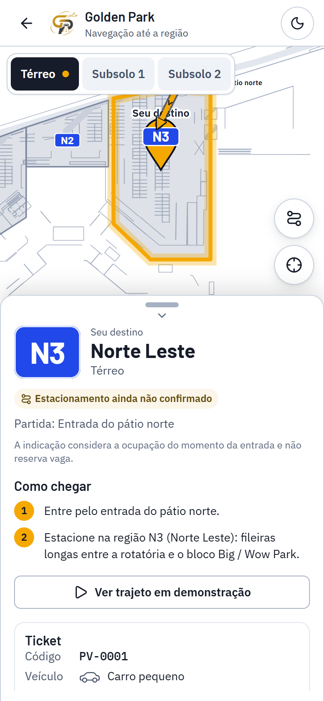
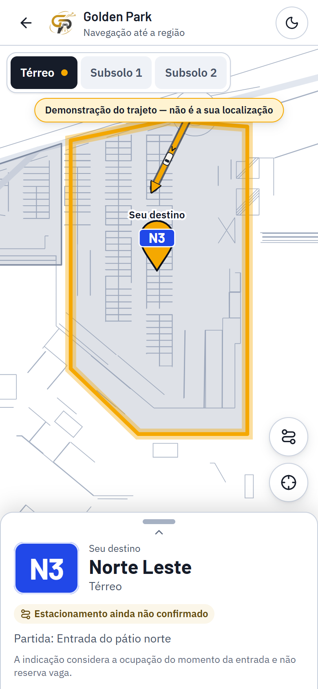
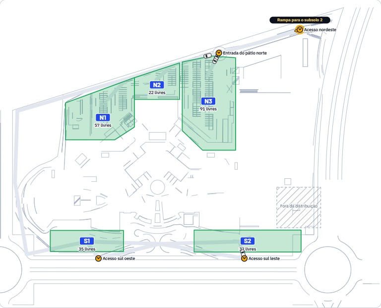
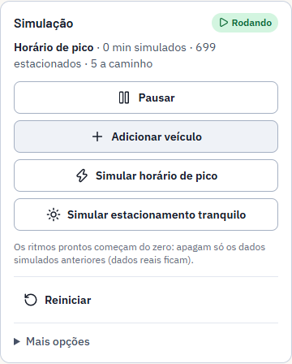

# Golden Park — Evolução do mapa, navegação mobile e simulação realista

Relatório da etapa. Escopo: a página do QR Code virou uma navegação estilo app de mobilidade, o mapa ganhou gestos, câmera e rotas suaves, e o simulador ficou mais simples e visual. As regras de negócio não mudaram: não existe reserva, a recomendação não altera a ocupação, a ocupação só muda na confirmação ou na saída, e a capacidade é revalidada na confirmação (atualização condicional no banco).

## 1. Resumo das melhorias

- **QR Code (`/t/:token`):** mapa em tela cheia, painel inferior expansível, cabeçalho compacto (voltar, marca, "Navegação até a região" / "Encontre seu veículo", tema). Botões "Ver rota inteira" e "Centralizar".
- **Rota:** segue os corredores do grafo (só nós do grafo), em linha contínua com as quinas arredondadas, setas de sentido, marcador de partida e pino de destino. Na carga, a linha é desenhada uma vez; com movimento reduzido ela já aparece pronta.
- **Estados do ticket:**
  - A caminho: região recomendada, rota a partir do acesso de entrada e passos.
  - Estacionado: região registrada, sem rota.
  - Saiu ou cancelado: ticket encerrado, sem localização ativa.
- **Honestidade:** nada de GPS, distância ou tempo estimado. O único carrinho que anda no QR Code é o "trajeto em demonstração", sempre com o aviso "Demonstração do trajeto — não é a sua localização".
- **Mapa:**
  - celular: arrastar com um dedo, zoom de pinça;
  - computador: arrastar com o mouse e zoom com a roda (no painel, Ctrl + roda, para não roubar a rolagem da página);
  - limites de zoom por nível; arrastar o mapa não seleciona região.
- **Simulador:**
  - botões Iniciar/Retomar, Pausar, Adicionar veículo, Simular horário de pico, Simular estacionamento tranquilo e Reiniciar (com confirmação);
  - cenários A–E, velocidade e Encerrar ficam em "Mais opções";
  - carrinhos animados percorrem a rota no mapa do painel (só visual).

## 2. Arquivos criados e modificados

**Criados**
- `apps/web/src/mapa/navegacao.ts`: caminho suave, posição ao longo da rota, setas, enquadramento da câmera descontando o painel inferior, zoom com limites, janelas de tempo por nível e rota de saída.
- `apps/web/src/mapa/veiculos.ts`: transforma os eventos `veiculo:entrou` e `veiculo:saiu` simulados em carrinhos animados; define o ritmo e o limite de 30 simultâneos.
- `apps/web/src/mapa/navegacao.test.tsx`: testes unitários dos cálculos, dos carrinhos e dos gestos.
- `apps/web/e2e/navegacao.spec.ts`: testes ponta a ponta mobile (iPhone SE, Pixel 7) e da simulação visual.
- `docs/mvp/capturas/mapa-nav-*.png`, `mapa-sim-*.png`: capturas desta etapa.

**Modificados**
- `apps/web/src/mapa/MapaEstacionamento.tsx`: câmera controlada, gestos, abas sobrepostas, rota suave, pino de destino e camada de veículos.
- `apps/web/src/paginas/localizador/Localizador.tsx`: reescrito como navegação mobile.
- `apps/web/src/paginas/painel/componentes.tsx` (`ControleSimulador`) e `Painel.tsx`: controles simplificados, carrinhos e mapa interativo.
- `apps/web/src/servicos/api.ts`: `RespostaLocalizador` ganhou `acesso` e `rota`; novas funções `simulacao.iniciar(config)`, `simulacao.cenario(c, config)` e `simulacao.evento(...)`.
- `apps/web/src/estilos/global.css`: animação do desenho da rota (desligada com movimento reduzido).
- `apps/web/package.json`: dependência `@parkvision/core` (menor caminho para a rota de saída).
- `apps/api/src/servicos/tickets.ts`: `GET /api/localizador/:token` devolve também o `acesso` de entrada e a `rota` da recomendação vigente, só enquanto o ticket está AGUARDANDO.
- Testes: `apps/api/test/api.test.ts`, `Localizador.test.tsx`, `Painel.test.tsx` e e2e `fluxos`, `integracao`, `golden`, `capturas`.

## 3. Mudanças no mapa

- **Câmera** (`viewBox`), com três fontes:
  - controlada pela página (o QR Code enquadra a rota ou o destino);
  - interna, vinda dos gestos (com botão "Reenquadrar");
  - padrão (nível inteiro).
- **Textos e traços** acompanham o zoom com tamanho estável na tela.
- **Pino de destino** maior que os rótulos comuns, com o código da região. Quando o pino aparece, o código não se repete no centro da região.
- **Abas de nível** compactas sobre o mapa (modo tela cheia). O ponto indica os níveis por onde a rota passa.
- **Sem dados novos de planta:** o grafo, as regiões e os acessos são os mesmos da Etapa 1. As posições de subsolo do modelo 3D **não** foram aplicadas, porque o 3D continua sendo só uma referência.

## 4. Interface mobile

- **Layout:** `100dvh` e áreas seguras (`env(safe-area-inset-*)`); sem rolagem lateral nem rolagem da página (o painel rola por dentro).
- **Painel inferior:**
  - recolhido, mostra a placa da região, o nome, o nível, o estado e a partida;
  - expandido (até 62% da altura), mostra os passos, o ticket e o aviso sobre atualização ao vivo;
  - abre e fecha com toque na alça ou arrastando para cima ou para baixo;
  - ao abrir ou fechar, o mapa se reenquadra.
- **Enquadramento:** a câmera desconta a altura do painel, então o destino fica na parte visível. O teste e2e confere que o pino fica acima do painel em 375×667 e 412×915.
- **Rota com rampa:** o mapa abre no primeiro nível com trecho. Um botão "A rota continua no Subsolo X" leva ao próximo nível, e "Centralizar" vai ao nível do destino.
- **Toque:** botões do mapa de 48 px e alça de largura total.
- **Atualização ao vivo:** se o estacionamento for confirmado em outra região, a página troca o destino e o nível sozinha.
- **Sem conexão:** mensagem em texto com "Tentar de novo". Sem tempo real, a página avisa que é preciso recarregar.

 
 

## 5. Como as rotas funcionam

1. Na entrada, o backend calcula a recomendação e a rota com o Dijkstra do `packages/core` sobre o grafo de vias. A rota é gravada na recomendação.
2. O localizador recebe essa mesma rota (`rota.nos`) enquanto o ticket está a caminho. Se a recomendação vigente não for a da região indicada, a rota vem nula e a página mostra só os passos em texto.
3. `trechosDaRota` divide a rota por nível e descarta saltos que não são vias. Cada trecho é desenhado com `caminhoSuave`: linhas retas entre os nós do grafo e curvas quadráticas nas quinas. O raio da curva é limitado à metade do segmento, para a linha não sair do corredor.
4. A rota de saída (carrinhos da simulação) vem do mesmo menor caminho, da região até o acesso por onde o veículo entrou.

## 6. Melhorias no simulador

- **Controles:**

  | Botão | O que faz |
  |---|---|
  | Iniciar | Relógio a 10×, 3 chegadas/min, manobra de 60 s |
  | Adicionar veículo | Com a simulação parada, liga o relógio sem chegadas automáticas e registra uma entrada; o backend confirma depois do tempo de manobra |
  | Horário de pico | Cenário B a 3×, manobra de 30 s |
  | Estacionamento tranquilo | Cenário A a 10×, manobra de 60 s |
  | Reiniciar | Pede confirmação e apaga somente os dados simulados |

- **Carrinhos:** aparecem só para eventos marcados como simulados.
  - O ritmo é o tempo de manobra ÷ velocidade do relógio (entre 2,5 e 12 s), então o carrinho chega mais ou menos quando a confirmação acontece.
  - Em rotas com rampa, cada nível mostra o carrinho só na sua janela de tempo.
  - A animação usa `requestAnimationFrame`, sem re-renderizar o React a cada quadro.
  - A ocupação e as cores do mapa continuam vindo do backend.
- **Movimento reduzido:** sem carrinhos, e a rota já aparece pronta.

 

## 7. Integrações

- `GET /api/localizador/:token`: novos campos `acesso` e `rota`.
- O painel usa os endpoints existentes:
  - `POST /api/simulacao/iniciar` com `config`;
  - `POST /api/simulacao/cenario` com `config`;
  - `POST /api/simulacao/eventos` com `{ acao: 'entrada' }`;
  - pausar, retomar, encerrar e reiniciar.
  Todos exigem o token do operador.
- Tempo real: `veiculo:entrou` e `veiculo:saiu` (com `simulado: true`) geram os carrinhos. O localizador continua na sala do próprio ticket (`/localizador`).

## 8. Testes executados e resultados

| Suíte | Resultado |
|---|---|
| `pnpm typecheck` (shared, core, api, web) | sem erros |
| Vitest `packages/shared` | 4 ✓ |
| Vitest `packages/core` | 89 ✓ |
| Vitest `apps/api` (banco de teste) | 56 ✓ |
| Vitest `apps/web` | 77 ✓ (eram 52) |
| Playwright (Edge, desktop + viewports de celular) | 24 ✓, 3 capturas puladas (só rodam com `CAPTURAS=1`) |

Testes novos:
- **Navegação mobile em dois tamanhos:** rota no mapa; pino acima do painel; painel expansível; botões de 48 px; arrastar e "ver rota inteira"; sem distância ou tempo inventados; ver a rota não ocupa vaga.
- **Trajeto em demonstração:** rotulado, o carrinho anda e o aviso some sozinho.
- **Estados:** estacionado e saída ao vivo.
- **Robustez:** tema escuro com a abóbora; queda de conexão.
- **Simulação:** carrinho no mapa e +1 ocupada só após a confirmação; movimento reduzido.
- **Unitários:** cálculos de rota e câmera, gestos (arrastar não seleciona; Ctrl + roda no painel), carrinhos (ritmo, limite, nível), estados da página, controles do simulador.

Correções feitas durante os testes:
- **Mapa preso no nível antigo:** o localizador aberto durante o trajeto ficava no nível antigo quando o carro estacionava em outro nível. Agora ele acompanha o novo destino.
- **Teste das abóboras instável** (problema anterior a esta etapa): olhava uma abóbora fixa com atraso aleatório. Agora verifica o conjunto.

## 9. Limitações técnicas

- **Grafo de vias grosseiro:** alguns trechos cruzam regiões em diagonal (ex.: rotatória → N3), e a ligação "acesso nordeste → rampa do SS2" é um salto direto. A rota é fiel ao grafo, não ao traçado fino das vias.
- **Sem GPS nem posição real:** não há distância nem tempo estimado, por falta de escala confirmada e de dados de velocidade.
- **Pinça:** testada com eventos de ponteiro nos testes unitários. O Playwright não simula dois dedos; o e2e cobre arrastar e tocar.
- **Navegadores:** só o Edge (Chromium) está instalado; Safari/iOS (WebKit) não foram testados aqui.
- **Ritmo dos carrinhos:** aproximado. O tempo de manobra real de cada veículo simulado varia de 0,6× a 1,4× o valor configurado.

## 10. Pendências e recomendações

1. **Refinar o grafo de vias** com a equipe (mais nós nos corredores e rampas reais). Isso melhora o desenho da rota e muda os custos do algoritmo, então exige revisão das justificativas.
2. **Definir a escala da planta** (metros por unidade) antes de mostrar qualquer distância.
3. Usar o modelo 3D como base para posicionar os subsolos e as rampas no mapa oficial, **quando a equipe decidir**.
4. Testar em aparelhos reais (iOS Safari e Android Chrome), principalmente a pinça e o painel inferior.
5. Avaliar se o painel deve abrir no nível com mais carrinhos durante a simulação.
