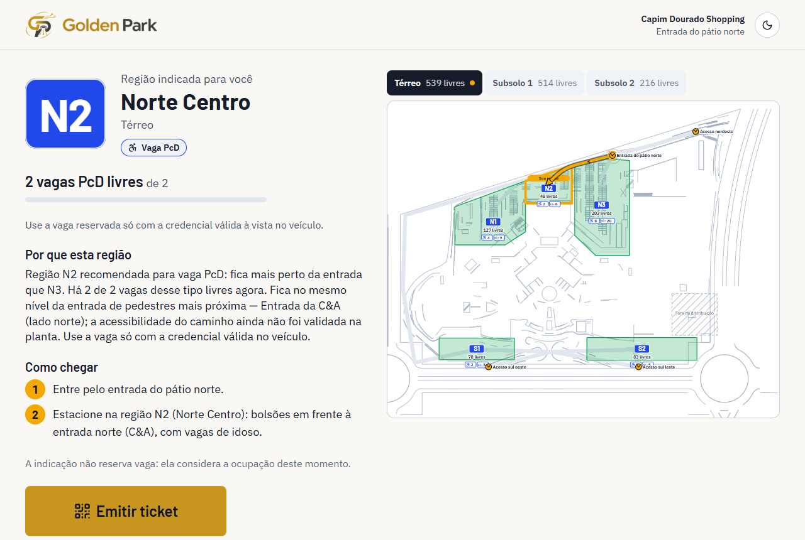
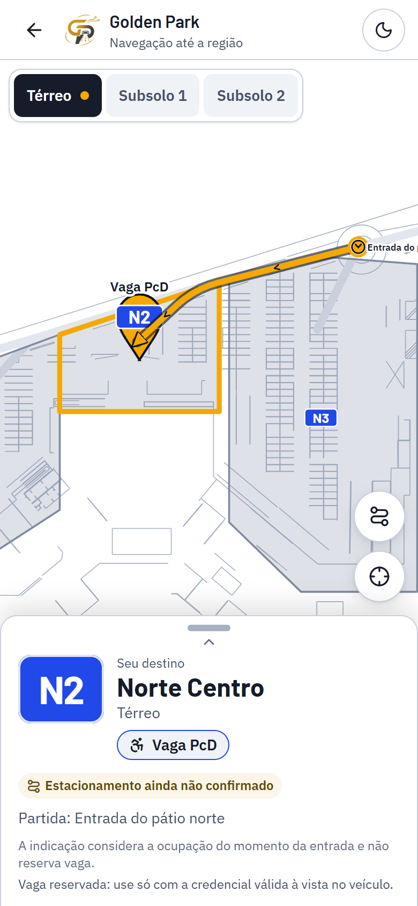
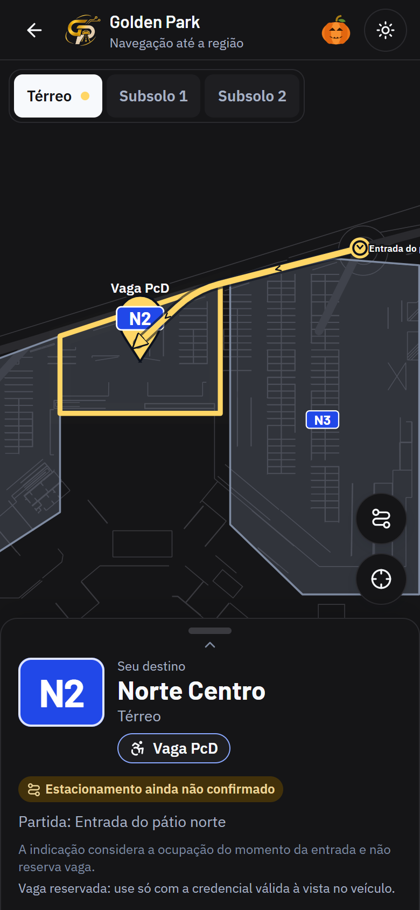
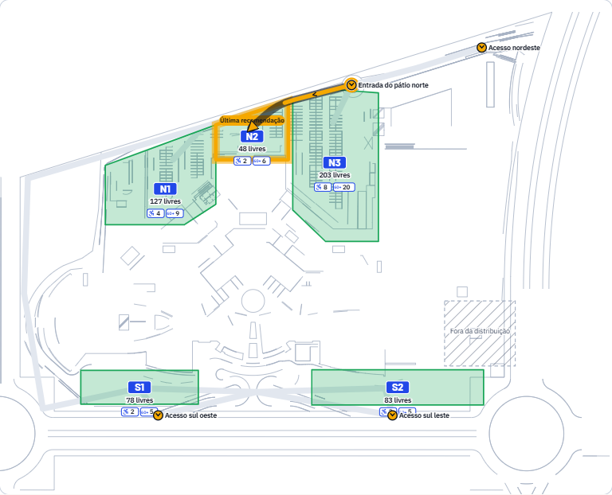
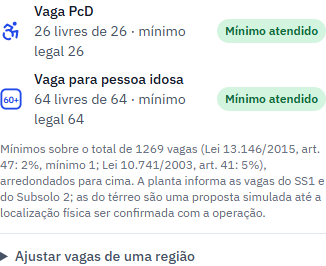

# Golden Park: vagas para PcD e pessoas idosas

Relatório da etapa. As vagas reservadas para pessoas com deficiência (PcD) e para pessoas idosas agora fazem parte do algoritmo, do mapa, do totem, da página do QR Code, do painel e do simulador.

As regras de sempre continuam valendo:
- não existe reserva temporária;
- a recomendação não altera a ocupação;
- a capacidade é revalidada na confirmação, com UPDATE condicionado no banco;
- a ocupação só muda na confirmação e na saída.

> **Status: proposta simulada.** Os mínimos vêm da lei. As vagas do SS1 e do Subsolo 2 vêm do texto da planta. As do térreo são uma distribuição proposta, porque a planta não mostra a posição física delas. Antes de considerar definitivo, falta validar com a operação, a ABNT NBR 9050, as resoluções do CONTRAN e a legislação municipal.

## 1. Resumo das alterações

- **Estrutura de dados.** Cada região guarda capacidade e ocupação de três tipos: comum, PcD e pessoa idosa. A soma sempre fecha com o total.
- **Ticket.** Guarda o tipo de vaga declarado na entrada.
- **Algoritmo:**
  - o pedido comum só usa vagas comuns;
  - PcD e pessoa idosa só usam vagas do próprio tipo;
  - quando não há vaga do tipo, informa a indisponibilidade e não troca de tipo sozinho;
  - para PcD, prioriza regiões com caminho a pé no mesmo nível da entrada do shopping.
- **Totem.** Nova etapa "Que tipo de vaga você precisa?" com três botões (comum, PcD, pessoa idosa).
  - Explica que a vaga reservada exige credencial válida e que o Golden Park não verifica a credencial.
  - Não pede nenhum dado médico.
  - Motos pulam essa etapa, porque não há vaga reservada de moto.
- **Mapa.** Selos com o Símbolo Internacional de Acesso (PcD) e "60+" (pessoa idosa) mostram as vagas livres de cada tipo em cada região, com ícone, número e contorno. Quando o tipo esgota, o número aparece riscado. A legenda foi atualizada e a descrição acessível de cada região inclui as vagas reservadas.
- **QR Code (celular):**
  - selo do tipo de vaga e pino "Vaga PcD" / "Vaga 60+";
  - lembrete da credencial;
  - o que a planta diz do caminho a pé, sem afirmar acessibilidade;
  - rota pelos corredores, como antes.
- **Painel:**
  - colunas "PcD livres" e "Pessoa idosa livres" na tabela, e o detalhe de cada tipo na região selecionada;
  - cartão **Vagas reservadas**, com totais × mínimo legal, alerta quando a distribuição fica abaixo do mínimo e ajuste administrativo por região, que recusa valores inconsistentes com a ocupação atual;
  - movimentações mostram o tipo ("entrou (carro pequeno, vaga PcD)").
- **Simulador:**
  - "Adicionar veículo" com seletor de tipo de vaga;
  - os ritmos prontos colocam parte dos carros pedindo vaga reservada;
  - novo **cenário F (Vagas reservadas)**: PcD lotadas desde o início, para demonstrar a indisponibilidade;
  - preenchimento e reinício trabalham por tipo de vaga.

## 2. Arquivos

**Criados**
- `packages/shared/src/mapa/acessibilidade.json`: referências legais, base de cálculo, vagas lidas na planta, entradas de pedestres, situação dos subsolos, normas a verificar e critérios da distribuição.
- `packages/shared/src/acessibilidade.ts`: `minimosLegais`, `caminhoPedestre`, `caminhosPedestres` e `resumoVagasReservadas` (totais e alertas).
- `packages/core/src/vagas-reservadas.ts`: `distribuirVagasReservadas` e `dividirProporcional`.
- `apps/web/src/componentes/IconeTipoVaga.tsx`: ícones e selo do tipo de vaga.
- Testes:
  - `packages/core/src/vagas-reservadas.test.ts`
  - `apps/api/test/vagas-reservadas.test.ts`
  - `apps/web/src/paginas/VagasReservadas.test.tsx`
  - `apps/web/e2e/vagas-reservadas.spec.ts`
- Capturas: `docs/mvp/capturas/vagas-*.png`.

**Modificados**
- `packages/shared/src/tipos.ts`:
  - novos `TipoVaga`, `VagasDoTipo` e `vagasDaRegiao`;
  - `Regiao.vagas`, `Ticket.tipoVaga`;
  - motivo `SEM_VAGA_DO_TIPO`;
  - `Indicadores.porTipoVaga`.
- `packages/shared/src/esquemas.ts`:
  - `tipoVaga` na entrada e no evento manual;
  - `esquemaVagasReservadas`;
  - `proporcaoTipoVaga` no simulador;
  - cenário F;
  - erro `TIPO_VAGA_INCOMPATIVEL`.
- `packages/core/src/recomendar.ts` e `index.ts`: filtro e disponibilidade por tipo, critério de distância dos reservados, prioridade para PcD e justificativas.
- `apps/api/prisma/schema.prisma`:
  - enum `TipoVaga`;
  - colunas `capacidadePcd`, `capacidadeIdoso`, `ocupadasPcd`, `ocupadasIdoso` e `fonteVagasReservadas` na região;
  - `tipoVaga` no ticket.
- `apps/api/src/servicos/regioes.ts`:
  - vagas por tipo no DTO;
  - ajuste do total que não invade as reservadas;
  - `configurarVagasReservadas` com UPDATE condicionado;
  - indicadores por tipo.
- `apps/api/src/servicos/tickets.ts`: entrada com tipo, ocupação e liberação atômicas por tipo, região sem o tipo recusada, localizador com tipo e caminho a pé.
- `apps/api/src/app.ts`: `GET /api/vagas-reservadas` e `PATCH /api/regioes/:id/vagas-reservadas` (exige operador).
- `apps/api/src/seed.ts`: aplica a proposta e preserva ajustes do operador.
- `apps/api/src/simulador/motor.ts` e `cenarios.ts`: tipo por veículo, preenchimento, limpeza e alternativa por tipo, cenário F.
- `apps/web`:
  - totem, localizador, painel (tabela, detalhe, cartão, simulador, movimentações) e mapa (selos e legenda);
  - cliente da API;
  - token de cor `--pv-vaga-reservada` (mais claro no tema escuro);
  - grid do painel que não força rolagem lateral.
- Testes existentes ajustados:
  - "lotar" passou a significar lotar as vagas comuns, porque o total agora não pode invadir as reservadas;
  - preenchimento esperado por tipo;
  - cenários A–F;
  - nova etapa do totem nos fluxos.

## 3. Estrutura de dados

```
Regiao
  capacidade, ocupadas                    ← totais (como antes)
  capacidadePcd, ocupadasPcd              ← PcD
  capacidadeIdoso, ocupadasIdoso          ← pessoa idosa
  comuns = total − PcD − pessoa idosa     (derivado: a soma sempre fecha)
  fonteVagasReservadas: planta | proposta | operador | sem-reserva
Ticket
  tipoVaga: COMUM | PCD | IDOSO           (declaração na entrada; padrão COMUM)
```

A API expõe `regiao.vagas = { COMUM, PCD, IDOSO }`, cada um com `{ capacidade, ocupadas, livres }`.

Invariantes, garantidas no próprio UPDATE (mesmo com operações simultâneas):
- `0 ≤ ocupadas do tipo ≤ capacidade do tipo`;
- `PcD + pessoa idosa ≤ capacidade`;
- comuns ocupadas `≤` comuns.

Confirmação e saída mexem no tipo do ticket e no total juntos. Um ajuste administrativo que deixaria a ocupação atual inconsistente é recusado com o motivo. Não há contagem duplicada: a ocupação continua sendo a da região, e cada ticket ocupa uma vaga do seu tipo.

## 4. Quantidade de vagas por região

Mínimos legais sobre o total de **1.269 vagas**:
- **PcD:** 2% = 25,38 → **26**;
- **pessoa idosa:** 5% = 63,45 → **64**.

| Região | Capacidade | PcD | Pessoa idosa | Comuns | Fonte |
|---|---:|---:|---:|---:|---|
| N1 Norte Oeste | 127 | 4 | 9 | 114 | proposta |
| N2 Norte Centro | 48 | 2 | 6 | 40 | proposta |
| N3 Norte Leste | 203 | 8 | 20 | 175 | proposta |
| S1 Sul Oeste | 78 | 2 | 5 | 71 | proposta |
| S2 Sul Leste | 83 | 2 | 5 | 76 | proposta |
| SS1 Subsolo 1 | 140 | 3 | 11 | 126 | **planta** |
| SS1M Motos | 374 | 0 | 0 | 374 | — (motos) |
| SS2O Subsolo 2 Oeste | 77 | 0 | 0 | 77 | — |
| SS2C Subsolo 2 Centro | 49 | 5 | 8 | 36 | **planta** |
| SS2L Subsolo 2 Leste | 90 | 0 | 0 | 90 | — |
| **Total** | **1.269** | **26** | **64** | **1.179** | |

## 5. Critérios de distribuição

1. Os mínimos legais são calculados sobre o total e arredondados para cima. PcD tem pelo menos 1 vaga.
2. As vagas lidas na planta ficam onde a planta diz:
   - SS1: 3 PNE e 11 idoso;
   - Subsolo 2: 5 PNE e 8 idoso, atribuídas ao bloco central (SS2C), que segundo a planta concentra as vagas especiais.
3. O que falta (18 PcD e 45 idoso) vai para as regiões de carro do **térreo**, onde a caminhada até a porta do shopping é no mesmo nível. Isso não foi validado em campo.
4. Peso de cada região = capacidade × proximidade da entrada de pedestres mais próxima: 1 ÷ (1 + distância ÷ 200), em unidades do mapa. As entradas foram lidas na planta: C&A, Big, entrada principal sul e Renner.
5. A divisão usa o método dos maiores restos, que é determinístico, com no máximo 25% de cada região reservada.
6. Ajustes administrativos pelo painel substituem a proposta da região (`fonte = operador`), e o seed não os desfaz.
7. Vagas de neurodiversos e de gestante/criança, que aparecem na planta, ficam fora desta etapa e seguem contadas como comuns.

## 6. Alterações no algoritmo

O algoritmo segue estes passos:
1. Identifica o tipo de vaga pedido.
2. Filtra regiões sem vaga do tipo (motivo `SEM_VAGA_DO_TIPO`).
3. Verifica as vagas livres **do tipo**.
4. Mede a proximidade.
5. Para PcD, ordena primeiro por faixa de caminho (mesmo nível da entrada → não identificado) e depois pela pontuação.
6. Recomenda.
7. Explica.

Detalhes:
- **Pesos:** os mesmos (50% disponibilidade, 30% distância, 20% fluxo).
- **Disponibilidade:** só conta as vagas do tipo.
- **Distância:** para os reservados, metade trajeto do carro e metade caminhada até a entrada do shopping. Para o pedido comum, nada mudou.
- **Justificativa:**
  - cita o tipo ("recomendada para vaga PcD") e as vagas livres do tipo;
  - cita o que a planta diz do caminho ("no mesmo nível da entrada de pedestres mais próxima — …; a acessibilidade do caminho ainda não foi validada na planta");
  - lembra da credencial;
  - nunca diz "rota acessível".
- **Indisponibilidade:** "Nenhuma vaga PcD disponível agora… O sistema não indica vaga de outro tipo automaticamente; procure a equipe do estacionamento ou escolha outra opção no totem."
- **Compatibilidade:** sem dados de vagas por tipo, a região é tratada como toda comum, então os dados antigos continuam funcionando. Vagas por tipo inconsistentes viram `DADOS_INVALIDOS`.

## 7. Mapa e simulador

**Mapa**
- Selos por região: ♿ e "60+", cada um com o número de vagas livres.
- Contorno e ícone em azul, com cor própria no tema escuro para manter contraste.
- O número fica riscado quando o tipo esgota.
- A legenda e o texto acessível descrevem tudo por extenso.
- A página do QR Code mostra o tipo no painel inferior e no pino. A rota continua passando só pelos corredores do grafo.

**Simulador**
- "Adicionar veículo" com seletor (comum, PcD ou pessoa idosa).
- Os ritmos prontos usam 90% comum, 4% PcD e 6% pessoa idosa. São números só para a demonstração, não estatística real.
- **Cenário F:** PcD 100% ocupadas e idoso 50%. Quem pede PcD fica sem ticket, com um alerta próprio (`SEM_VAGA_RESERVADA`), até alguém sair.
- Quem ignora a recomendação procura outra região **do mesmo tipo**.
- Preenchimento e reinício trabalham por tipo; o reinício devolve as vagas de cada tipo.
- O padrão do motor continua 100% comum, para manter as sementes dos cenários antigos.



 



## 8. Testes executados

| Suíte | Resultado |
|---|---|
| `pnpm typecheck` (shared, core, api, web) | sem erros |
| Vitest `packages/shared` | 4 ✓ |
| Vitest `packages/core` | 106 ✓ (+17) |
| Vitest `apps/api` (banco de teste) | 71 ✓ (+15) |
| Vitest `apps/web` | 89 ✓ (+12) |
| Playwright (Edge; desktop e celular) | 29 ✓ (+5); 4 especificações de captura puladas (só rodam com `CAPTURAS=1`) |

O que foi coberto:
- **Percentuais e arredondamento:** 1.269 → 26/64; 100 → 2/5; 10 → 1/1; 0 → 0.
- **Distribuição:** soma 26/64, planta preservada, nada em região de moto, limite de 25% por região, soma das categorias igual à capacidade.
- **Separação de tipos:** o pedido comum nunca usa vaga reservada.
- **Recomendação:** cada tipo recebe vaga do próprio tipo; PcD prioriza o térreo; indisponibilidade sem troca de tipo; moto não recebe vaga reservada.
- **Ocupação:** confirmação e saída mexem no tipo certo; uma região sem vaga do tipo é recusada.
- **Concorrência:** confirmações simultâneas nas últimas vagas PcD nunca passam da capacidade nem "vazam" para as comuns.
- **Ajuste administrativo:** exige token; recusa reduzir abaixo do ocupado, passar da capacidade ou espremer as comuns; o seed preserva o ajuste.
- **QR Code:** tipo, credencial e caminho "não validado"; ticket comum sem nada extra; viewport de celular, pino acima do painel, sem rolagem lateral, temas claro e escuro.
- **Simulador:** entrada manual PcD e pessoa idosa, confirmação, saída, cenário F e reinício por tipo.
- **Painel e mapa:** colunas, detalhe, alerta abaixo do mínimo e evento de ajuste; selos com ícone e número.

Correção feita durante os testes: as duas colunas novas da tabela forçavam rolagem lateral do painel em telas de 768 px. Agora os cartões do painel podem encolher e a tabela rola por dentro.

## 9. Limitações e pendências

1. **Localização física não validada.** A planta informa as quantidades do SS1 e do Subsolo 2, mas não a posição das vagas; no térreo nem a quantidade. A distribuição é uma proposta simulada para a equipe ajustar pelo painel.
2. **Caminho a pé não validado.** As entradas de pedestres foram lidas na planta com confiança média. Nos subsolos não há elevador nem rampa de pedestres identificados, então o sistema não chama nenhum caminho de acessível. O traçado do caminho a pé não é desenhado, só descrito.
3. **Base de cálculo.** Os percentuais foram aplicados ao total, inclusive vagas de moto, como pedido. Confirmar com a equipe ou o jurídico se as motos entram na base. Sem as motos, seriam 18 PcD e 45 idoso sobre 895.
4. **Normas a verificar:** ABNT NBR 9050 (dimensões, sinalização, rota acessível), resoluções do CONTRAN sobre credenciais e a legislação municipal de Palmas (percentuais ou categorias adicionais).
5. **Credencial.** É só uma declaração; o sistema não verifica. A fiscalização continua com a operação.
6. **Grafo de vias.** A rota do carro continua no grafo grosseiro da etapa anterior (pendência já registrada).
7. **Selos no mapa.** Em S1 e S2 o selo encosta no rótulo do acesso sul. Ajustar a posição quando o mapa definitivo for desenhado.
8. **Vagas especiais fora do escopo:** neurodiverso e gestante/criança.
