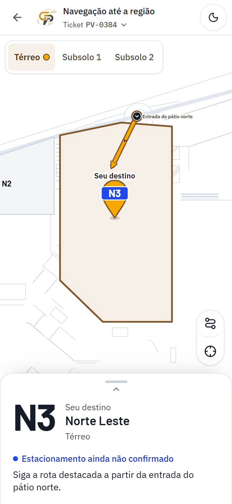
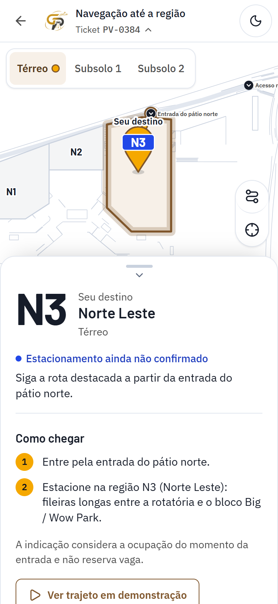
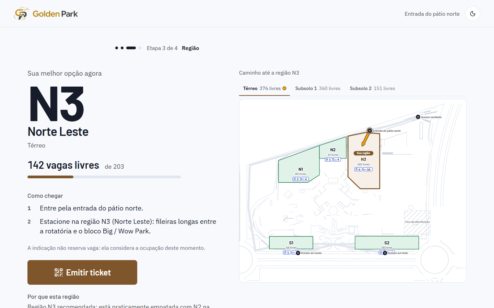
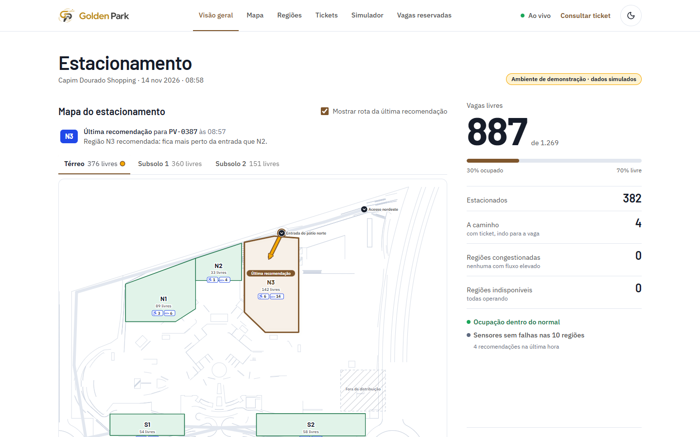
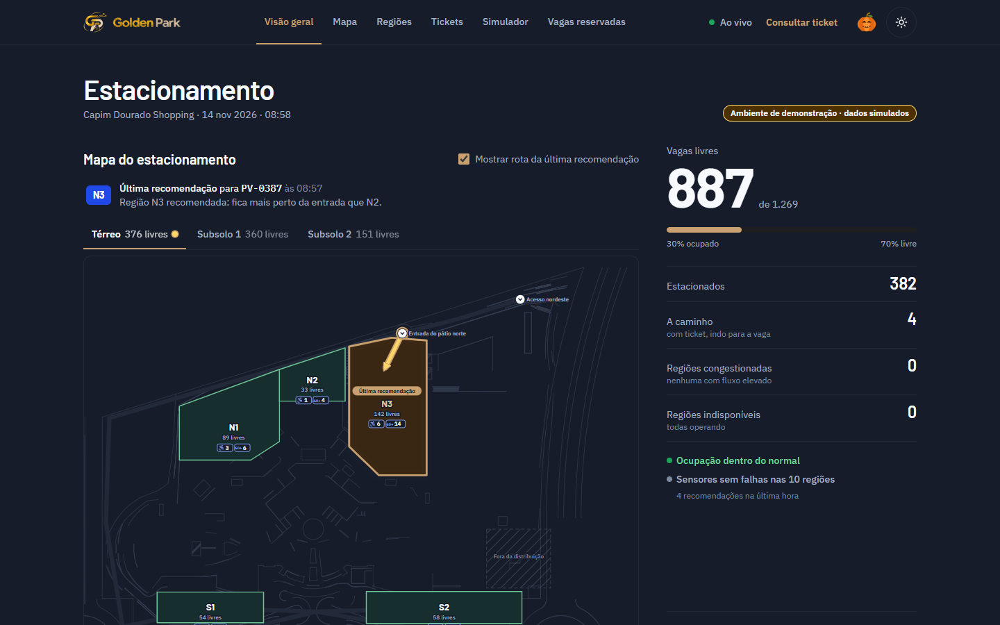

# Golden Park — telas MVP definitivas

Relatório da etapa. Os wireframes aprovados viraram as três telas reais do produto: o localizador mobile (QR Code), o totem e o painel. As três estão integradas ao backend, ao banco, aos tickets, aos QR Codes, ao algoritmo, ao simulador e ao tempo real que já existiam. Nenhum contrato de API mudou.

## 1. Resumo

- **Design system:** consolidado com a paleta aprovada.
  - Bronze #7F562C é a única cor de ação.
  - O ouro #C8961F fica só no logo.
  - O fundo claro é #F7F9FC e o escuro é grafite.
  - A tipografia é Barlow + IBM Plex.
  - Os contrastes conferem com a auditoria dos wireframes.
- **Localizador mobile:** mapa em tela cheia, cabeçalho compacto com o código do ticket e painel inferior com o código da zona em destaque.
  - O painel abre e fecha por toque, por arraste ou pelo teclado (Esc fecha).
  - No desktop, o painel vira uma coluna lateral.
- **Totem:** coluna central, uma ação principal por etapa e indicador "Etapa X de 4".
  - A recomendação mostra o código da zona bem grande.
  - O botão "Emitir ticket" aparece já na primeira tela.
- **Painel:**
  - **Navegação:** horizontal; a sidebar escura saiu.
  - **Visão geral:** número dominante de vagas livres, barra bronze e linhas de contexto.
  - **Mapa grande** e tabela sem cartões, com comuns, PcD e pessoa idosa.
  - **Funções secundárias:** tickets, simulador e vagas reservadas, por âncoras na navegação.
- **Mapa compartilhado:** visual mais calmo sobre a geometria real da planta. Rota âmbar com contorno bronze, destino em bronze, texto com tamanho mínimo legível no celular e legenda em caixa normal.

## 2. Telas finalizadas

| Tela | Estados cobertos |
|---|---|
| Localizador `/t/:token` | a caminho (rota), estacionado (região registrada), saiu, cancelado, QR inválido, não encontrado, sem conexão, vaga PcD / pessoa idosa, trajeto em demonstração |
| Totem `/totem?acesso=…` | início, veículo, tipo de vaga, processando, recomendação, ticket, sem vagas (comum e reservada), sem conexão, acesso inválido |
| Painel `/painel` | carregando, erro com "Tentar de novo", sem tempo real, ao vivo, demonstração, simulador, alertas de vagas reservadas |

## 3. Arquivos

**Criados**
- `apps/web/e2e/telas-mvp.spec.ts`: responsividade nas 6 larguras, temas e logos, teclado.
- `docs/mvp/capturas/mvp-*.png`: 15 capturas.
- Este relatório.

**Modificados**
- Design system:
  - `design-system/tokens/tokens.json` (v0.3.0): primitivas bronze, cinza e atenção; semânticas claro e escuro; botão de perigo.
  - Arquivos gerados `tokens/build/*` e `prototype/assets/tokens.css`, cópia gerada pelo build. O protótipo navegável também passa a usar a paleta nova.
- `apps/web/src/componentes/base.tsx`:
  - botões (variante neutro, mínimo de 44 px, leve retorno ao pressionar);
  - placa chapada;
  - novos `Status` (ponto + texto, com tamanho) e `Indicador` (número dominante);
  - `SeloDemonstracao` com `testId`.
- `apps/web/src/estilos/global.css`:
  - regras de base dentro de `@layer base`: títulos balanceados, toque sem atraso, `select` acompanhando o tema;
  - vias do mapa no escuro;
  - abóbora com 44 px.
- `apps/web/index.html` e `src/tema/tema.tsx`: `theme-color` dos dois temas e `viewport-fit=cover` para a área segura.
- Telas: `paginas/localizador/Localizador.tsx`, `paginas/totem/Totem.tsx`, `paginas/painel/Painel.tsx`, `paginas/painel/componentes.tsx`.
- `mapa/MapaEstacionamento.tsx` (visual e abas compactas) e `mapa/dados.ts` (concordância "pela entrada" / "pelo acesso").
- Testes:
  - unitários do localizador, totem, painel e integração;
  - e2e `capturas`, `golden` e `integracao` (textos e cores novos).

## 4. Skills usadas

| Skill | Situação | Uso |
|---|---|---|
| `frontend-design` | instalada neste ambiente (e no pacote) | carregada e aplicada: plano de design revisado contra o brief, um elemento marcante (o código da zona), sem rótulos em caixa alta, sem grade de cartões |
| `web-design-guidelines` (Vercel) | só no pacote do ZIP | as diretrizes foram baixadas da fonte que a skill indica e aplicadas: foco visível, alvos de toque, `touch-action`, `theme-color`, `select` no tema escuro, `tabular-nums`, reduced motion, área segura |
| `design-taste-frontend` | só no pacote do ZIP | só lida como referência de princípios (bordas iguais, microinterações discretas). **Não foi executada:** é voltada a sites de marketing com fotos e efeitos e instala um *hook* que roda scripts. |
| `ui-ux-pro-max` | instalada e no pacote | **não carregada** nesta etapa; o `MASTER.md` gerado por ela foi descartado (ver decisões) |

O conjunto do pacote veio de `anthropics/skills` (frontend-design) e `vercel-labs/agent-skills` (web-design-guidelines), segundo o `skills-lock.json`. As outras duas não constam no lock.

## 5. Agentes

| Agente | Responsabilidade | Arquivos |
|---|---|---|
| Líder de UI/UX e QA (sessão principal) | análise dos wireframes, tokens e componentes base, integração, testes e2e, revisão visual e correções finais | tokens, `base.tsx`, `global.css`, e2e, relatório |
| Mobile Experience | localizador | `Localizador.tsx` e testes |
| Frontend: Totem | totem | `Totem.tsx` e testes |
| Frontend: Painel | painel e navegação horizontal | `Painel.tsx`, `componentes.tsx` e testes |
| Map & Navigation | visual do mapa compartilhado | `MapaEstacionamento.tsx` |

Os quatro agentes rodaram em paralelo, cada um só nos próprios arquivos, sem servidores nem Playwright (as portas são compartilhadas). Pedidos de mudança em arquivos compartilhados vieram nos relatórios e foram aplicados pela sessão principal:
- tamanho do `Status`;
- `testId` do selo de demonstração;
- `@layer base`;
- vias no escuro;
- abas em 320 px.

## 6. Decisões de design

- **Inconsistência nos documentos:** o `MASTER.md` gerado automaticamente propõe fundo escuro com verde, Plus Jakarta e glassmorphism. Isso contradiz o relatório e a paleta aprovados, então foi descartado. Valeram o `RELATORIO-WIREFRAMES.md` e o `PALETA-E-REFERENCIA.md`.
- **Elemento marcante:** o código da zona em Barlow 700 bem grande ("N3", "SS2L"). Todo o resto é quieto: divisórias finas, espaço em branco, poucos cartões.
- **Status sempre com ponto e texto,** nunca só cor. O mapa usa cor, padrão e texto.
- **Tema escuro:** grafite azulado do Golden Park (#0C111C / #161C29). As ações usam bronze claro com texto escuro (7,86:1).
- **Nada inventado:**
  - a dica "1 min a pé" do wireframe do totem não foi implementada;
  - o painel não tem a *sparkline* do wireframe, porque não há dado real de fluxo por dia;
  - nenhuma tela fala em GPS ou rastreamento.
- **Ordem da recomendação no totem:** "Emitir ticket" vem antes da justificativa, para a ação principal caber na primeira tela em 1440×900.
- **Abertura do localizador:** abre no nível da entrada. Quando o destino está em outro nível, aparece "A rota continua no …" e o botão "Centralizar" leva ao destino.

## 7. Componentes reutilizáveis

- **Base** (`base.tsx`): Botao (primário, secundário, neutro, fantasma, perigo), Placa, Status, Indicador, Medidor, Selo, Aviso, Cartao, EstadoVazio, Esqueleto, Carregando, SeloDemonstracao.
- **Marca e tema:** BrandLogo (logo por tema), ControlesTema (tema + abóbora).
- **Vagas:** IconeTipoVaga e SeloTipoVaga.
- **Mapa:** MapaEstacionamento (mapa, marcadores, rota, pino, veículos, abas e legenda); `navegacao.ts` (câmera e rota suave).
- **Painel inferior:** está no localizador, que é o único consumidor.

## 8. Integrações preservadas

- **Backend:** REST de regiões, indicadores, histórico, entradas, localizador, tickets, simulação e vagas reservadas.
- **Tempo real:** Socket.IO nos namespaces `/painel` e `/localizador`.
- **QR e simulador:** QR Code real no ticket; simulador com as regras do backend.
- **Dados de demonstração:** continuam marcados com "Ambiente de demonstração · dados simulados" e "Ticket simulado".

## 9. Capturas

Arquivos em `docs/mvp/capturas/`:
- **Localizador:**
  - `mvp-localizador-375-claro.png`
  - `mvp-localizador-375-detalhes.png`
  - `mvp-localizador-320-escuro.png`
  - `mvp-localizador-430-escuro.png`
  - `mvp-localizador-1440-claro.png`
  - `mvp-localizador-nao-encontrado.png`
- **Totem:**
  - `mvp-totem-1440-inicio.png`
  - `mvp-totem-1440-tipo.png`
  - `mvp-totem-1440-recomendacao.png`
  - `mvp-totem-375-recomendacao.png`
  - `mvp-totem-1080-escuro.png`
- **Painel:**
  - `mvp-painel-1440-claro.png`
  - `mvp-painel-1440-escuro.png`
  - `mvp-painel-375-claro.png`
  - `mvp-painel-1440-completo.png`

Comparadas com os PNGs P0 do Penpot (`wireframes/exports/p0`), as telas mantêm a estrutura: cabeçalho horizontal, número dominante, mapa e tabela no painel; código grande, passos e CTA único no totem; código grande e "como encontrar" no localizador.

 

## 10. Testes

| Suíte | Resultado |
|---|---|
| `pnpm typecheck` | sem erros |
| Vitest: shared / core / api / web | 4 / 106 / 71 / 94 ✓ |
| Playwright (Edge) | 49 ✓; 6 especificações de captura puladas (só rodam com `CAPTURAS=1`) |

`telas-mvp.spec.ts` verifica:
- **Localizador, totem e painel em 320×640, 375×812, 390×844, 430×932, 768×1024 e 1440×900:**
  - sem rolagem horizontal;
  - o mapa é a maior área do localizador;
  - o pino do destino não fica coberto pelo painel;
  - nenhum botão menor que 44 px no celular.
- **Temas:**
  - logo dourada e preta no claro, dourada e bege no escuro;
  - preferência mantida ao recarregar;
  - fundos #0C111C e #F7F9FC.
- **Teclado:** o totem funciona só com Tab e Enter, com foco visível.

Corrigido durante a revisão:
- botão de tema e abóbora com 40 px, agora 44 px;
- concordância "pela entrada" / "da entrada";
- contorno pesado demais nas regiões sem dados no QR Code;
- "Emitir ticket" fora da primeira tela no totem;
- regras globais que venciam utilitários do Tailwind;
- um caso de teste que assumia destino sempre no térreo.

## 11. Limitações e pendências

1. **Navegadores:** só o Edge (Chromium) foi testado. Safari/iOS e Android reais não; a pinça com dois dedos só tem teste unitário.
2. **Geometria:** o mapa continua com o grafo de vias grosseiro (pendência anterior). A geometria é a da planta, mas a rota não acompanha o traçado fino das vias.
3. **Telas P1/P2 dos wireframes** (mapa de vagas individual, distribuição, tickets, pagamento e configurações) não foram implementadas como páginas próprias. As funções existentes ficaram como seções do painel.
4. **Vagas reservadas:** a localização física e os caminhos a pé continuam como proposta simulada (etapa anterior).
5. **Cor no escuro:** o bronze claro das ações e o âmbar da rota ficam próximos. Se a equipe quiser mais separação, dá para ajustar o tom.
6. **Dados de teste no banco de desenvolvimento:** a revisão visual criou tickets de teste em modo demonstração. São simulados e somem com "Reiniciar".
